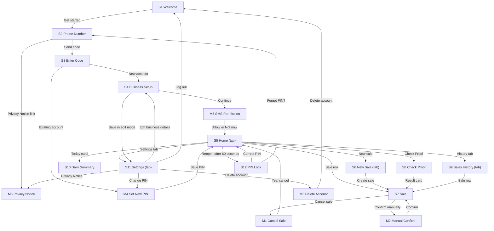

# IMPLEMENTATION_PLAN.md: ProofPay

---

## 0. Plan details

| Field | Value |
| --- | --- |
| App name | ProofPay |
| Built from PRD version | v0.3 (the PRD v0.2 plus the 13 answers in Section 18; `docs/PRD.md` must be updated to v0.3 before Phase 1 starts) |
| Screen designs | Stitch project: https://stitch.withgoogle.com/projects/1237301378596450552 (exports saved in `docs/designs/`, one image per screen, named as in Section 7.3) |
| Plan version | v1.0 |
| Repository | TO FILL IN (GitHub link, created before Phase 1) |
| Status | Draft |
| Last updated | 03 Nov 2026 |

---

## 1. Start here (instructions for the coding agent)

Before writing any code:

1. Read this whole file from top to bottom.
2. Read `docs/PRD.md`.
3. Look at the screen designs listed in Section 7.3.
4. Check Section 18. If any clarification is still **Open**, stop and ask the human. Do not start.
5. Check that the prerequisites in Section 4.2 are installed.
6. Start **Phase 1 only**. Follow Section 2 at all times.

---

## 2. Rules for the coding agent (copy word for word, do not edit)

1. **One phase at a time.** Only work on the phase the human asked for. When that phase's Definition of Done is complete, stop and wait for the human to say "Start Phase <number>".
2. **Test-driven development (TDD) for every task.** Follow the cycle in Section 12.1:
    - Write the test.
    - Run it and see it fail for the right reason.
    - Write the smallest code that makes it pass.
    - Run all tests.
    - Refactor while all tests still pass.
3. **Never cheat a test.** Never delete, skip, weaken or change a test just to make it pass. If you believe a test is wrong, stop and explain why to the human.
4. **Never break earlier work.** Every test from earlier phases must still pass before a phase is done.
5. **Build only what is planned.** Build only what is in this file and `docs/PRD.md`. Never build anything in Section 3.3 (Deferred).
6. **Ask, don't guess.** If anything is missing, unclear or contradictory, stop, add it to Section 18, and ask the human.
7. **Match the designs.** Every screen must match its design in Section 7.3: layout, order, labels, text, colours and spacing. Use the design tokens in Section 7.1. Never hard-code colours, font sizes or spacing.
8. **Every state, every screen.** Each screen must handle every state listed for it in Section 7.3 (chosen from normal, empty, loading, error, offline, success, plus any screen-specific states).
9. **Exact wording.** Use the exact labels and messages from the PRD. Never invent wording.
10. **Security first.**
    - Never put secret keys in app code, logs, test files or Git.
    - Every permission rule in Section 9 must be enforced on the server or database, never only in the app.
    - Every permission rule must have a test.
11. **Full check before "done".** Run the full check command (Section 4.3) before saying a phase is done, then add a short summary of the results to the Progress log (Section 17).
12. **Record your progress.** After each phase:
    - tick the checkboxes for that phase in this file;
    - add a row to the Progress log;
    - commit using the commit message given in the phase.
13. **No surprise libraries.** Do not add, remove or upgrade any library or tool not listed in Section 4.1 without asking the human first.
14. **Stuck rule.** If the same problem is still failing after 3 attempts, stop and report:
    - what you tried;
    - the exact error;
    - what you need from the human.
15. **Clean code.** Follow the folder structure in Section 5. Use the PRD's key terms (Section 3.4) for names in code. Keep files small and focused.

---

## 3. Project summary and scope

### 3.1 Summary

ProofPay is an Android app that helps small traders in South Africa (spaza shops, salons, market traders, home caterers and online sellers) confirm that a customer's bank transfer has really arrived. The Trader creates a Sale with a Reference such as PP-4821; the app reads the Bank Message that arrives on the Trader's own phone and changes the Sale to Confirmed within 30 seconds, or to Suspicious when the amount is different. Matching works with no internet.

**Platform:** Android app (Android 10 or newer). iPhone is deferred.

### 3.2 Features in scope

| ID | Feature | Priority | Built in phase |
| --- | --- | --- | --- |
| F1 | Account and setup | Must | 3 |
| F2 | Create a Sale | Must | 4 |
| F3 | Automatic matching | Must | 5 |
| F4 | Check Proof | Must | 6 |
| F5 | History and Daily Summary | Must | 6 |
| F6 | Manual Confirm | Should | 7 |
| F7 | WhatsApp receipt | Should | 7 |

### 3.3 Deferred: do NOT build

Non-goals (PRD 3.2):

- AI check of payment screenshots
- iPhone app
- Bank connections (open banking or bank APIs)
- Card payments, or holding or moving money
- Customer accounts or a customer app
- Sharing of fraud alerts between Traders

Future features (PRD 4.3):

- isiZulu, Sesotho, Sepedi and Xitsonga screens (v1 is English only)
- Paid plan with CSV export of Sales
- Email alert reading and bank connections
- Staff accounts for shops with more than one till
- Restoring earlier Sales on a new phone (added by Section 18, question 5)

### 3.4 Key terms (use these names in code)

| Term (PRD 1.7) | Name in code | Meaning |
| --- | --- | --- |
| Trader | `Trader`, table `traders` | The person who owns the account and takes payments from customers. The customer never installs the app. |
| Sale | `Sale`, table `sales` | One amount the Trader expects to be paid by one customer. It has a Reference and a Status. |
| Reference | `reference` | PP- followed by 4 digits (1000 to 9999), such as PP-4821 (BR3). The customer quotes it when paying. |
| Bank Message | `BankMessage`, table `bank_messages` | An SMS that a chosen bank sends to the Trader's phone when money arrives. Only five facts are saved from it (BR8). |
| Status | `SaleStatus`: `pending`, `confirmed`, `suspicious`, `expired`, `cancelled` | Where a Sale stands. Stored in lower case, shown with a capital letter (Pending, Confirmed, Suspicious, Expired, Cancelled). |
| Check Proof | `checkProof` | Look up a Reference from a customer's screenshot (BR10). |
| Manual Confirm | `manualConfirm`, `confirm_type = 'manual'` | The Trader marks a Sale as paid by hand, with a reason and the PIN (BR11). |

---

## 4. Tech stack, prerequisites and commands

### 4.1 Stack

| Layer | Tool | Version | Used for |
| --- | --- | --- | --- |
| Frontend | React Native with Expo, Expo Router, as a development build (Expo Go cannot read SMS) | Expo SDK 54 | Screens, navigation, Android build |
| Language | TypeScript (strict mode) | Latest stable at setup | All app, server function and test code |
| Styling | NativeWind | v4 | Tailwind-style classes that use the design tokens |
| Backend and database | Supabase: PostgreSQL, Auth (phone login), Cron | supabase-js 2.x; Supabase CLI latest stable at setup | Synced copy of data, login codes, database rules, nightly job |
| Server functions | Supabase Edge Functions (Deno) | Latest stable at setup | `verify-code` and `delete-account` (Section 18, question 3) |
| Local database | expo-sqlite | Matches Expo SDK 54 | Keeps every Sale and Bank Message on the phone so matching works with no internet |
| Data fetching and caching | None | Not applicable | The app is local-first: screens read SQLite; one sync service pushes to Supabase |
| Android native code | Expo config plugin and a small Kotlin module in `android-modules/` | Latest stable at setup | SMS receiver and foreground service. It forwards the sender and text to TypeScript; all parsing and matching is TypeScript. |
| QR code | react-native-qrcode-svg with react-native-svg | Latest stable at setup | QR code on S7 |
| Notifications | expo-notifications | Matches Expo SDK 54 | Android notifications and the foreground service notice |
| PIN storage | expo-secure-store | Matches Expo SDK 54 | PIN stored in the Android Keystore (BR13) |
| Sound | expo-audio, with `assets/sounds/confirmed.wav` | Matches Expo SDK 54 | One short sound when a Sale is Confirmed |
| Date picker | @react-native-community/datetimepicker | Latest stable at setup | Android date picker on S10 |
| Vibration and share | React Native `Vibration` and `Share` | Part of React Native | 300 ms vibration; receipt share sheet |
| Unit and component tests | Jest with jest-expo, React Native Testing Library | Latest stable at setup | Business rules, components, screens in every state |
| Database and permission tests | pgTAP via the Supabase CLI | Latest stable at setup | Constraints, triggers and permission rules |
| Integration tests | Jest with supabase-js against the local backend | Latest stable at setup | Edge Functions, sync, database functions |
| End-to-end tests | Maestro | Latest stable at setup | Whole flows on an Android emulator |
| Lint and type check | ESLint, TypeScript compiler (`tsc`) | Latest stable at setup | Code quality |
| Build and hosting | Expo EAS (internal distribution APK) | Latest stable at setup | Installable APK for the pilot phones |

### 4.2 Prerequisites on the computer

- [ ] Node.js 20 LTS and npm
- [ ] Git, with a GitHub account
- [ ] Docker Desktop, for the local Supabase backend
- [ ] Android Studio with the Android SDK and one emulator (Android 14 image), and the `adb` command
- [ ] An Android 10 or newer phone for the manual checks, with developer mode on
- [ ] Java 17 (needed for the Android build)
- [ ] Maestro command-line tool
- [ ] Accounts: Supabase, Expo (EAS) and Twilio (login code SMS, configured only in the Supabase dashboard)

### 4.3 Commands

Before the full check, the local backend must be running (`npm run backend:start`).

| Purpose | Command |
| --- | --- |
| Install dependencies | `npm install` |
| Start the local backend | `npm run backend:start` (runs `npx supabase start`) |
| Reset the database (migrations + seed data) | `npm run db:reset` (runs `npx supabase db reset`, then `npm run seed`) |
| Start the app | `npm run android` (builds the development build and starts Metro) |
| Unit and component tests | `npm run test:unit` |
| Database and permission tests | `npm run test:db` (runs `npx supabase test db`) |
| Integration tests | `npm run test:int` |
| End-to-end tests | `npm run test:e2e` (runs `maestro test .maestro/`; needs the emulator running and the development build installed, so it is not part of the full check) |
| Lint | `npm run lint` |
| Type check | `npm run typecheck` |
| **Full check (run before every "done")** | `npm run check` (runs lint, typecheck, test:unit, test:db and test:int) |
| Build for release | `npm run build:apk` (runs `eas build --platform android --profile preview`) |

---

## 5. Folder structure

```
proofpay/
  app/                       Screens. One file per screen (Expo Router)
    _layout.tsx              Root layout: redirects and the PIN lock (Section 11)
    (auth)/welcome.tsx       S1
    (auth)/phone.tsx         S2
    (auth)/code.tsx          S3
    business-setup.tsx       S4 (new account and edit mode)
    (tabs)/_layout.tsx       Tab bar
    (tabs)/index.tsx         S5 Home
    (tabs)/new-sale.tsx      S6
    (tabs)/history.tsx       S9
    (tabs)/settings.tsx      S11
    sale/[id].tsx            S7
    check-proof.tsx          S8
    daily-summary.tsx        S10
    pin-lock.tsx             S12
    modals/cancel-sale.tsx       M1
    modals/manual-confirm.tsx    M2
    modals/delete-account.tsx    M3
    modals/set-pin.tsx           M4
    modals/sms-permission.tsx    M5
    modals/privacy-notice.tsx    M6
  components/                Shared components (Section 7.2)
  theme/tokens.ts            Design tokens (Section 7.1). The only place colours, sizes and spacing are written
  lib/
    rules/                   Business rules as pure functions (BR1 to BR18)
    localdb/                 SQLite setup, migrations and queries
    sync/                    Outbox and push to Supabase (BR19)
    sms/                     Bank Message reader: sender filter, extractor, matcher, banks/ (one file per bank)
    notifications/           Notification text and scheduling
    auth/                    Login, session, PIN lock
    supabase.ts              Supabase client (anon key only)
    format.ts                Rand, date, time and phone formatting
  android-modules/           Kotlin SMS receiver and foreground service, and the Expo config plugin
  assets/sounds/             confirmed.wav
  supabase/
    config.toml              Local Supabase settings, including the test login code
    migrations/              Database tables, triggers, permission rules, cron job
    functions/verify-code/   Edge Function
    functions/delete-account/ Edge Function
    seed/                    Seed script, test messages, README
    tests/                   pgTAP tests
  tests/
    unit/                    Unit tests (tests/unit/rules/ for BR# tests)
    component/               Component and screen tests (tests/component/screens/, tests/component/components/)
    integration/             Integration tests
    fixtures/                Sample Bank Messages per bank
  .maestro/                  End-to-end flows
  docs/PRD.md
  docs/designs/              Exported designs, one image per screen
  IMPLEMENTATION_PLAN.md
  .env.example
  .gitignore
  README.md
```

**Rule:** a new folder may only be created if it is added to this section first.

---

## 6. Environment variables and secrets

| Name | What it is | Where to get it | Public or secret | Used by |
| --- | --- | --- | --- | --- |
| EXPO_PUBLIC_SUPABASE_URL | Project address | Local: printed by `supabase start`. Hosted: Supabase dashboard, Project Settings | Public | App |
| EXPO_PUBLIC_SUPABASE_ANON_KEY | Public (anon) key | Same | Public (safe only because RLS is on for every table) | App |
| SUPABASE_SERVICE_ROLE_KEY | Admin (service role) key | Same | Secret | Scripts and integration tests only (seed script, `test:int`). Edge Functions receive it from Supabase automatically. Never in the app |
| TEST_LOGIN_CODE | The fixed login code used in local tests | Set in `supabase/config.toml` and `.env` | Secret (kept out of Git and out of this file) | Scripts and tests only |
| Twilio account SID and auth token | Login code SMS credentials | Twilio console | Secret | Typed only into the Supabase dashboard, Authentication, Providers. Never in a file |

`.env.example` (committed to Git, placeholder values only):

```
EXPO_PUBLIC_SUPABASE_URL=http://YOUR_COMPUTER_IP:54321
EXPO_PUBLIC_SUPABASE_ANON_KEY=your-anon-key-here
SUPABASE_SERVICE_ROLE_KEY=your-service-role-key-here
TEST_LOGIN_CODE=000000
```

Rules:

- Real values go in `.env`, which is listed in `.gitignore` and never committed.
- For a mobile app, the backend address the **phone** uses is not `127.0.0.1` (that is the phone itself). Use your computer's Wi-Fi IP address, or the emulator's special address `10.0.2.2`.
- Secret values are never used in app code. They are used only in server functions, scripts or integration tests, read from `.env`.
- If a new variable is needed, add it here and to `.env.example` first.

---

## 7. Design system and screens

### 7.1 Design tokens

All tokens live in `theme/tokens.ts`. Screens and components use tokens only.

| Token | Value | From PRD |
| --- | --- | --- |
| `color.primary` | #0B7A3E | 9.1 Primary colour |
| `color.navy` | #12304A | 9.1 Secondary / accent colour |
| `color.background` | #FFFFFF | 9.1 |
| `color.surface` | #F5F7F6 | 9.1 |
| `color.text` | #111111 | 9.1 |
| `color.textSecondary` | #4B5563 | 9.1 |
| `color.error` / `color.success` / `color.warning` | #B3261E / #0B7A3E / #8A5A00 | 9.1 |
| `color.neutral` | #5F6368 | 9.1 Neutral status colour |
| `color.divider` | #E5E7EB | 9.1 Shadows (divider lines) |
| `color.onPrimary` | #FFFFFF | 9.1 (white text on primary) |
| `color.disabledBackground` / `color.disabledText` | #E5E7EB / #4B5563 | 9.4 |
| `color.bannerBackground` | #FFF4D6 | 8.3 Permission banner (Change log v0.2) |
| `color.toastBackground` | #111111 | 8.3 Toast |
| `font.family` | Inter | 9.1 |
| `font.size.amount` | 40 px, bold | 9.1 Text sizes |
| `font.size.reference` | 32 px, semibold | 9.1 |
| `font.size.title` | 24 px, bold | 9.1 |
| `font.size.heading` | 18 px, semibold | 9.1 |
| `font.size.body` | 16 px, regular | 9.1 |
| `font.size.button` | 16 px, semibold | 9.1 |
| `font.size.small` | 12 px, regular | 9.1 |
| `space.unit` | 4 px; steps `space.2` 8, `space.3` 12, `space.4` 16, `space.6` 24, `space.8` 32 | 9.1 Spacing unit |
| `space.margin` | 16 px (screen side margin) | 9.1 |
| `radius.card` / `radius.input` / `radius.button` / `radius.chip` | 12 / 8 / 12 / fully rounded | 9.1 Corner radius |
| `border.focus` / `border.error` | 2 px green / 2 px red | 8.3 Text field |
| `shadow.none` | No shadows; 1 px `color.divider` lines | 9.1 |
| `size.button` / `size.input` | 48 px / 48 px | 9.1 |
| `size.touchMin` | 44 px | 9.4 |
| `size.qr` / `size.qrBorder` | 240 px / 16 px white border | 9.3 |
| `size.codeBox` | 48 x 56 px | 8.3 Code boxes |
| `size.avatar` | Not used | Not in PRD |

### 7.2 Shared components

| Component | File | Variants and states | Used on | Tests |
| --- | --- | --- | --- | --- |
| Header | `components/Header.tsx` | Title; back arrow (44 x 44 px, label "Back") where listed | S2, S3, S4 (edit mode), S7, S8, S9, S10, S11 | T-C-1 |
| Tab bar | `components/TabBar.tsx` | 4 tabs: Home (house), New Sale (plus-circle), History (clock), Settings (gear), Lucide outline; active = filled icon and green label | S5, S6, S9, S11 | T-C-2 |
| Button | `components/Button.tsx` | primary, secondary, danger; disabled (#E5E7EB, #4B5563 label); loading (spinner); 48 px high | All screens with actions | T-C-3 |
| Text field | `components/TextField.tsx` | Normal, focused (2 px green border), error (2 px red border, message and warning icon); label above, 48 px box | S2, S4, S8, M2, M3, M4 | T-C-4 |
| Amount field | `components/AmountField.tsx` | R prefix, 40 px bold, placeholder "R0.00", number keypad, 2 decimals; error state | S6 | T-C-5 |
| Status block | `components/StatusBlock.tsx` | 5 Statuses (icon, word, one line of text; full-colour background, white text) | S7 | T-C-6 |
| Sale card | `components/SaleCard.tsx` | Reference, amount, note (1 line), Status (icon and word in Status colour), "Manual" label, time or date | S5, S9 | T-C-7 |
| Code boxes | `components/CodeBoxes.tsx` | 6 boxes, focus moves on; normal, error, disabled, success | S3 | T-C-8 |
| PIN dots and keypad | `components/PinPad.tsx` | 4 dots; 3 by 4 numeric keypad (1 to 9, 0, delete); normal, partly typed, error, disabled | S4, S12, M2, M3, M4 | T-C-9 |
| Toast | `components/Toast.tsx` | One line, #111111 background, white text, disappears after 3 seconds | S1, S5, S7, S11 | T-C-10 |
| Confirmation dialog | `components/ConfirmationDialog.tsx` | Title, text, two buttons | M1, M3, M5 | T-C-11 |
| Empty-state block | `components/EmptyState.tsx` | Receipt line illustration (navy, 120 px wide), one sentence, one button | S5, S9 | T-C-12 |
| Loading placeholder | `components/LoadingPlaceholder.tsx` | Grey #E5E7EB rounded boxes | S5, S7, S9, S10 | T-C-13 |
| Offline banner | `components/OfflineBanner.tsx` | Grey bar with the exact offline text | All logged-in screens except S12 | T-C-14 |
| Permission banner | `components/PermissionBanner.tsx` | Amber bar (#FFF4D6, text #8A5A00), "Turn on" button; off and paused texts | S5 | T-C-15 |
| Chip | `components/Chip.tsx` | Single-select and multi-select; selected and unselected | S4, S9 | T-C-16 |
| Checkbox | `components/Checkbox.tsx` | Unticked, ticked, error | S2 | T-C-17 |
| Radio choice | `components/RadioChoice.tsx` | Selected and unselected | M2 | T-C-18 |

### 7.3 Screens

Each design is the Stitch screen with the same name, exported to `docs/designs/` as `S5_Home.png`, `M1_Cancel_Sale.png`. The design is the source for layout, order, text and spacing; the PRD (8.2) is the source for exact wording.

| ID | Screen | Route / file | Design | Who can open it (else redirect to) | Tab bar | Required states | Phase |
| --- | --- | --- | --- | --- | --- | --- | --- |
| S1 | Welcome | `/welcome`, `app/(auth)/welcome.tsx` | Stitch "S1 Welcome" | Logged out (else S5) | No | Normal | 1 |
| S2 | Phone Number | `/phone`, `app/(auth)/phone.tsx` | Stitch "S2 Phone Number" | Logged out (else S5) | No | Normal, Filled, Error (field and server), Loading, Offline | 3 |
| S3 | Enter Code | `/code`, `app/(auth)/code.tsx` | Stitch "S3 Enter Code" | Logged out, after S2 (else S1) | No | Normal, Filled, Loading, Error, Locked, Offline, Success | 3 |
| S4 | Business Setup | `/business-setup`, `app/business-setup.tsx` | Stitch "S4 Business Setup" | Logged in with no business details yet, or from S11 in edit mode (else S1) | No | Normal, Filled, Error (each field), Loading, Error (server), Offline, Edit mode, Success (edit mode) | 3 |
| S5 | Home | `/`, `app/(tabs)/index.tsx` | Stitch "S5 Home" | Logged in and unlocked (else S1, or S12 when locked) | Yes | Normal, Permission banner, Empty, Loading, Error, Offline, Success | 3 (Empty and banner), 6 (all) |
| S6 | New Sale | `/new-sale`, `app/(tabs)/new-sale.tsx` | Stitch "S6 New Sale" | Logged in and unlocked (else S1) | Yes | Normal, Filled, Error (amount, note, limit), Loading, Error (server), Offline | 4 (stub in 3) |
| S7 | Sale | `/sale/[id]`, `app/sale/[id].tsx` | Stitch "S7 Sale" | Logged in and unlocked, own Sale only (else S5) | No | Pending, Pending after extension, Confirmed (automatic), Confirmed (manual), Suspicious (short and over), Expired, Cancelled, Loading, Error, Offline | 4, 5, 7 |
| S8 | Check Proof | `/check-proof`, `app/check-proof.tsx` | Stitch "S8 Check Proof" | Logged in and unlocked (else S1) | No | Normal, Error (format), Loading, Result (Confirmed, Pending, Suspicious, Expired, Cancelled, Not found), Error (server) | 6 |
| S9 | Sales History | `/history`, `app/(tabs)/history.tsx` | Stitch "S9 Sales History" | Logged in and unlocked (else S1) | Yes | Normal, Filtered, Empty (no Sales), Empty (filter), Loading, Loading more, Error, Offline | 6 (stub in 3) |
| S10 | Daily Summary | `/daily-summary`, `app/daily-summary.tsx` | Stitch "S10 Daily Summary" | Logged in and unlocked (else S1) | No | Normal, Empty (day with no Sales), Loading, Error | 6 |
| S11 | Settings | `/settings`, `app/(tabs)/settings.tsx` | Stitch "S11 Settings" | Logged in and unlocked (else S1) | Yes | Normal, Automatic confirmation Off, Offline, Success | 3 |
| S12 | PIN Lock | `/pin-lock`, `app/pin-lock.tsx` | Stitch "S12 PIN Lock" | Logged in, when the app returns after 60 seconds in the background | No | Normal, Partly typed, Error, Locked | 3 |
| M1 | Cancel Sale | `/modals/cancel-sale`, `app/modals/cancel-sale.tsx` | Stitch "M1 Cancel Sale" | Logged in, from S7 (else S5) | Not applicable | Normal | 4 |
| M2 | Manual Confirm | `/modals/manual-confirm`, `app/modals/manual-confirm.tsx` | Stitch "M2 Manual Confirm" | Logged in, from S7 (else S5) | Not applicable | Normal, Filled, Error | 7 |
| M3 | Delete Account | `/modals/delete-account`, `app/modals/delete-account.tsx` | Stitch "M3 Delete Account" | Logged in, from S11 (else S5) | Not applicable | Normal, Loading, Error, Offline, Success | 3 |
| M4 | Set New PIN | `/modals/set-pin`, `app/modals/set-pin.tsx` | Stitch "M4 Set New PIN" | Logged in, after S3 or from S11 (else S1) | Not applicable | Normal (after login), Normal (from Settings), Error, Success | 3 |
| M5 | SMS Permission | `/modals/sms-permission`, `app/modals/sms-permission.tsx` | Stitch "M5 SMS Permission" | Logged in, after S4 (else S5) | Not applicable | Normal | 3 |
| M6 | Privacy Notice | `/modals/privacy-notice`, `app/modals/privacy-notice.tsx` | Stitch "M6 Privacy Notice" | Anyone (from S2 or S11) | Not applicable | Normal | 3 |

In Phase 3, the tab routes S6 and S9 exist as stubs (header and title only) so the tab bar works. They are filled in Phases 4 and 6. Phase 3 builds only the Empty state and the permission banner of S5.

---

## 8. Data model and database

### 8.1 Tables

All timestamps are stored in UTC (`timestamptz`) and shown in SAST (UTC+2). Status and choice values are stored in lower case.

**Table: `traders`**: one person with an account. The `id` is the Supabase Auth user id.

| Column | Type | Null? | Default | Constraints | Notes |
| --- | --- | --- | --- | --- | --- |
| id | uuid | No | none | primary key, foreign key → `auth.users(id)` on delete cascade | Same as the login account ID |
| phone | text | No | none | unique, check `phone ~ '^\+27[0-9]{9}$'` | Saved in +27 format (BR12) |
| business_name | text | No | none | check `char_length(business_name) between 2 and 40` | BR17 |
| business_type | text | No | none | check in (`spaza_tuckshop`, `salon_barber`, `market_street_trader`, `online_seller`, `caterer`, `other`) | BR17 |
| is_18_or_older | boolean | No | false | check `is_18_or_older = true` | Must be true to sign up |
| privacy_accepted_at | timestamptz | No | now() | | Time the Privacy Notice box was ticked |
| sound_on | boolean | No | true | | S11 |
| vibration_on | boolean | No | true | | S11 |
| created_at | timestamptz | No | now() | | |

**Table: `trader_banks`**: one bank that one Trader gets paid in.

| Column | Type | Null? | Default | Constraints | Notes |
| --- | --- | --- | --- | --- | --- |
| id | uuid | No | generated | primary key | |
| trader_id | uuid | No | none | foreign key → `traders(id)` on delete cascade; unique (`trader_id`, `bank`) | |
| bank | text | No | none | check in (`capitec`, `fnb`, `standard_bank`, `absa`, `nedbank`, `tymebank`, `african_bank`, `discovery_bank`) | BR7 |
| created_at | timestamptz | No | now() | | |

**Table: `sales`**: one amount a Trader expects to be paid by one customer.

| Column | Type | Null? | Default | Constraints | Notes |
| --- | --- | --- | --- | --- | --- |
| id | uuid | No | generated | primary key | The phone may supply the id (local-first) |
| trader_id | uuid | No | none | foreign key → `traders(id)` on delete cascade | |
| reference | text | No | none | check `reference ~ '^PP-[1-9][0-9]{3}$'`; partial unique index on (`trader_id`, `reference`) where `status = 'pending'` | BR3 |
| amount | numeric(12,2) | No | none | check `amount between 1.00 and 50000.00` | BR1; cannot change after creation |
| note | text | Yes | null | check `char_length(note) <= 60` | BR2 |
| status | text | No | `'pending'` | check in (`pending`, `confirmed`, `suspicious`, `expired`, `cancelled`) | 8.3 |
| confirm_type | text | Yes | null | check in (`automatic`, `manual`); check `confirm_type is null or status = 'confirmed'` | Set when Confirmed |
| manual_reason | text | Yes | null | check in (`seen_in_banking_app`, `customer_known_trusted`, `other`); check `manual_reason is null or confirm_type = 'manual'` | BR11 |
| received_amount | numeric(12,2) | Yes | null | check `received_amount is null or status in ('suspicious','confirmed')` | BR6; Section 18, question 12 |
| extended | boolean | No | false | | BR4 |
| expires_at | timestamptz | No | none | check `expires_at > created_at` | BR4: created_at plus 15 minutes, plus 15 more when extended |
| confirmed_at | timestamptz | Yes | null | check `confirmed_at is null or status = 'confirmed'` | |
| created_at | timestamptz | No | now() | | |

**Table: `bank_messages`**: the saved facts from one SMS sent by a chosen bank (BR8). The full SMS text is never saved.

| Column | Type | Null? | Default | Constraints | Notes |
| --- | --- | --- | --- | --- | --- |
| id | uuid | No | generated | primary key | |
| trader_id | uuid | No | none | foreign key → `traders(id)` on delete cascade | |
| sale_id | uuid | Yes | null | foreign key → `sales(id)` on delete set null | The Sale this message confirmed or made Suspicious |
| bank | text | No | none | same allowed values as `trader_banks.bank` | |
| amount | numeric(12,2) | Yes | null | check `amount is not null or parse_status = 'unreadable'` | Section 18, question 11 |
| reference_text | text | Yes | null | check `char_length(reference_text) <= 30` | BR5 |
| received_at | timestamptz | No | none | | Time the SMS arrived on the phone |
| parse_status | text | No | `'read'` | check in (`read`, `unreadable`) | |
| created_at | timestamptz | No | now() | | |

**Table: `bank_senders`**: reference data. The sender ID that a bank's SMS comes from (BR7).

| Column | Type | Null? | Default | Constraints | Notes |
| --- | --- | --- | --- | --- | --- |
| id | uuid | No | generated | primary key | |
| bank | text | No | none | same allowed values as `trader_banks.bank`; unique (`bank`, `sender_id`) | |
| sender_id | text | No | none | check `char_length(sender_id) <= 20` | |
| created_at | timestamptz | No | now() | | |

**Table: `login_attempts`**: counts wrong login codes (BR12). Added by Section 18, question 3. No access for app roles.

| Column | Type | Null? | Default | Constraints | Notes |
| --- | --- | --- | --- | --- | --- |
| phone | text | No | none | primary key, check `phone ~ '^\+27[0-9]{9}$'` | |
| failed_count | integer | No | 0 | check `failed_count between 0 and 3` | |
| locked_until | timestamptz | Yes | null | | |
| updated_at | timestamptz | No | now() | | |

The PIN is not stored in any table. It is stored only on the phone (BR13).

**Local database on the phone (SQLite).** It has the same columns as `traders`, `trader_banks`, `sales` and `bank_messages` (one `traders` row), plus one table `outbox` (`id`, `table_name`, `row_id`, `operation`, `payload`, `created_at`, `failed_at`, `error`) that lists changes not yet pushed to Supabase (BR19). The phone is the only place a Sale is changed (Section 18, question 4).

### 8.2 Relationships and delete behaviour

- One Trader has many Sales: `sales.trader_id` → `traders.id`, on delete cascade.
- One Trader has many Bank Message records: `bank_messages.trader_id` → `traders.id`, on delete cascade.
- One Trader chooses many banks: `trader_banks.trader_id` → `traders.id`, on delete cascade.
- One Bank Message record belongs to at most one Sale: `bank_messages.sale_id` → `sales.id`, on delete set null. One Sale can have more than one Bank Message record.
- `bank_senders` has no link to a Trader.
- `traders.id` → `auth.users.id`, on delete cascade, so deleting the account deletes every row above.

### 8.3 Status changes

| Table.column | From | To | Triggered by | Enforced by |
| --- | --- | --- | --- | --- |
| sales.status | pending | confirmed | A Bank Message matches (BR5), or Manual Confirm (BR11) | trigger `sales_status_transition` |
| sales.status | pending | suspicious | A Bank Message holds the Reference but a different amount (BR6) | trigger `sales_status_transition` |
| sales.status | pending | expired | The countdown reaches 00:00 (BR4) | trigger `sales_status_transition`; function `expire_overdue_sales` |
| sales.status | pending | cancelled | The Trader confirms "Yes, cancel" on M1 | trigger `sales_status_transition` |
| sales.status | expired | confirmed | A Bank Message matches within 5 minutes of expiry (BR5), or Manual Confirm within 24 hours of creation (BR11) | trigger `sales_status_transition` |
| sales.status | suspicious | confirmed | Manual Confirm within 24 hours of creation (BR11) | trigger `sales_status_transition` |
| sales.extended | false | true | The Trader taps "Add 15 minutes" (BR4) | trigger `sales_immutable` (allows this change once) |
| bank_messages.sale_id | null | a Sale | The message is matched to a Sale (BR5 or BR6) | trigger `bank_messages_limited_update` |

`confirmed` and `cancelled` are final. Every other change is refused.

### 8.4 Indexes

- `sales (trader_id, created_at desc)` for history and the daily limit count.
- `sales (trader_id, reference)` for Check Proof and matching.
- Partial unique index `sales (trader_id, reference) where status = 'pending'` (BR3).
- `bank_messages (trader_id, received_at desc)`.
- `trader_banks (trader_id)` and `bank_senders (bank)`.

### 8.5 Automatic jobs and triggers

| Name | Runs when | What it does | BR# | Test |
| --- | --- | --- | --- | --- |
| `sales_limit_per_day` (trigger) | Before insert on `sales` | Refuses the 201st Sale of a Trader in one SAST day with the message "You have reached 200 Sales today. Try again tomorrow." | BR18 | T-BR18-2 |
| `sales_immutable` (trigger) | Before update on `sales` | Refuses any change to `trader_id`, `reference`, `amount` and `created_at`; allows `extended` to change from false to true once; refuses any update to a `confirmed` or `cancelled` Sale | BR1, BR3, BR4 | T-DB-5 |
| `sales_status_transition` (trigger) | Before update on `sales` | Allows only the changes in 8.3 | BR4, BR5, BR6, BR11 | T-DB-4 |
| `bank_messages_limited_update` (trigger) | Before update on `bank_messages` | Allows only `sale_id` to change | BR8 | T-SEC-14b |
| `expire_overdue_sales` (function) | Called by the sync service after each push | Sets every `pending` Sale of the calling Trader whose `expires_at` has passed to `expired` | BR4 | T-INT-4 |
| `cleanup_old_rows` (cron) | Daily at 02:00 SAST (00:00 UTC) | Deletes `sales` and `bank_messages` older than 12 months | BR14 | T-DB-10 |
| `rls_enabled_check` (test only) | Every database test run | Fails if any table in the `public` schema has RLS switched off | Section 9 | T-DB-11 |

### 8.6 Migrations (in order)

1. `001_traders_and_banks.sql`: tables `traders` and `trader_banks`, constraints and indexes.
2. `002_sales.sql`: table `sales`, constraints, partial unique index, indexes.
3. `003_bank_messages_and_senders.sql`: tables `bank_messages` and `bank_senders`, constraints and indexes.
4. `004_login_attempts.sql`: table `login_attempts`.
5. `005_triggers_and_functions.sql`: the triggers and `expire_overdue_sales` in 8.5.
6. `006_permissions.sql`: RLS switched on for every table, and every policy in Section 9.
7. `007_cleanup_cron.sql`: the nightly `cleanup_old_rows` job.

### 8.7 Seed data and test accounts

- **Seed file:** `supabase/seed/seed.ts`. It uses the service role key from `.env` to create 4 test login accounts, then loads the sample data set from PRD 8.4: 4 Traders with their bank choices; 8 Sales (thandi: 6, sipho: 1, nomsa: 1); and 5 Bank Message records (R150.00 with "PP-4821", R649.99 with "PP-1182", R200.00 with "PP-5540", R120.00 with "PP-2290", R95.00 with "PP-2104"). It also loads one `bank_senders` row for tests: sender `5550001` for the bank `capitec` (Section 18, question 6).
- **Test accounts:** thandi (0821234567, 6 Sales), sipho (0731234567), nomsa (+27641234567) and ayesha (0791234567, 0 Sales, for empty states). The login code for all of them is the value of `TEST_LOGIN_CODE` in `.env`. No password or code is written in this file.

---

## 9. Security and permissions

Every rule is enforced as a Row-Level Security (RLS) policy, a trigger or a check constraint in the database. "Owner" means `auth.uid()` equals the row's `trader_id` (or `id` for `traders`).

| ID | Table / resource | Action | Who is allowed | Rule | Enforced by | Tests (allow / deny) |
| --- | --- | --- | --- | --- | --- | --- |
| SEC1 | `traders` | read | Owner only | `id = auth.uid()` | policy `traders_select_own` | T-SEC-1a / T-SEC-1b |
| SEC2 | `traders` | create | A logged-in user, for their own row | `id = auth.uid()` and `is_18_or_older = true` | policy `traders_insert_own` | T-SEC-2a / T-SEC-2b |
| SEC3 | `traders` | update | Owner only | `id = auth.uid()` | policy `traders_update_own` | T-SEC-3a / T-SEC-3b |
| SEC4 | `traders` | delete | Owner only | `id = auth.uid()` | policy `traders_delete_own` | T-SEC-4a / T-SEC-4b |
| SEC5 | `trader_banks` | read | Owner only | `trader_id = auth.uid()` | policy `trader_banks_select_own` | T-SEC-5a / T-SEC-5b |
| SEC6 | `trader_banks` | create | Owner only | `trader_id = auth.uid()` | policy `trader_banks_insert_own` | T-SEC-6a / T-SEC-6b |
| SEC7 | `trader_banks` | delete | Owner only | `trader_id = auth.uid()` | policy `trader_banks_delete_own` | T-SEC-7a / T-SEC-7b |
| SEC8 | `sales` | read | Owner only | `trader_id = auth.uid()` | policy `sales_select_own` | T-SEC-8a / T-SEC-8b |
| SEC9 | `sales` | create | Owner only | `trader_id = auth.uid()`; at most 200 Sales per SAST day (BR18) | policy `sales_insert_own`; trigger `sales_limit_per_day` | T-SEC-9a / T-SEC-9b |
| SEC10 | `sales` | update | Owner only | Only `status` (as in 8.3), `extended`, `expires_at`, `confirm_type`, `manual_reason`, `received_amount` and `confirmed_at` can change; `amount` and `reference` cannot; a `confirmed` or `cancelled` Sale cannot be updated | policy `sales_update_own`; triggers `sales_immutable`, `sales_status_transition` | T-SEC-10a / T-SEC-10b |
| SEC11 | `sales` | delete | Nobody in the app | No delete policy exists. Rows are removed only by account deletion and the nightly job | no policy (default deny) | T-SEC-11a / T-SEC-11b |
| SEC12 | `bank_messages` | read | Owner only | `trader_id = auth.uid()` | policy `bank_messages_select_own` | T-SEC-12a / T-SEC-12b |
| SEC13 | `bank_messages` | create | Owner only | `trader_id = auth.uid()` | policy `bank_messages_insert_own` | T-SEC-13a / T-SEC-13b |
| SEC14 | `bank_messages` | update | Owner only | Only `sale_id` can change | policy `bank_messages_update_own`; trigger `bank_messages_limited_update` | T-SEC-14a / T-SEC-14b |
| SEC15 | `bank_messages` | delete | Nobody in the app | No delete policy exists | no policy (default deny) | T-SEC-15a / T-SEC-15b |
| SEC16 | `bank_senders` | read | Any logged-in user | `auth.uid() is not null` | policy `bank_senders_select_all` | T-SEC-16a / T-SEC-16b |
| SEC17 | `bank_senders` | create, update, delete | Admin, in the Supabase dashboard only | No policy for app users | no policy (default deny) | T-SEC-17a / T-SEC-17b |
| SEC18 | `login_attempts` | all | Nobody in the app. Only the `verify-code` Edge Function, with the service role | No policy for app users | no policy (default deny) | T-SEC-18a / T-SEC-18b |

For SEC1 to SEC18, "allow" is a test as the owner (thandi) and "deny" is a test as another Trader (sipho) or as a logged-out user. For SEC11, SEC15, SEC17 and SEC18, the "allow" test proves the permitted path (account deletion by the Edge Function, the nightly job, or the service role) and the "deny" test proves the app role cannot do it.

**Always-on security checks** (tested in the hardening phase):

- [ ] Every table has permission rules switched on (RLS enabled). There is a test that fails if any table has none (T-DB-11).
- [ ] Input is checked in the app **and** on the server or database (T-BR1-2, T-BR2-2, T-BR17-1, T-DB-1, T-DB-2).
- [ ] Rate limits from the PRD are enforced on the server: BR12 (`verify-code` and `login_attempts`), BR18 (trigger).
- [ ] File uploads check type and size before upload and again on the server: not applicable, because ProofPay stores no files (PRD 11.1).
- [ ] No passwords, tokens, PINs, login codes, phone numbers or Bank Message text are written to logs (T-NFR-11).
- [ ] A secret scan of the repository finds no keys (T-REL-5).

---

## 10. Backend operations

"Built as" names exactly where the code lives. Error messages come from PRD 12.2 and the acceptance criteria.

| ID | Operation | Who can call it | Input | Output | Rules | Errors (exact message) | Built as | Tests |
| --- | --- | --- | --- | --- | --- | --- | --- | --- |
| OP1 | Send login code | Logged out | Mobile number | Code sent by SMS; goes to S3 | BR12, Section 5 | "Enter a South African mobile number, for example 0821234567."; "We could not send the code. Try again."; "You're offline. Connect to the internet to continue." | Supabase Auth phone sign-in (`signInWithOtp`) through `lib/auth/login.ts` | T-US1-1, T-US1-2, T-BR12-1, T-BR12-3 |
| OP2 | Verify login code | Logged out | Mobile number, 6-digit code | Session (30 days) | BR12, SEC18 | "That code is not correct. 2 attempts left."; "Too many attempts. Try again in 10 minutes." | Edge Function `verify-code` (uses `login_attempts`) | T-US1-3, T-US1-4, T-BR12-2, T-INT-2 |
| OP3 | Save business details | Trader | Business name, type, banks, age box, privacy time | Rows in `traders` and `trader_banks` (local first, then pushed) | BR17, SEC2, SEC6 | "Enter 2 to 40 characters."; "Choose a business type."; "Choose at least 1 bank." | Local SQLite write plus outbox; pushed by OP17 | T-US2-1, T-BR17-1, T-BR17-2 |
| OP4 | Edit business details | Trader | Business name, type, banks | Updated rows; toast "Saved" | BR17, SEC3, SEC5, SEC7 | Same as OP3 | Local SQLite write plus outbox | T-S4-1 |
| OP5 | Change sound or vibration | Trader | Two on/off values | Updated `traders` row; toast "Saved" | SEC3 | "Something went wrong. Try again." | Local SQLite write plus outbox | T-S11-1 |
| OP6 | Delete account | Trader | The PIN (checked on the phone) | Server rows deleted, phone data deleted, S1 with toast "Account deleted" | Section 5, SEC4 | "You're offline. Connect to the internet to delete your account."; "Something went wrong. Try again." | Edge Function `delete-account` (deletes the auth user; cascade removes all rows), then the app clears SQLite and SecureStore | T-US4-2, T-US4-3, T-INT-3, T-AUTH-5 |
| OP7 | Create Sale | Trader | Amount, optional note | New Pending Sale with Reference, `expires_at` | BR1, BR2, BR3, BR4, BR18, SEC9 | "Enter an amount from R1.00 to R50,000.00."; "Use 60 characters or fewer."; "You have reached 200 Sales today. Try again tomorrow." | `lib/rules` plus local SQLite insert plus outbox; database trigger on push | T-US5-1, T-US5-2, T-US5-3, T-BR3-2 |
| OP8 | Extend Sale | Trader | Sale id | `extended = true`, `expires_at` plus 15 minutes | BR4, SEC10 | "Something went wrong. Try again." | Local SQLite update plus outbox | T-US6-1, T-BR4-2, T-BR4-3 |
| OP9 | Cancel Sale | Trader | Sale id | Status `cancelled`; toast "Sale cancelled" on S5 | BR4, SEC10 | "Something went wrong. Try again." | Local SQLite update plus outbox | T-US6-2, T-BR4-5 |
| OP10 | Expire Sale | The app (timer, app start, foreground service) and the server | Sale id | Status `expired` | BR4, 8.3 | None | `lib/rules/saleLifetime.ts` on the phone; function `expire_overdue_sales` on the server | T-US6-3, T-BR4-4, T-INT-4 |
| OP11 | Process Bank Message | The app (Android SMS receiver) | Sender, text, time | Saved BankMessage row; Sale set to Confirmed or Suspicious; notification | BR5, BR6, BR7, BR8, BR9 | "We could not read a bank message. Confirm the payment yourself in your banking app." (notification) | `lib/sms/processBankMessage.ts`, called by the Kotlin module through `android-modules/` | T-US7-1, T-US7-2, T-US7-3, T-US7-4, T-US8-1, T-US8-2, T-US8-3, T-BR5-1, T-BR5-2, T-BR5-3, T-BR5-4, T-BR6-1, T-BR6-2, T-BR6-3, T-BR7-1, T-BR7-2, T-BR8-1 |
| OP12 | Confirm manually | Trader | Sale id, reason, PIN | Status `confirmed`, `confirm_type = 'manual'` | BR11, SEC10 | "Choose a reason."; "Wrong PIN. 4 attempts left." | `lib/rules/manualConfirm.ts` plus local SQLite update plus outbox | T-US11-1, T-US11-2, T-US11-3, T-BR11-1, T-BR11-2, T-BR11-3, T-BR11-4 |
| OP13 | Check Proof lookup | Trader | Reference | Status, amount and time of that Sale, or "Not found" | BR10 | "Enter a Reference like PP-4821."; "Not found. This Reference was not created in your ProofPay. Do not hand over goods." | `lib/rules/checkProof.ts` reading local SQLite (12 months) | T-US9-1, T-US9-2, T-US9-3, T-BR10-1, T-BR10-2, T-BR10-3 |
| OP14 | List Sales | Trader | Status filter, page | 20 Sales, newest first | BR14 | "No Sales found. Try another filter."; "Something went wrong. Try again." | `lib/localdb/sales.ts` (`listSales`) | T-US10-2, T-US10-3, T-BR14-1 |
| OP15 | Daily totals | Trader | A date | Counts and rand totals for that SAST day | BR15 | "No Sales on this day." (shown, not an error) | `lib/rules/dailySummary.ts` reading local SQLite | T-US10-1, T-US10-4, T-BR15-1, T-BR15-2 |
| OP16 | Build receipt text | Trader | Sale id | Receipt text and the share sheet | BR16 | None (the button is not shown for other Statuses) | `lib/rules/receipt.ts`, React Native `Share` | T-US12-1, T-US12-2, T-BR16-1, T-BR16-2 |
| OP17 | Push to server | The app, when online | Outbox rows, in the order created | Rows in Supabase; outbox rows removed | BR19, SEC1 to SEC15 | Failed rows stay in the outbox with `failed_at` and `error` (no personal data) | `lib/sync/push.ts` using supabase-js with the anon key and the Trader's session | T-INT-1, T-BR19-2, T-BR19-3 |
| OP18 | Load bank senders | The app, when online | None | Local copy of `bank_senders` | BR7, SEC16 | None | `lib/sync/bankSenders.ts` | T-INT-5 |
| OP19 | Clean up old rows | Supabase Cron | None | Rows older than 12 months deleted | BR14 | None | Migration `007_cleanup_cron.sql` | T-DB-10 |

---

## 11. Navigation rules

- **Logged out:** can only open S1, S2, S3 and M6. Any other route → S1.
- **Logged in, business details not finished:** always → S4 (new account mode) until finished, then M5, then S5.
- **Logged in:** opening S1, S2 or S3 → S5.
- **Lock:** when the app returns after more than 60 seconds in the background, S12 opens first and, after the correct PIN, the Trader returns to the screen they left. After a login on this phone with no PIN stored, M4 opens first, then S5.
- **Tabs:** Home (S5), New Sale (S6), History (S9), Settings (S11), in that order. Tapping the active tab scrolls to the top.
- **Back button:** modals (M1, M2, M3, M5, M6) close and return to the previous screen; M4 opened after login cannot be closed (no Cancel); S5 exits the app; S12 exits the app (the lock cannot be skipped); S4 in new account mode has no back arrow; every other screen returns to the previous screen.
- **Navigation map** (PRD 7.2, with the Change log v0.2 additions):



---

## 12. Testing strategy

### 12.1 The TDD cycle (every task, every phase)

1. **Red:** write one test for the behaviour, using the acceptance criterion or rule. Run it. It must **fail**, and fail for the expected reason (e.g. "screen not found", not "syntax error").
2. **Green:** write the **smallest** amount of code that makes that test pass. Run **all** tests.
3. **Refactor:** clean up names, remove duplication, move code to the right folder. Run all tests again. They must still pass.
4. Repeat for the next test.

### 12.2 Test levels

| Level | What it proves | Tool | Folder | Command |
| --- | --- | --- | --- | --- |
| Unit | Business rules and helper functions give the right answers | Jest (jest-expo) | `tests/unit/` | `npm run test:unit` |
| Component | Each component and screen shows the right things in every state, with fake data | Jest with React Native Testing Library | `tests/component/` | `npm run test:unit` |
| Database and permissions | Constraints, triggers and permission rules allow and deny the right people | pgTAP via the Supabase CLI | `supabase/tests/` | `npm run test:db` |
| Integration | Each backend operation works against the real local backend | Jest with supabase-js | `tests/integration/` | `npm run test:int` |
| End-to-end | Whole user flows work on a real app build | Maestro on an Android emulator | `.maestro/` | `npm run test:e2e` |
| Manual | Screens match the designs; real-device checks (SMS, battery, speed) | Human | Checklists in each phase | Not applicable |

Every level has one passing example test at the end of Phase 1 (T-SETUP-1 to T-SETUP-5). Real Bank Messages are not used in automated tests: tests use the synthetic test sender 5550001 (Section 18, questions 6 and 7).

### 12.3 Test IDs

Every automated test name starts with its ID, so a single test can be found and run on its own.

| Prefix | Comes from | Example |
| --- | --- | --- |
| T-SETUP-# | Phase 1 tool and setup checks | T-SETUP-1 |
| T-US#-# | PRD acceptance criteria (Section 6) | T-US1-2 |
| T-AUTH-# | Account rules (PRD Section 5) | T-AUTH-1 |
| T-BR#-# | Business rules (PRD 4.4) | T-BR1-1 |
| T-SEC-#a / b | Permission rules (Section 9), allow / deny | T-SEC-3b |
| T-DB-# | Database constraints and triggers not covered by a BR | T-DB-2 |
| T-INT-# | Backend operations not covered by a T-US test (Section 10) | T-INT-1 |
| T-C-# | Shared components (Section 7.2) | T-C-4 |
| T-S#-# / T-M#-# | Extra states or behaviour of one screen or modal | T-S6-1 |
| T-NAV-# | Navigation rules (Section 11) | T-NAV-1 |
| T-EDGE-# | Edge cases (PRD 6.2) | T-EDGE-2 |
| T-E2E-# | User flows (PRD 7.1) | T-E2E-1 |
| T-NFR-# | Quality requirements (PRD 12.1) | T-NFR-3 |
| T-REL-# | Release checks (release phase) | T-REL-1 |

The same ID may be used at two levels when both prove the same criterion, e.g. T-US1-1 as a component test and as an integration test.

### 12.4 Test data rules

- Tests never depend on each other or on the order they run in.
- Database tests start from a fresh reset (migrations + seed).
- Component tests use fake data from the PRD sample data set (8.4), never real network calls.
- Tests never use real personal data or real passwords.

### 12.5 Coverage rules

- 100% of PRD acceptance criteria (T-US…) have an automated test, or a manual check where automation is not possible (marked "manual").
- 100% of business rules have unit or database tests.
- 100% of permission rules have an allow test and a deny test.
- 100% of PRD edge cases have a test.
- At least 80% line coverage for business-rule code.

---

## 13. Phases

### 13.0 Phase overview

| Phase | Name | Features | Screens | Main tests |
| --- | --- | --- | --- | --- |
| 1 | Foundation | — | S1 | T-SETUP-1 to T-SETUP-6, T-C-3, T-S1-1, T-NFR-7 |
| 2 | Data and security | — | — | T-DB-1 to T-DB-13, T-SEC-1a to T-SEC-18b, T-BR18-2 |
| 3 | Account and setup | F1 | S1 to S4, S5 (shell), S11, S12, M3 to M6 | T-US1-1 to T-US4-3, T-AUTH, T-BR12, T-BR13, T-BR17, T-NAV, T-E2E-6 |
| 4 | Create a Sale | F2 | S6, S7, M1 | T-US5-1 to T-US6-3, T-BR1 to T-BR4, T-BR18-1, T-E2E-1 |
| 5 | Automatic matching | F3 | S7 | T-US7-1 to T-US8-3, T-BR5 to T-BR9, T-EDGE, T-E2E-2 |
| 6 | Check Proof, history and summary | F4, F5 | S5, S8, S9, S10 | T-US9-1 to T-US10-4, T-BR10, T-BR14, T-BR15, T-E2E-3, T-E2E-4 |
| 7 | Manual Confirm and receipt | F6, F7 | S7, M2 | T-US11-1 to T-US12-2, T-BR11, T-BR16, T-E2E-5 |
| 8 | Hardening | — | All | T-NFR-1 to T-NFR-12, T-INT-6, T-BR19-1, all T-EDGE and T-E2E again |
| 9 | Release | — | All | T-REL-1 to T-REL-7, full suite |

---

### Phase 1: Foundation

**Goal:** The human can open the app on an emulator or phone and see S1 Welcome built to its design, and every kind of test runs once.

**Covers:** Features — · Stories — · Screens S1 · Rules — · Operations — · Permissions —

**Starts when:** The human says "Start Phase 1".

**Step 1: Write the failing tests first (Red)**

| Test ID | Level | File | What it checks |
| --- | --- | --- | --- |
| T-SETUP-1 | Unit | `tests/unit/setup.test.ts` | Given Jest is configured, when a test reads `color.primary` from `theme/tokens.ts`, then it equals #0B7A3E. |
| T-SETUP-2 | Component | `tests/component/components/setup.test.tsx` | Given React Native Testing Library is configured, when Button renders with the label "Get started" and is pressed, then the press handler is called once. |
| T-SETUP-3 | Database | `supabase/tests/000_setup.test.sql` | Given the local database is reset, when pgTAP runs `select 1`, then the test passes. |
| T-SETUP-4 | Integration | `tests/integration/setup.test.ts` | Given the local backend is running, when supabase-js with the anon key calls the API, then it gets a response with no network error. |
| T-SETUP-5 | E2E | `.maestro/00_setup.yaml` | Given the development build is installed on the emulator, when Maestro launches the app, then S1 shows "Know the money is real." |
| T-SETUP-6 | Manual | Checklist in Phase 1 | Given the development build on the emulator has the SMS permission, when `adb emu sms send 5550001 "test"` is run, then the native module passes sender "5550001" and text "test" to TypeScript (visible in the log). If this fails, the agent stops and asks (Section 18, question 6). |
| T-C-3 | Component | `tests/component/components/Button.test.tsx` | Given Button in primary, secondary, danger, disabled and loading variants, when each renders, then it is 48 px high with the token colours, and a disabled or loading Button ignores presses. |
| T-S1-1 | Component | `tests/component/screens/s1-welcome.test.tsx` | Given S1, when it renders, then it shows the logo, "Know the money is real.", "Confirm bank transfers in seconds. Log in or create an account with your phone number." and the primary button "Get started" that opens S2. |
| T-NFR-7 | Unit | `tests/unit/accessibility.test.ts` | Given every text and background colour pair in `theme/tokens.ts`, then each has a contrast ratio of at least 4.5 to 1; every tappable component is at least 44 x 44 px; every icon-only button has a text label; no Status is shown by colour alone. |

- [ ] All tests above are written, run, and fail for the expected reason.

**Step 2: Backend (Green)**

- [ ] Create the repository, the folder structure in Section 5, `.gitignore` (lists `.env`), `.env.example` (Section 6), `docs/PRD.md` and `docs/designs/` (exported designs).
- [ ] Run `npx supabase init`. Commit `supabase/config.toml` with phone login switched on and the fixed test login code read from `TEST_LOGIN_CODE`.
- [ ] Write `supabase/tests/000_setup.test.sql` and `tests/integration/setup.test.ts` and make them pass against the local backend.
- [ ] Add the npm scripts from Section 4.3 (`backend:start`, `db:reset`, `android`, `test:unit`, `test:db`, `test:int`, `test:e2e`, `lint`, `typecheck`, `check`, `build:apk`).

**Step 3: Frontend (Green)**

- [ ] Create the Expo SDK 54 project with Expo Router, TypeScript (strict), NativeWind v4, ESLint and expo-dev-client. Build the development build.
- [ ] Create `theme/tokens.ts` with every token in Section 7.1 and load the Inter font.
- [ ] Build `components/Button.tsx` (primary, secondary, danger, disabled, loading) to T-C-3.
- [ ] Build S1 Welcome (`app/(auth)/welcome.tsx`) to its design with the Normal state. "Get started" opens S2 (an empty route until Phase 3).
- [ ] Write `.maestro/00_setup.yaml`. Write `README.md` with a first version of setup and commands.

**Step 4: Refactor and full check**

- [ ] Code cleaned up; no duplicated logic; names use PRD key terms.
- [ ] Full check passes (lint, type check, every automated test from every phase so far).

**Step 5: Manual checks (human)**

- [ ] Run `npm run android` on the emulator and on your own phone: S1 opens.
- [ ] Android SMS spike (T-SETUP-6): in the development build, run `adb emu sms send 5550001 "test"` and confirm the native module logs sender and text. If it does not work, stop and report (Section 18, question 6).
- [ ] Run `git status`: `.env` is not listed.
- [ ] Each screen in this phase matches its design side by side: layout, text, colours, spacing.

**Definition of Done**

- [ ] Every test in Step 1 passes.
- [ ] All earlier tests still pass.
- [ ] Every screen in this phase shows all its required states.
- [ ] Manual checks are ticked by the human.
- [ ] Progress log updated (Section 17).

**Commit message:** `Phase 1: Foundation`

**STOP.** Wait for the human to say "Start Phase 2".

---

### Phase 2: Data and security

**Goal:** The whole database exists and refuses bad data and the wrong people; there is no UI yet.

**Covers:** Features — · Stories — · Screens — · Rules BR1, BR2, BR3, BR4, BR14, BR17, BR18 (database parts) · Operations OP19 · Permissions SEC1 to SEC18

**Starts when:** Phase 1 is complete and the human says "Start Phase 2".

**Step 1: Write the failing tests first (Red)**

| Test ID | Level | File | What it checks |
| --- | --- | --- | --- |
| T-DB-1 | Database | `supabase/tests/020_sales.test.sql` | Given `sales`, when an amount of 0.99 or 50000.01 is inserted, then it is refused by the check constraint. |
| T-DB-2 | Database | `supabase/tests/020_sales.test.sql` | Given `sales`, when the Reference is "PP-999", "PP-0123" or "AB-1234", then it is refused. |
| T-DB-3 | Database | `supabase/tests/020_sales.test.sql` | Given a Pending Sale with PP-4821, when a second Pending Sale of the same Trader uses PP-4821, then it is refused; after the first is Confirmed, then it is accepted. |
| T-DB-4 | Database | `supabase/tests/020_sales.test.sql` | Given each pair of Statuses, when updated, then only the changes in Section 8.3 succeed and every other change (for example Confirmed to Pending) is refused. |
| T-DB-5 | Database | `supabase/tests/020_sales.test.sql` | Given a Sale, when `amount`, `reference` or `trader_id` is updated, or a Confirmed Sale is updated, then it is refused; `extended` can change from false to true once. |
| T-DB-6 | Database | `supabase/tests/030_cascade.test.sql` | Given a Trader with banks, Sales and Bank Message records, when the auth user is deleted, then no row of that Trader remains. |
| T-DB-7 | Database | `supabase/tests/030_cascade.test.sql` | Given a Bank Message linked to a Sale, when the Sale is deleted by an admin, then `sale_id` becomes null and the row stays. |
| T-DB-8 | Database | `supabase/tests/040_login_attempts.test.sql` | Given `login_attempts`, when an app user reads or writes it, then it is refused; `failed_count` above 3 is refused. |
| T-DB-9 | Database | `supabase/tests/010_traders.test.sql` | Given `trader_banks`, when the same bank is inserted twice for one Trader, then the second is refused; a bank outside the 8 allowed values is refused. |
| T-DB-10 | Database | `supabase/tests/050_cleanup.test.sql` | Given a Sale and a Bank Message 13 months old and others 11 months old, when `cleanup_old_rows` runs, then only the 13-month-old rows are deleted. |
| T-DB-11 | Database | `supabase/tests/060_rls_enabled.test.sql` | Given the `public` schema, when every table is checked, then RLS is switched on for all of them; the test fails if any table has it off. |
| T-DB-12 | Database | `supabase/tests/010_traders.test.sql` | Given `traders`, when a phone not in +27 format, a business name of 1 or 41 characters or an unknown business type is inserted, then it is refused. |
| T-DB-13 | Database | `supabase/tests/070_seed.test.sql` | Given the database is reset, then it holds 4 Traders, 8 Sales, 5 Bank Message records and the test sender 5550001. |
| T-AUTH-3 | Database | `supabase/tests/010_traders.test.sql` | Given a new account, when `is_18_or_older` is false, then the insert is refused. |
| T-BR18-2 | Database | `supabase/tests/020_sales.test.sql` | Given 200 Sales for one Trader in one SAST day, then the 201st insert is refused by the trigger `sales_limit_per_day`. |
| T-SEC-1a | Database | `supabase/tests/101_traders_policies.test.sql` | Given the owner (thandi), when she does "read" on her own traders rows, then it succeeds. |
| T-SEC-1b | Database | `supabase/tests/101_traders_policies.test.sql` | Given another Trader (sipho) or a logged-out user, when they do "read" on thandi's traders rows, then it is refused or returns no rows. |
| T-SEC-2a | Database | `supabase/tests/102_traders_policies.test.sql` | Given the owner (thandi), when she does "create" on her own traders rows, then it succeeds (with a row that follows the rules in Section 8.1). |
| T-SEC-2b | Database | `supabase/tests/102_traders_policies.test.sql` | Given another Trader (sipho) or a logged-out user, when they do "create" on thandi's traders rows, then it is refused or returns no rows. |
| T-SEC-3a | Database | `supabase/tests/103_traders_policies.test.sql` | Given the owner (thandi), when she does "update" on her own traders rows, then it succeeds (with a row that follows the rules in Section 8.1). |
| T-SEC-3b | Database | `supabase/tests/103_traders_policies.test.sql` | Given another Trader (sipho) or a logged-out user, when they do "update" on thandi's traders rows, then it is refused or returns no rows. |
| T-SEC-4a | Database | `supabase/tests/104_traders_policies.test.sql` | Given the owner (thandi), when she does "delete" on her own traders rows, then it succeeds. |
| T-SEC-4b | Database | `supabase/tests/104_traders_policies.test.sql` | Given another Trader (sipho) or a logged-out user, when they do "delete" on thandi's traders rows, then it is refused or returns no rows. |
| T-SEC-5a | Database | `supabase/tests/105_trader_banks_policies.test.sql` | Given the owner (thandi), when she does "read" on her own trader_banks rows, then it succeeds. |
| T-SEC-5b | Database | `supabase/tests/105_trader_banks_policies.test.sql` | Given another Trader (sipho) or a logged-out user, when they do "read" on thandi's trader_banks rows, then it is refused or returns no rows. |
| T-SEC-6a | Database | `supabase/tests/106_trader_banks_policies.test.sql` | Given the owner (thandi), when she does "create" on her own trader_banks rows, then it succeeds (with a row that follows the rules in Section 8.1). |
| T-SEC-6b | Database | `supabase/tests/106_trader_banks_policies.test.sql` | Given another Trader (sipho) or a logged-out user, when they do "create" on thandi's trader_banks rows, then it is refused or returns no rows. |
| T-SEC-7a | Database | `supabase/tests/107_trader_banks_policies.test.sql` | Given the owner (thandi), when she does "delete" on her own trader_banks rows, then it succeeds. |
| T-SEC-7b | Database | `supabase/tests/107_trader_banks_policies.test.sql` | Given another Trader (sipho) or a logged-out user, when they do "delete" on thandi's trader_banks rows, then it is refused or returns no rows. |
| T-SEC-8a | Database | `supabase/tests/108_sales_policies.test.sql` | Given the owner (thandi), when she does "read" on her own sales rows, then it succeeds. |
| T-SEC-8b | Database | `supabase/tests/108_sales_policies.test.sql` | Given another Trader (sipho) or a logged-out user, when they do "read" on thandi's sales rows, then it is refused or returns no rows. |
| T-SEC-9a | Database | `supabase/tests/109_sales_policies.test.sql` | Given the owner (thandi), when she does "create" on her own sales rows, then it succeeds (with a row that follows the rules in Section 8.1). |
| T-SEC-9b | Database | `supabase/tests/109_sales_policies.test.sql` | Given another Trader (sipho) or a logged-out user, when they do "create" on thandi's sales rows, then it is refused or returns no rows. |
| T-SEC-10a | Database | `supabase/tests/110_sales_policies.test.sql` | Given the owner (thandi), when she does "update" on her own sales rows, then it succeeds (with a row that follows the rules in Section 8.1). |
| T-SEC-10b | Database | `supabase/tests/110_sales_policies.test.sql` | Given another Trader (sipho) or a logged-out user, when they do "update" on thandi's sales rows, then it is refused or returns no rows. |
| T-SEC-11a | Database | `supabase/tests/111_sales_policies.test.sql` | Given the nightly job or account deletion, when it removes sales rows, then it succeeds. |
| T-SEC-11b | Database | `supabase/tests/111_sales_policies.test.sql` | Given the owner (thandi), when she tries to delete sales rows, then it is refused. |
| T-SEC-12a | Database | `supabase/tests/112_bank_messages_policies.test.sql` | Given the owner (thandi), when she does "read" on her own bank_messages rows, then it succeeds. |
| T-SEC-12b | Database | `supabase/tests/112_bank_messages_policies.test.sql` | Given another Trader (sipho) or a logged-out user, when they do "read" on thandi's bank_messages rows, then it is refused or returns no rows. |
| T-SEC-13a | Database | `supabase/tests/113_bank_messages_policies.test.sql` | Given the owner (thandi), when she does "create" on her own bank_messages rows, then it succeeds (with a row that follows the rules in Section 8.1). |
| T-SEC-13b | Database | `supabase/tests/113_bank_messages_policies.test.sql` | Given another Trader (sipho) or a logged-out user, when they do "create" on thandi's bank_messages rows, then it is refused or returns no rows. |
| T-SEC-14a | Database | `supabase/tests/114_bank_messages_policies.test.sql` | Given the owner (thandi), when she does "update" on her own bank_messages rows, then it succeeds (with a row that follows the rules in Section 8.1). |
| T-SEC-14b | Database | `supabase/tests/114_bank_messages_policies.test.sql` | Given another Trader (sipho) or a logged-out user, when they do "update" on thandi's bank_messages rows, then it is refused or returns no rows. |
| T-SEC-15a | Database | `supabase/tests/115_bank_messages_policies.test.sql` | Given the nightly job or account deletion, when it removes bank_messages rows, then it succeeds. |
| T-SEC-15b | Database | `supabase/tests/115_bank_messages_policies.test.sql` | Given the owner (thandi), when she tries to delete bank_messages rows, then it is refused. |
| T-SEC-16a | Database | `supabase/tests/116_bank_senders_policies.test.sql` | Given any logged-in Trader, when they read `bank_senders`, then they get all rows. |
| T-SEC-16b | Database | `supabase/tests/116_bank_senders_policies.test.sql` | Given a logged-out user, when they read `bank_senders`, then they get no rows. |
| T-SEC-17a | Database | `supabase/tests/117_bank_senders_policies.test.sql` | Given the service role (admin dashboard), when it inserts, updates or deletes a `bank_senders` row, then it succeeds. |
| T-SEC-17b | Database | `supabase/tests/117_bank_senders_policies.test.sql` | Given a logged-in Trader, when they insert, update or delete a `bank_senders` row, then it is refused. |
| T-SEC-18b | Database | `supabase/tests/118_login_attempts_policies.test.sql` | Given a logged-in Trader or a logged-out user, when they read or write `login_attempts`, then it is refused. |

- [ ] All tests above are written, run, and fail for the expected reason.

**Step 2: Backend (Green)**

- [ ] Write migrations `001` to `007` exactly as in Section 8.6: all 6 tables with every constraint, the partial unique index, the indexes in 8.4, the triggers and `expire_overdue_sales` in 8.5, RLS switched on for every table with the policies in Section 9, and the nightly cron job.
- [ ] Write the seed script `supabase/seed/seed.ts` (Section 8.7) and `npm run seed`, and the seed README.
- [ ] Write every pgTAP test in the table above under `supabase/tests/`. Each permission rule has an allow test (as thandi) and a deny test (as sipho or logged out).
- [ ] Check that `npm run db:reset` can be run twice in a row and gives the same data.

**Step 3: Frontend (Green)**

- [ ] None in this phase.

**Step 4: Refactor and full check**

- [ ] Code cleaned up; no duplicated logic; names use PRD key terms.
- [ ] Full check passes (lint, type check, every automated test from every phase so far).

**Step 5: Manual checks (human)**

- [ ] Open Supabase Studio (local) and look at every table: columns and constraints match Section 8.1.
- [ ] Confirm RLS shows as enabled on all 6 tables.
- [ ] Confirm no secret or test code appears in any committed file.


**Definition of Done**

- [ ] Every test in Step 1 passes.
- [ ] All earlier tests still pass.
- [ ] Every screen in this phase shows all its required states.
- [ ] Manual checks are ticked by the human.
- [ ] Progress log updated (Section 17).

**Commit message:** `Phase 2: Data and security`

**STOP.** Wait for the human to say "Start Phase 3".

---

### Phase 3: Account and setup (F1)

**Goal:** A Trader can sign up or log in with a phone number and code, set up the business, banks and PIN, allow SMS reading, lock and unlock the app, read the Privacy Notice, log out and delete the account.

**Covers:** Features F1 · Stories US1, US2, US3, US4 · Screens S1 to S4, S5 (Empty state and banner only), S11, S12, M3, M4, M5, M6 · Rules BR12, BR13, BR17, BR19 (push) · Operations OP1 to OP6, OP17 · Permissions SEC2, SEC3, SEC5, SEC7, SEC18

**Starts when:** Phase 2 is complete and the human says "Start Phase 3".

**Step 1: Write the failing tests first (Red)**

| Test ID | Level | File | What it checks |
| --- | --- | --- | --- |
| T-US1-1 | Component | `tests/component/screens/s2-phone.test.tsx` | Given S2, when the Trader enters 0821234567, ticks "I am 18 or older" and "I agree to the Privacy Notice" and taps "Send code", then a 6-digit code is requested and S3 opens with "Enter the code we sent to 082 123 4567." |
| T-US1-2 | Component | `tests/component/screens/s2-phone.test.tsx` | Given a number that is not a South African mobile number, when it is typed, then "Send code" is greyed out and the field shows a red border and "Enter a South African mobile number, for example 0821234567." (unhappy) |
| T-US1-3 | Integration | `tests/integration/verify-code.test.ts` | Given S3, when the correct 6-digit code is typed, then a new account goes to S4, and an existing account opens M4 and, after a PIN is saved, S5. |
| T-US1-4 | Integration | `tests/integration/verify-code.test.ts` | Given S3, when a wrong code is typed, then "That code is not correct. 2 attempts left." shows; after the 3rd wrong code "Too many attempts. Try again in 10 minutes." shows and the boxes are disabled. (unhappy) |
| T-US2-1 | Component | `tests/component/screens/s4-business-setup.test.tsx` | Given S4, when a business name of 2 to 40 characters, a type, at least 1 bank and the same 4-digit PIN twice are entered and "Continue" is tapped, then M5 opens. |
| T-US2-2 | Component | `tests/component/screens/m5-sms-permission.test.tsx` | Given M5, when "Allow" is tapped and the Android SMS permission is accepted, then S5 opens and the notification "ProofPay is watching for payments." appears. |
| T-US2-3 | Component | `tests/component/screens/m5-sms-permission.test.tsx` | Given M5, when "Not now" is tapped or the Android permission is refused, then S5 shows the banner "Automatic confirmation is off. Turn it on in Settings." and every Sale needs Manual Confirm. (unhappy) |
| T-US2-4 | Component | `tests/component/screens/s4-business-setup.test.tsx` | Given the PIN is 1234 or the two PINs differ, then "Continue" is greyed out and the field shows "Choose a different PIN." or "The PINs do not match." (unhappy) |
| T-US3-1 | Component | `tests/component/screens/s12-pin-lock.test.tsx` | Given the app was in the background for more than 60 seconds, when it opens, then S12 shows and, after the correct PIN, the Trader returns to the screen they left. |
| T-US3-2 | Component | `tests/component/screens/s12-pin-lock.test.tsx` | Given S12, when a wrong PIN is typed, then "Wrong PIN. 4 attempts left." shows; after the 5th wrong PIN "Too many attempts. Try again in 15 minutes." shows. (unhappy) |
| T-US3-3 | Integration | `tests/integration/forgot-pin.test.ts` | Given S12, when "Forgot PIN?" is tapped and the Trader logs in again with a code, then M4 opens, and after a new PIN is saved S5 shows with the Sales still listed. |
| T-US4-1 | Component | `tests/component/screens/m3-delete-account.test.tsx` | Given S11, when "Delete account" is tapped, then M3 opens with "Delete your account? All your Sales and settings will be deleted. This cannot be undone." and the buttons "Delete account" and "Cancel". |
| T-US4-2 | Integration | `tests/integration/delete-account.test.ts` | Given M3 is open, when "Delete account" is tapped and the PIN is typed, then the account, Sales, Bank Message records and bank choices are deleted from the server and the phone, and S1 opens. |
| T-US4-3 | Component | `tests/component/screens/m3-delete-account.test.tsx` | Given the phone has no internet, when "Delete account" is tapped, then "You're offline. Connect to the internet to delete your account." shows and nothing is deleted. (unhappy) |
| T-AUTH-1 | Unit | `tests/unit/rules/phone.test.ts` | Given 0821234567 and +27821234567, when checked, then both are accepted and saved as +27821234567; 082123456, 0721234567890 and 123 are refused. |
| T-AUTH-2 | Integration | `tests/integration/session.test.ts` | Given a Trader logged in 29 days ago, then the session still works; after 30 days "Please log in again." shows and S2 opens, and Sales stay on the phone. |
| T-AUTH-4 | Integration | `tests/integration/logout.test.ts` | Given a Trader logs out, then their Sales stay on the phone; when a different number logs in on the same phone, then the earlier Trader's Sales are removed from the phone and stay on the server. |
| T-AUTH-5 | Integration | `tests/integration/delete-account.test.ts` | Given a Trader with Sales and Bank Message records, when `delete-account` runs, then no row of that Trader remains in any table. |
| T-AUTH-6 | Integration | `tests/integration/forgot-pin.test.ts` | Given "Forgot PIN?" on S12, then the Trader is logged out and S2 opens; their Sales are not deleted. |
| T-BR12-1 | Integration | `tests/integration/verify-code.test.ts` | Given a code requested at 10:00, then it works at 10:04 and is refused at 10:06. |
| T-BR12-2 | Integration | `tests/integration/verify-code.test.ts` | Given 3 wrong codes, then a 4th attempt, even with the right code, is refused for 10 minutes. |
| T-BR12-3 | Component | `tests/component/screens/s3-code.test.tsx` | Given S3, then "Send a new code" is disabled for the first 60 seconds and enabled after. |
| T-BR13-1 | Unit | `tests/unit/rules/pin.test.ts` | Given 4821, then it is accepted; 1111, 1234, 4321 and 123 are refused. |
| T-BR13-2 | Component | `tests/component/screens/s12-pin-lock.test.tsx` | Given 59 seconds in the background, then S12 does not show; after 61 seconds it does. |
| T-BR13-3 | Unit | `tests/unit/rules/pin.test.ts` | Given 5 wrong PINs, then the app is locked for 15 minutes. |
| T-BR13-4 | Unit | `tests/unit/rules/pin.test.ts` | Given a saved PIN, then it is held only in expo-secure-store and appears in no SQLite row, no outbox row and no network request. |
| T-BR17-1 | Unit | `tests/unit/rules/business.test.ts` | Given business names of 1, 2, 40 and 41 characters, then only 2 and 40 are accepted. |
| T-BR17-2 | Unit | `tests/unit/rules/business.test.ts` | Given the 6 business types, then each is accepted and any other value is refused. |
| T-BR19-2 | Integration | `tests/integration/sync.test.ts` | Given 3 offline changes, when the phone is online again, then they reach Supabase in the order created, trader first. |
| T-BR19-3 | Integration | `tests/integration/sync.test.ts` | Given a pushed row the server refuses, then it stays in the outbox with `failed_at` and `error`, and later rows are still pushed. |
| T-INT-1 | Integration | `tests/integration/sync.test.ts` | Given outbox rows for a Trader, a Sale and a Bank Message created offline, when `push` runs against the local backend, then the rows exist in Supabase for that Trader only, in the order created, and the outbox is empty. |
| T-INT-2 | Integration | `tests/integration/verify-code.test.ts` | Given the Edge Function `verify-code`, when called with the right code, then it returns a session; with a wrong code it returns the attempts left and increases `failed_count`. |
| T-INT-3 | Integration | `tests/integration/delete-account.test.ts` | Given the Edge Function `delete-account` called by a logged-in Trader, then that Trader's auth user and rows are deleted; called by a logged-out user, then it returns "You can't do that." and deletes nothing. |
| T-SEC-18a | Integration | `tests/integration/login-attempts.test.ts` | Given the `verify-code` function with the service role, when a wrong code is counted, then `login_attempts` is updated. |
| T-C-1 | Component | `tests/component/components/Header.test.tsx` | Given Header with a title and a back arrow, when it renders, then the title is 24 px bold navy and the back arrow is at least 44 x 44 px with the label "Back". |
| T-C-2 | Component | `tests/component/components/TabBar.test.tsx` | Given the tab bar with Settings active, when it renders, then it shows Home, New Sale, History and Settings in that order, Settings has a filled icon and green label, and the others are grey. |
| T-C-4 | Component | `tests/component/components/TextField.test.tsx` | Given TextField, when it is normal, focused and in error, then the border is 1 px, 2 px green and 2 px red, and the error shows its message with a warning icon. |
| T-C-8 | Component | `tests/component/components/CodeBoxes.test.tsx` | Given CodeBoxes, when 6 digits are typed, then focus moves to the next box after each digit and the full code is reported; in the error state the boxes have a red border. |
| T-C-9 | Component | `tests/component/components/PinPad.test.tsx` | Given PinPad, when 4 digits are typed, then 4 dots are filled, digits are never shown, and the keypad has the keys 1 to 9, 0 and delete. |
| T-C-10 | Component | `tests/component/components/Toast.test.tsx` | Given Toast with the text "Saved", when it appears, then it has a #111111 background and white text and disappears after 3 seconds. |
| T-C-11 | Component | `tests/component/components/ConfirmationDialog.test.tsx` | Given ConfirmationDialog with a title, text and two buttons, when a button is pressed, then its handler is called and the dialog closes. |
| T-C-12 | Component | `tests/component/components/EmptyState.test.tsx` | Given EmptyState with the text "No Sales yet. Tap New sale to create your first one." and the button "New sale", when it renders, then the illustration, sentence and button show, and pressing the button calls its handler. |
| T-C-14 | Component | `tests/component/components/OfflineBanner.test.tsx` | Given OfflineBanner, when it renders, then it shows exactly "You're offline. Sales are saved on this phone and will sync later." |
| T-C-15 | Component | `tests/component/components/PermissionBanner.test.tsx` | Given PermissionBanner, when automatic confirmation is off, then it shows "Automatic confirmation is off. Turn it on in Settings." with a "Turn on" button on #FFF4D6 with #8A5A00 text; when paused it shows "Automatic confirmation is paused. Open ProofPay to restart it." |
| T-C-16 | Component | `tests/component/components/Chip.test.tsx` | Given Chip in single-select and multi-select groups, when chips are pressed, then single-select keeps one chosen and multi-select keeps all chosen. |
| T-C-17 | Component | `tests/component/components/Checkbox.test.tsx` | Given Checkbox, when it is unticked and in error, then it shows "Tick this box to continue."; when ticked the error is gone. |
| T-S2-1 | Component | `tests/component/screens/s2-phone.test.tsx` | Given S2, when it renders in Normal, Filled, Error, Loading, Server error and Offline states, then each shows its exact text: "Sending…", "We could not send the code. Try again." with "Try again", and "You're offline. Connect to the internet to continue." with "Send code" disabled. |
| T-S3-1 | Component | `tests/component/screens/s3-code.test.tsx` | Given S3, when it renders in Normal, Filled, Loading, Error, Locked, Offline and Success states, then each shows its exact text, including "Send a new code in 0:45" for the first 60 seconds and green boxes for 1 second on Success. |
| T-S4-1 | Component | `tests/component/screens/s4-business-setup.test.tsx` | Given S4, when it renders in new account and edit mode with every field error, then PIN fields are hidden and the button reads "Save" in edit mode, each error shows its exact text, and the toast "Saved" shows after saving in edit mode. |
| T-S5-1 | Component | `tests/component/screens/s5-home-shell.test.tsx` | Given a logged-in Trader with no Sales, when S5 opens, then it shows the header, the Empty state "No Sales yet. Tap New sale to create your first one." with "New sale", the tab bar with Home active, and the permission banner when automatic confirmation is off. |
| T-S11-1 | Component | `tests/component/screens/s11-settings.test.tsx` | Given S11, when it renders Normal, automatic confirmation Off, Offline and Success, then the rows, toggles, "Version 1.0.0" and the toast "Saved" show as in PRD 8.2. |
| T-S12-1 | Component | `tests/component/screens/s12-pin-lock.test.tsx` | Given S12, when it renders Normal, Partly typed, Error and Locked, then each shows its exact text: "Enter your PIN", "Wrong PIN. 4 attempts left.", "Too many attempts. Try again in 15 minutes." |
| T-M3-1 | Component | `tests/component/screens/m3-delete-account.test.tsx` | Given M3, when it renders Normal, Loading, Error, Offline and Success, then each shows its exact text, and Success shows S1 with the toast "Account deleted". |
| T-M4-1 | Component | `tests/component/screens/m4-set-pin.test.tsx` | Given M4, when it opens after login and from Settings, then "Cancel" shows only from Settings, and errors show "Choose a different PIN." and "The PINs do not match."; Success shows the toast "Saved". |
| T-M5-1 | Component | `tests/component/screens/m5-sms-permission.test.tsx` | Given M5, when it renders, then it shows "Allow ProofPay to read bank messages", the explanation text, "Allow" and "Not now". |
| T-M6-1 | Component | `tests/component/screens/m6-privacy-notice.test.tsx` | Given M6, when it renders, then it shows the 6 headings and the exact text from PRD 8.2 and a "Close" button. |
| T-NAV-1 | Component | `tests/component/navigation/guards.test.tsx` | Given a logged-out user, when any route other than S1, S2, S3 or M6 is opened, then S1 opens. |
| T-NAV-2 | Component | `tests/component/navigation/guards.test.tsx` | Given a logged-in user with no business details, when any route is opened, then S4 opens until details are saved, then M5, then S5. |
| T-NAV-3 | Component | `tests/component/navigation/guards.test.tsx` | Given a logged-in user, when S1, S2 or S3 is opened, then S5 opens. |
| T-NAV-4 | Component | `tests/component/navigation/tabs.test.tsx` | Given the tabs, then the order is Home, New Sale, History, Settings, and tapping the active tab scrolls to the top. |
| T-NAV-5 | Component | `tests/component/navigation/back.test.tsx` | Given each screen type, when the Android back button is pressed, then modals close; M4 after login does not close; S5 and S12 exit the app; S4 in new account mode ignores back; other screens go to the previous screen. |
| T-NAV-6 | Component | `tests/component/navigation/lock.test.tsx` | Given the app returns after 61 seconds, then S12 opens and after the correct PIN the Trader returns to the screen they left; after login with no PIN on the phone, M4 opens first. |
| T-EDGE-8 | Integration | `tests/integration/logout.test.ts` | Given a different number logs in on the same phone, then the earlier Trader's Sales are removed from the phone and stay on the server. |
| T-E2E-6 | E2E | `.maestro/06_lock_settings.yaml` | Flow 6: Given a logged-in Trader, when the app is locked and unlocked, the PIN is changed, M6 is read, business details are edited and the account is deleted, then each step ends on the screen named in PRD 7.1. |

- [ ] All tests above are written, run, and fail for the expected reason.

**Step 2: Backend (Green)**

- [ ] Edge Function `verify-code` (`supabase/functions/verify-code`): checks the code through Supabase Auth, counts wrong codes in `login_attempts`, locks the phone for 10 minutes after 3 wrong codes, returns a 30-day session.
- [ ] Edge Function `delete-account` (`supabase/functions/delete-account`): deletes the calling user's auth user with the service role (cascade removes every row).
- [ ] Auth service `lib/auth/` (send code, verify code, session, log out, delete account) and PIN service (expo-secure-store; 5 wrong PINs lock for 15 minutes; lock after 60 seconds in the background).
- [ ] Local database `lib/localdb/`: SQLite setup with migrations for `traders`, `trader_banks` and `outbox`.
- [ ] Sync service `lib/sync/push.ts`: pushes outbox rows in the order created, trader first; failed rows stay in the outbox with `failed_at` and `error` (Section 18, question 4).
- [ ] Business rules in `lib/rules/`: `phone.ts` (BR12 format), `pin.ts` (BR13), `business.ts` (BR17).
- [ ] Route guards in `app/_layout.tsx` (Section 11).

**Step 3: Frontend (Green)**

- [ ] Components: Header, TabBar, TextField, CodeBoxes, PinPad, Toast, ConfirmationDialog, EmptyState, OfflineBanner, PermissionBanner, Chip, Checkbox (Section 7.2), each to its design.
- [ ] Screens S2, S3, S4 (new account and edit mode), S11, S12 and modals M3, M4, M5, M6, each with every state in Section 7.3.
- [ ] S5 Home with the Empty state, the permission banner and the tab bar; stub routes for S6 and S9 (header and title only).
- [ ] Android permission request for SMS from M5; the permanent notification "ProofPay is watching for payments." is built in Phase 5.
- [ ] Write `.maestro/06_lock_settings.yaml`.

**Step 4: Refactor and full check**

- [ ] Code cleaned up; no duplicated logic; names use PRD key terms.
- [ ] Full check passes (lint, type check, every automated test from every phase so far).

**Step 5: Manual checks (human)**

- [ ] On a real phone with the development build: sign up with a test number and `TEST_LOGIN_CODE`; set up a business; allow and refuse SMS access; confirm the banner appears when refused.
- [ ] Put the app in the background for 61 seconds: S12 opens. Try a wrong PIN 5 times and see the 15-minute lock.
- [ ] Use "Forgot PIN?", log in again and set a new PIN.
- [ ] Open M6 from S2 and S11. Delete the account and confirm S1 shows with the toast "Account deleted".
- [ ] Each screen in this phase matches its design side by side.


**Definition of Done**

- [ ] Every test in Step 1 passes.
- [ ] All earlier tests still pass.
- [ ] Every screen in this phase shows all its required states.
- [ ] Manual checks are ticked by the human.
- [ ] Progress log updated (Section 17).

**Commit message:** `Phase 3: Account and setup (F1)`

**STOP.** Wait for the human to say "Start Phase 4".

---

### Phase 4: Create a Sale (F2)

**Goal:** A Trader can create a Sale for an exact amount, see its Reference, QR code and countdown, add 15 minutes, cancel it, and see it expire.

**Covers:** Features F2 · Stories US5, US6 · Screens S6, S7 (Pending, extended, Expired, Cancelled), M1 · Rules BR1, BR2, BR3, BR4, BR18 · Operations OP7 to OP10 · Permissions SEC8, SEC9, SEC10

**Starts when:** Phase 3 is complete and the human says "Start Phase 4".

**Step 1: Write the failing tests first (Red)**

| Test ID | Level | File | What it checks |
| --- | --- | --- | --- |
| T-US5-1 | Component | `tests/component/screens/s6-new-sale.test.tsx` | Given S6, when 150 and the note "2 loaves and airtime" are entered and "Create sale" is tapped, then S7 opens for a new Pending Sale with a Reference (PP- and 4 digits), "R150.00", a QR code and a countdown starting at 15:00. |
| T-US5-2 | Component | `tests/component/screens/s6-new-sale.test.tsx` | Given an amount below R1.00 or above R50,000.00, then "Create sale" is greyed out and the field shows "Enter an amount from R1.00 to R50,000.00." (unhappy) |
| T-US5-3 | Integration | `tests/integration/sales-limit.test.ts` | Given 200 Sales were already created today, when "Create sale" is tapped, then "You have reached 200 Sales today. Try again tomorrow." shows and no Sale is created. (unhappy) |
| T-US5-4 | Component | `tests/component/screens/s7-sale-pending.test.tsx` | Given the QR code on S7, when its content is read, then it is "ProofPay|Thandi's Tuckshop|R150.00|PP-4821" (business name, amount and Reference). |
| T-US6-1 | Component | `tests/component/screens/s7-sale-pending.test.tsx` | Given a Pending Sale that was not extended, when "Add 15 minutes" is tapped, then the countdown goes up by 15 minutes and the button is hidden. |
| T-US6-2 | Component | `tests/component/screens/m1-cancel-sale.test.tsx` | Given a Pending Sale, when "Cancel sale" and then "Yes, cancel" are tapped, then the Status is Cancelled and S5 opens. |
| T-US6-3 | Unit | `tests/unit/rules/saleLifetime.test.ts` | Given the countdown reaches 00:00 with no matching Bank Message, then the Status becomes Expired and S7 shows "Expired. No payment was found." (unhappy) |
| T-BR1-1 | Unit | `tests/unit/rules/amount.test.ts` | Given 1.00, 150.00 and 50000.00, then each is accepted. |
| T-BR1-2 | Unit | `tests/unit/rules/amount.test.ts` | Given 0.99, 50000.01, 12.345, a negative number and text, then each is refused with "Enter an amount from R1.00 to R50,000.00." |
| T-BR2-1 | Unit | `tests/unit/rules/note.test.ts` | Given a note of 0 and of 60 characters, then both are accepted. |
| T-BR2-2 | Unit | `tests/unit/rules/note.test.ts` | Given a note of 61 characters, then it is refused with "Use 60 characters or fewer." |
| T-BR3-1 | Unit | `tests/unit/rules/reference.test.ts` | Given 1000 generated References, then each is PP- and 4 digits from 1000 to 9999. |
| T-BR3-2 | Unit | `tests/unit/rules/reference.test.ts` | Given 8,999 Pending Sales leave one free Reference, then the generator returns that one; it never returns the Reference of another Pending Sale of the same Trader. |
| T-BR3-3 | Unit | `tests/unit/rules/reference.test.ts` | Given PP-4821 belongs to a Confirmed, Expired or Cancelled Sale, then PP-4821 can be used again for a new Sale. |
| T-BR4-1 | Unit | `tests/unit/rules/saleLifetime.test.ts` | Given a Sale created at 10:00, then `expires_at` is 10:15. |
| T-BR4-2 | Unit | `tests/unit/rules/saleLifetime.test.ts` | Given a Pending Sale, when extended once, then `expires_at` is 10:30 and `extended` is true. |
| T-BR4-3 | Unit | `tests/unit/rules/saleLifetime.test.ts` | Given a Sale already extended, when extended again, then it is refused. (unhappy) |
| T-BR4-4 | Unit | `tests/unit/rules/saleLifetime.test.ts` | Given a Pending Sale at its `expires_at`, then its Status becomes Expired. |
| T-BR4-5 | Unit | `tests/unit/rules/saleLifetime.test.ts` | Given a Pending Sale, when cancelled, then its Status is Cancelled; a Confirmed Sale cannot be cancelled. |
| T-BR18-1 | Unit | `tests/unit/rules/dailyLimit.test.ts` | Given 199 Sales today, then the 200th is allowed and the 201st is refused with "You have reached 200 Sales today. Try again tomorrow." |
| T-EDGE-6 | Integration | `tests/integration/offline.test.ts` | Given no internet, when a Sale is created, then it is saved on the phone, the banner "You're offline. Sales are saved on this phone and will sync later." shows, matching works, and the Sale syncs when the phone is online. |
| T-INT-4 | Integration | `tests/integration/expire.test.ts` | Given a Pending Sale past its `expires_at` on the server, when `expire_overdue_sales` runs for that Trader, then it becomes Expired; Sales of other Traders are not changed. |
| T-C-5 | Component | `tests/component/components/AmountField.test.tsx` | Given AmountField, when the Trader types 150, then it shows "R150.00" in 40 px bold; when empty it shows the placeholder "R0.00". |
| T-C-6 | Component | `tests/component/components/StatusBlock.test.tsx` | Given StatusBlock for each of the 5 Statuses, when it renders, then it shows the right colour, icon and word (Pending amber clock, Confirmed green check-circle, Suspicious red alert-triangle, Expired and Cancelled grey x-circle). |
| T-C-13 | Component | `tests/component/components/LoadingPlaceholder.test.tsx` | Given LoadingPlaceholder, when it renders, then it shows grey #E5E7EB rounded boxes and no text. |
| T-S6-1 | Component | `tests/component/screens/s6-new-sale.test.tsx` | Given S6, when it renders in Normal, Filled, amount error, note error, limit error, Loading, server error and Offline states, then each shows its exact text and "Create sale" is greyed out until the amount is accepted. |
| T-S7-1 | Component | `tests/component/screens/s7-sale-pending.test.tsx` | Given S7 for PP-7305, when it renders Pending, Pending after extension, Expired, Cancelled, Loading, Error and Offline, then each shows its Status block, the 240 x 240 px QR code only when Pending, and the buttons for that Status (Section 7.3 and PRD 8.2). |
| T-M1-1 | Component | `tests/component/screens/m1-cancel-sale.test.tsx` | Given M1 for PP-7305, when it renders, then it shows "Cancel this sale?", "Sale PP-7305 for R85.50 will be marked Cancelled.", the danger button "Yes, cancel" and "Keep sale". |
| T-E2E-1 | E2E | `.maestro/01_first_sale.yaml` | Flow 1: Given a new install, when the Trader signs up (S1 to S4, M5), creates a Sale on S6, then S7 shows a Pending Sale with a Reference and a QR code. |

- [ ] All tests above are written, run, and fail for the expected reason.

**Step 2: Backend (Green)**

- [ ] Extend the local database with `sales` (same columns as Section 8.1) and extend the sync service to push Sales (T-INT-1 is extended to include a Sale; same ID).
- [ ] Business rules in `lib/rules/`: `amount.ts` (BR1), `note.ts` (BR2), `reference.ts` (BR3), `saleLifetime.ts` (BR4: 15 minutes, one extension of 15 minutes, expiry, cancel), `dailyLimit.ts` (BR18).
- [ ] Operations OP7 (create), OP8 (extend), OP9 (cancel) and OP10 (expire on the phone: timer, app start); the QR text builder "ProofPay|<business name>|<amount>|<Reference>".
- [ ] After each push, call `expire_overdue_sales` on the server (OP10).

**Step 3: Frontend (Green)**

- [ ] Components: AmountField, StatusBlock, LoadingPlaceholder (Section 7.2).
- [ ] S6 New Sale (replacing the stub) with all states; S7 Sale with the Pending, Pending after extension, Expired, Cancelled, Loading, Error and Offline states, the 240 x 240 px QR code (react-native-qrcode-svg) and the countdown; M1 Cancel Sale.
- [ ] Write `.maestro/01_first_sale.yaml`.

**Step 4: Refactor and full check**

- [ ] Code cleaned up; no duplicated logic; names use PRD key terms.
- [ ] Full check passes (lint, type check, every automated test from every phase so far).

**Step 5: Manual checks (human)**

- [ ] Create a Sale for R150.00 on a real phone: the QR code scans with another phone and shows the exact text in T-US5-4.
- [ ] Let a Sale expire (set the test time short in a debug setting only if the plan allows it; otherwise wait 15 minutes) and check Expired.
- [ ] Each screen in this phase matches its design side by side.


**Definition of Done**

- [ ] Every test in Step 1 passes.
- [ ] All earlier tests still pass.
- [ ] Every screen in this phase shows all its required states.
- [ ] Manual checks are ticked by the human.
- [ ] Progress log updated (Section 17).

**Commit message:** `Phase 4: Create a Sale (F2)`

**STOP.** Wait for the human to say "Start Phase 5".

---

### Phase 5: Automatic matching (F3)

**Goal:** When a bank SMS with the right Reference and amount arrives, the Sale becomes Confirmed within 5 seconds, even with the app closed and no internet; a different amount makes it Suspicious.

**Covers:** Features F3 · Stories US7, US8 · Screens S7 (Confirmed, Suspicious), S5 (permission banner paused), S11 (automatic confirmation status) · Rules BR5, BR6, BR7, BR8, BR9 · Operations OP11, OP18 · Permissions SEC12, SEC13, SEC14, SEC16

**Starts when:** Phase 4 is complete and the human says "Start Phase 5".

**Step 1: Write the failing tests first (Red)**

| Test ID | Level | File | What it checks |
| --- | --- | --- | --- |
| T-US7-1 | Integration | `tests/integration/process-bank-message.test.ts` | Given Sale PP-4821 for R150.00 is Pending, when a Bank Message from a chosen bank arrives with R150.00 and "PP-4821", then within 5 seconds the Status is Confirmed, S7 is green with "Confirmed", and the phone vibrates once for 300 ms and plays one short sound. |
| T-US7-2 | Manual | Checklist in Phase 5 | Given the app is closed and the phone has no internet, when that Bank Message arrives, then the Sale is Confirmed on the phone and the notification "Confirmed: R150.00 received for PP-4821." appears. (manual on a real phone) |
| T-US7-3 | Unit | `tests/unit/rules/matcher.test.ts` | Given a Bank Message with R150.00 and no Reference, then nothing changes and the Sale stays Pending. (unhappy) |
| T-US7-4 | Unit | `tests/unit/rules/senderFilter.test.ts` | Given an SMS from a sender that is not a chosen bank, then it is ignored and nothing from it is saved. (unhappy) |
| T-US8-1 | Unit | `tests/unit/rules/matcher.test.ts` | Given Sale PP-2290 for R150.00 is Pending, when a Bank Message holds PP-2290 and R120.00, then the Status is Suspicious and S7 is red with "Expected R150.00, received R120.00. Short by R30.00." |
| T-US8-2 | Unit | `tests/unit/rules/matcher.test.ts` | Given the Bank Message holds PP-2290 and R180.00, then S7 shows "Expected R150.00, received R180.00. Over by R30.00." |
| T-US8-3 | Unit | `tests/unit/rules/matcher.test.ts` | Given a Bank Message holds the Reference of a Sale that is already Confirmed, then the Sale stays Confirmed and nothing else changes. (unhappy) |
| T-BR5-1 | Unit | `tests/unit/rules/matcher.test.ts` | Given the texts "PP-4821", "pp 4821", "PP4821" and "pp-4821", then each matches Reference PP-4821; "PP-4822" does not. |
| T-BR5-2 | Unit | `tests/unit/rules/matcher.test.ts` | Given the Reference matches, when the amount is R150.00 for a R150.00 Sale, then the Sale becomes Confirmed; any other amount does not. |
| T-BR5-3 | Unit | `tests/unit/rules/matcher.test.ts` | Given a Bank Message that arrives before the Sale was created, then it does not match; 3 minutes after expiry, then an Expired Sale becomes Confirmed; 8 minutes after expiry, then it does not match. |
| T-BR5-4 | Unit | `tests/unit/rules/matcher.test.ts` | Given a Bank Message already used for one Sale, then it cannot confirm a second Sale. |
| T-BR6-1 | Unit | `tests/unit/rules/matcher.test.ts` | Given a lower amount with the right Reference, then the Sale becomes Suspicious with `received_amount` set and the text "Short by R30.00." |
| T-BR6-2 | Unit | `tests/unit/rules/matcher.test.ts` | Given a higher amount with the right Reference, then the Sale becomes Suspicious with the text "Over by R30.00." |
| T-BR6-3 | Unit | `tests/unit/rules/matcher.test.ts` | Given a Confirmed Sale, when a Bank Message with its Reference arrives, then nothing changes. |
| T-BR7-1 | Unit | `tests/unit/rules/senderFilter.test.ts` | Given Capitec and FNB are chosen, then SMS from their sender IDs are processed and SMS from the Absa sender ID are not. |
| T-BR7-2 | Integration | `tests/integration/process-bank-message.test.ts` | Given an SMS from a sender that is not chosen, then no BankMessage row is written and nothing is sent to the server. |
| T-BR8-1 | Integration | `tests/integration/process-bank-message.test.ts` | Given a processed Bank Message, then the saved row and the data pushed to the server hold only the bank, amount, Reference text, time received and parse status; the full SMS text, payer name and account numbers appear nowhere. |
| T-BR9-1 | Integration | `tests/integration/process-bank-message.test.ts` | Given a Bank Message handed to `processBankMessage`, then the Sale Status changes within 5 seconds. |
| T-BR9-2 | Manual | Checklist in Phase 5 | Given the app is closed, when a test message arrives on a real phone, then the Sale is Confirmed within 5 seconds and the notification shows. (manual) |
| T-INT-5 | Integration | `tests/integration/bank-senders.test.ts` | Given the local backend with 1 test sender, when the app loads `bank_senders`, then the local copy holds that sender and is used by the sender filter with no internet. |
| T-EDGE-1 | Unit | `tests/unit/rules/matcher.test.ts` | Given the customer pays the right amount without the Reference, then the Sale stays Pending, Check Proof shows "Pending: no payment found yet.", and Manual Confirm is possible. |
| T-EDGE-2 | Unit | `tests/unit/rules/matcher.test.ts` | Given a matching Bank Message arrives 3 minutes after expiry, then the Sale becomes Confirmed and S7 shows "Confirmed" with the note "Paid after the time ended." |
| T-EDGE-3 | Unit | `tests/unit/rules/matcher.test.ts` | Given a matching Bank Message arrives 8 minutes after expiry, then the Sale stays "Expired. No payment was found.", the message is saved with no Sale, and Manual Confirm works within 24 hours of creation. |
| T-EDGE-4 | Manual | Checklist in Phase 5 | Given a Pending Sale and the phone restarts, then "ProofPay is watching for payments." returns, the Sale is still Pending, and a matching message then Confirms it. (manual on a real phone) |
| T-EDGE-5 | Manual | Checklist in Phase 5 | Given Android stops the reading service, then the next app start shows "Automatic confirmation is paused. Open ProofPay to restart it." and restarts the service. (manual on a real phone) |
| T-EDGE-7 | Unit | `tests/unit/rules/matcher.test.ts` | Given two Pending Sales of R50.00 with different References, when a Bank Message holds one Reference, then only that Sale is confirmed. |
| T-S7-2 | Component | `tests/component/screens/s7-sale-matched.test.tsx` | Given S7, when it renders Confirmed (automatic), Confirmed (manual), Suspicious (short) and Suspicious (over), then the texts are "Payment received.", "Confirmed manually.", "Expected R150.00, received R120.00. Short by R30.00." and "Expected R150.00, received R180.00. Over by R30.00." |
| T-E2E-2 | E2E | `.maestro/02_sale_paid.yaml` | Flow 2: Given a Pending Sale, when `adb emu sms send 5550001` sends the matching message, then S7 turns Confirmed; with R120.00 it turns Suspicious; with no message it turns Expired; "Add 15 minutes" and "Cancel sale" work. |

- [ ] All tests above are written, run, and fail for the expected reason.

**Step 2: Backend (Green)**

- [ ] Extend the local database with `bank_messages`; extend the sync service to push Bank Message records; add `lib/sync/bankSenders.ts` (OP18) so the sender list works with no internet.
- [ ] Kotlin module and Expo config plugin in `android-modules/`: an SMS receiver and a foreground service (type `specialUse`) that forward sender, text and time to TypeScript. Declare the Android permissions in Section 18, question 10. Keep all parsing and matching in TypeScript.
- [ ] `lib/sms/senderFilter.ts` (BR7), `lib/sms/extract.ts` (amount and Reference from text), `lib/sms/banks/testbank.ts` (the test sender 5550001) with 10 synthetic fixtures in `tests/fixtures/`, `lib/rules/matcher.ts` (BR5, BR6) and `lib/sms/processBankMessage.ts` (BR8: only five facts are saved; the full text is never stored or uploaded).
- [ ] `lib/notifications/`: "Confirmed: R150.00 received for PP-4821.", "Suspicious: PP-2290 expected R150.00, received R120.00.", "PP-7305 expires in 2 minutes.", "We could not read a bank message. Confirm the payment yourself in your banking app." and "ProofPay is watching for payments."
- [ ] Play one short sound (`assets/sounds/confirmed.wav`) and vibrate once for 300 ms on Confirmed, unless turned off in S11. Detect a stopped service and show "Automatic confirmation is paused. Open ProofPay to restart it." on the next app start.
- [ ] Write `.maestro/02_sale_paid.yaml` using `adb emu sms send 5550001 "<text>"`.

**Step 3: Frontend (Green)**

- [ ] S7 Confirmed (automatic), Confirmed (manual), Suspicious (short and over) states and the note "Paid after the time ended."
- [ ] S5 permission banner "paused" text; S11 shows automatic confirmation On or Off with "Turn on".

**Step 4: Refactor and full check**

- [ ] Code cleaned up; no duplicated logic; names use PRD key terms.
- [ ] Full check passes (lint, type check, every automated test from every phase so far).

**Step 5: Manual checks (human)**

- [ ] On a real phone: create a Sale; send a test Bank Message from a second phone or the emulator command; confirm Confirmed, the sound and one vibration.
- [ ] Repeat with the app closed and then with the phone in aeroplane mode (T-US7-2, T-BR9-2).
- [ ] Restart the phone with a Pending Sale (T-EDGE-4). Force-stop the service (T-EDGE-5).
- [ ] Check on an Android 14 phone that the foreground service starts (Section 18, question 10).
- [ ] Each screen in this phase matches its design side by side.


**Definition of Done**

- [ ] Every test in Step 1 passes.
- [ ] All earlier tests still pass.
- [ ] Every screen in this phase shows all its required states.
- [ ] Manual checks are ticked by the human.
- [ ] Progress log updated (Section 17).

**Commit message:** `Phase 5: Automatic matching (F3)`

**STOP.** Wait for the human to say "Start Phase 6".

---

### Phase 6: Check Proof, history and summary (F4, F5)

**Goal:** A Trader can check a Reference from a screenshot, see today's totals, browse and filter all Sales, and see the totals for any day.

**Covers:** Features F4, F5 · Stories US9, US10 · Screens S5 (full), S8, S9, S10 · Rules BR10, BR14, BR15 · Operations OP13, OP14, OP15 · Permissions SEC8

**Starts when:** Phase 5 is complete and the human says "Start Phase 6".

**Step 1: Write the failing tests first (Red)**

| Test ID | Level | File | What it checks |
| --- | --- | --- | --- |
| T-US9-1 | Component | `tests/component/screens/s8-check-proof.test.tsx` | Given S8, when PP-4821 is typed and "Check" is tapped, then "Confirmed: R150.00 received on 27 Oct 2026 at 10:12." shows. |
| T-US9-2 | Unit | `tests/unit/rules/checkProof.test.ts` | Given PP-9999 and no Sale with that Reference, then "Not found. This Reference was not created in your ProofPay. Do not hand over goods." shows. (unhappy) |
| T-US9-3 | Component | `tests/component/screens/s8-check-proof.test.tsx` | Given 4821 without PP-, then "Check" is greyed out and the field shows "Enter a Reference like PP-4821." (unhappy) |
| T-US10-1 | Component | `tests/component/screens/s5-home.test.tsx` | Given Sales today, when S5 opens, then the "Today" card shows the Confirmed total and the count of each Status, and the 5 most recent Sales. |
| T-US10-2 | Component | `tests/component/screens/s9-history.test.tsx` | Given S9, when the filter "Suspicious" is tapped, then only Suspicious Sales are listed, 20 at a time, and the next 20 load at the bottom. |
| T-US10-3 | Component | `tests/component/screens/s9-history.test.tsx` | Given no Sale matches the filter, then "No Sales found. Try another filter." shows. (unhappy) |
| T-US10-4 | Component | `tests/component/screens/s10-daily-summary.test.tsx` | Given the "Today" card on S5 is tapped and another date is picked, then S10 shows the BR15 totals for that date. |
| T-BR10-1 | Unit | `tests/unit/rules/checkProof.test.ts` | Given PP-4821, then the lookup returns that Sale's Status, amount and time; PP-48 and 4821 are refused as the wrong format. |
| T-BR10-2 | Unit | `tests/unit/rules/checkProof.test.ts` | Given a Sale 11 months old and one 13 months old, then only the first is found. |
| T-BR10-3 | Unit | `tests/unit/rules/checkProof.test.ts` | Given a Reference that exists only for another Trader, then the lookup returns "Not found". |
| T-BR14-1 | Unit | `tests/unit/rules/history.test.ts` | Given 45 Sales, then page 1 holds the 20 newest, page 2 the next 20 and page 3 the last 5, newest first. |
| T-BR15-1 | Unit | `tests/unit/rules/dailySummary.test.ts` | Given Sales at 23:59 and 00:00 SAST, then each is counted in its own day. |
| T-BR15-2 | Unit | `tests/unit/rules/dailySummary.test.ts` | Given thandi's 27 Oct 2026 data, then Confirmed is 2 Sales R470.00, Confirmed manually 1 Sale R320.00, Pending 1, Suspicious 1, Expired 1, Cancelled 0. |
| T-C-7 | Component | `tests/component/components/SaleCard.test.tsx` | Given SaleCard for PP-3377, when it renders, then it shows the Reference, "R320.00", the note, "Confirmed" with its icon, the label "Manual" and the time "11:05"; for an earlier day it shows a date such as "26 Oct". |
| T-S5-2 | Component | `tests/component/screens/s5-home.test.tsx` | Given thandi's data, when S5 renders in Normal, Permission banner, Loading, Error, Offline and Success states, then Normal shows "Today · 27 Oct 2026", "R470.00 confirmed", "2 Confirmed · 1 Pending · 1 Suspicious" and the 5 most recent Sale cards; Success shows the toast "Sale cancelled". |
| T-S8-1 | Component | `tests/component/screens/s8-check-proof.test.tsx` | Given S8, when it renders Normal, format error, Loading, server error and the 6 results, then each shows its exact result text from PRD 8.2. |
| T-S9-1 | Component | `tests/component/screens/s9-history.test.tsx` | Given S9, when it renders Normal, Filtered, Empty (no Sales), Empty (filter), Loading, Loading more, Error and Offline, then each shows its exact text and the filter chips All, Pending, Confirmed, Suspicious, Expired, Cancelled. |
| T-S10-1 | Component | `tests/component/screens/s10-daily-summary.test.tsx` | Given S10, when it renders Normal, Empty day, Loading and Error, then Normal shows Confirmed 2 Sales R470.00, Confirmed manually 1 Sale R320.00, Pending 1, Suspicious 1, Expired 1, Cancelled 0, and Empty shows "No Sales on this day." with zeros. |
| T-E2E-3 | E2E | `.maestro/03_check_proof.yaml` | Flow 3: Given a Confirmed Sale, when PP-4821 and then PP-9999 are checked on S8, then the Confirmed and Not found results show; tapping a found result opens S7. |
| T-E2E-4 | E2E | `.maestro/04_review_day.yaml` | Flow 4: Given thandi's data, when S5, S10 and S9 are opened and the filter "Suspicious" is used, then the totals and the list match the sample data. |

- [ ] All tests above are written, run, and fail for the expected reason.

**Step 2: Backend (Green)**

- [ ] `lib/rules/checkProof.ts` (BR10: format PP- and 4 digits, own Sales only, last 12 months), `lib/rules/history.ts` (BR14: 20 at a time, newest first), `lib/rules/dailySummary.ts` (BR15: SAST day, Confirmed including Manual, "Confirmed manually" separately).
- [ ] Local queries `lib/localdb/sales.ts` (`listSales`, `findByReference`, `totalsForDay`) using the indexes in 8.4.
- [ ] Write `.maestro/03_check_proof.yaml` and `.maestro/04_review_day.yaml`.

**Step 3: Frontend (Green)**

- [ ] Component SaleCard.
- [ ] S5 Home in full (Normal, Permission banner, Empty, Loading, Error, Offline, Success), S8 Check Proof (all results), S9 Sales History (replacing the stub), S10 Daily Summary with the Android date picker.

**Step 4: Refactor and full check**

- [ ] Code cleaned up; no duplicated logic; names use PRD key terms.
- [ ] Full check passes (lint, type check, every automated test from every phase so far).

**Step 5: Manual checks (human)**

- [ ] Load the seed data: S5 shows "R470.00 confirmed" and the 5 recent Sales; S9 shows the same Sales and the "26 Oct 2026" heading with PP-2104; S10 shows the 27 Oct 2026 totals.
- [ ] Check PP-4821 and PP-9999 on S8.
- [ ] Each screen in this phase matches its design side by side.


**Definition of Done**

- [ ] Every test in Step 1 passes.
- [ ] All earlier tests still pass.
- [ ] Every screen in this phase shows all its required states.
- [ ] Manual checks are ticked by the human.
- [ ] Progress log updated (Section 17).

**Commit message:** `Phase 6: Check Proof, history and summary (F4, F5)`

**STOP.** Wait for the human to say "Start Phase 7".

---

### Phase 7: Manual Confirm and receipt (F6, F7)

**Goal:** A Trader can confirm a Sale by hand with a reason and the PIN, and send a receipt for a Confirmed Sale.

**Covers:** Features F6, F7 · Stories US11, US12 · Screens S7 (buttons by Status), M2 · Rules BR11, BR16 · Operations OP12, OP16 · Permissions SEC10

**Starts when:** Phase 6 is complete and the human says "Start Phase 7".

**Step 1: Write the failing tests first (Red)**

| Test ID | Level | File | What it checks |
| --- | --- | --- | --- |
| T-US11-1 | Component | `tests/component/screens/m2-manual-confirm.test.tsx` | Given a Pending Sale, when "Confirm manually" is tapped, "Seen in banking app" is chosen and the PIN is typed on M2, then the Status is Confirmed with the label "Confirmed manually". |
| T-US11-2 | Component | `tests/component/screens/m2-manual-confirm.test.tsx` | Given a wrong PIN on M2, then "Wrong PIN. 4 attempts left." shows and the Sale does not change. (unhappy) |
| T-US11-3 | Unit | `tests/unit/rules/manualConfirm.test.ts` | Given a Sale created more than 24 hours ago, then the button "Confirm manually" is not shown. (unhappy) |
| T-US12-1 | Unit | `tests/unit/rules/receipt.test.ts` | Given a Confirmed Sale, when "Send receipt" is tapped, then the share sheet opens with: "Thandi's Tuckshop", "Receipt", "27 Oct 2026 10:12", "Amount R150.00", "Reference PP-4821", "Payment verified by ProofPay", each on its own line. |
| T-US12-2 | Component | `tests/component/screens/s7-buttons.test.tsx` | Given a Pending, Suspicious, Expired or Cancelled Sale, then the button "Send receipt" is not shown. (unhappy) |
| T-BR11-1 | Unit | `tests/unit/rules/manualConfirm.test.ts` | Given Pending, Suspicious and Expired Sales created less than 24 hours ago, then Manual Confirm is allowed; a Confirmed or Cancelled Sale, or one older than 24 hours, is refused. |
| T-BR11-2 | Unit | `tests/unit/rules/manualConfirm.test.ts` | Given the 3 reasons, then each is accepted and any other value is refused. |
| T-BR11-3 | Unit | `tests/unit/rules/manualConfirm.test.ts` | Given a wrong PIN, then the Sale does not change. |
| T-BR11-4 | Unit | `tests/unit/rules/dailySummary.test.ts` | Given a Manual Confirm, then S10 counts it in Confirmed and in "Confirmed manually". |
| T-BR16-1 | Unit | `tests/unit/rules/receipt.test.ts` | Given Pending, Suspicious, Expired and Cancelled Sales, then no receipt is built. |
| T-BR16-2 | Unit | `tests/unit/rules/receipt.test.ts` | Given an automatic Confirmed Sale, then the last line is "Payment verified by ProofPay"; given a Manual one, then it is "Payment confirmed manually". |
| T-C-18 | Component | `tests/component/components/RadioChoice.test.tsx` | Given RadioChoice with 3 options, when one is pressed, then only that option is chosen. |
| T-M2-1 | Component | `tests/component/screens/m2-manual-confirm.test.tsx` | Given M2, when it renders Normal, Filled and Error, then it shows 3 reasons, a PIN field, "Confirm" greyed out until a reason and 4 digits are given, and the errors "Choose a reason." and "Wrong PIN. 4 attempts left." |
| T-S7-3 | Component | `tests/component/screens/s7-buttons.test.tsx` | Given S7 in each Status, when it renders, then the buttons are exactly: Pending "Add 15 minutes" (hidden after use), "Confirm manually", "Cancel sale"; Confirmed "Send receipt", "Done"; Suspicious "Confirm manually", "Done"; Expired "Confirm manually" (24 hours only), "New sale with the same amount", "Done"; Cancelled "Done". |
| T-E2E-5 | E2E | `.maestro/05_manual_receipt.yaml` | Flow 5: Given a Pending Sale, when "Confirm manually" is completed with the PIN, then "Confirmed manually" shows and "Send receipt" opens the share sheet. |

- [ ] All tests above are written, run, and fail for the expected reason.

**Step 2: Backend (Green)**

- [ ] `lib/rules/manualConfirm.ts` (BR11: allowed Statuses, 24 hours, 3 reasons, PIN check) and `lib/rules/receipt.ts` (BR16: one item per line, verified line by confirm type).
- [ ] Write `.maestro/05_manual_receipt.yaml`.

**Step 3: Frontend (Green)**

- [ ] Component RadioChoice.
- [ ] M2 Manual Confirm (bottom sheet) with all states; S7 buttons for every Status exactly as in Section 7.3 and PRD 8.2; the receipt share sheet (React Native `Share`).

**Step 4: Refactor and full check**

- [ ] Code cleaned up; no duplicated logic; names use PRD key terms.
- [ ] Full check passes (lint, type check, every automated test from every phase so far).

**Step 5: Manual checks (human)**

- [ ] Manually confirm a Pending, a Suspicious and an Expired Sale. Check a Sale older than 24 hours has no "Confirm manually" button.
- [ ] Send a receipt to WhatsApp on a real phone and read the text.
- [ ] Each screen in this phase matches its design side by side.


**Definition of Done**

- [ ] Every test in Step 1 passes.
- [ ] All earlier tests still pass.
- [ ] Every screen in this phase shows all its required states.
- [ ] Manual checks are ticked by the human.
- [ ] Progress log updated (Section 17).

**Commit message:** `Phase 7: Manual Confirm and receipt (F6, F7)`

**STOP.** Wait for the human to say "Start Phase 8".

---

### Phase 8: Hardening

**Goal:** The app works offline, shows exact errors, meets the quality requirements and passes every end-to-end flow.

**Covers:** Features — · Stories — · Screens All · Rules BR12, BR13, BR18, BR19 · Operations All · Permissions All

**Starts when:** Phase 7 is complete and the human says "Start Phase 8".

**Step 1: Write the failing tests first (Red)**

| Test ID | Level | File | What it checks |
| --- | --- | --- | --- |
| T-BR19-1 | Integration | `tests/integration/offline.test.ts` | Given no internet, then creating a Sale, matching a Bank Message, Check Proof, history and summaries all work. |
| T-INT-6 | Integration | `tests/integration/errors.test.ts` | Given a request the database refuses, then the app shows "You can't do that." and saves nothing; given a server failure, then "Something went wrong. Try again." with a "Try again" button. |
| T-NFR-1 | Manual | Checklist in Phase 8 | Given a real phone on mobile data, when each screen opens, then it shows content or grey placeholders within 3 seconds. |
| T-NFR-2 | Integration | `tests/integration/process-bank-message.test.ts` | Given a Bank Message, then the Status changes within 5 seconds of arrival (BR9). |
| T-NFR-3 | Integration | `tests/integration/data-usage.test.ts` | Given 30 days of 20 Sales and 20 Bank Message records a day, when synced, then the total uploaded size is under 5 MB. |
| T-NFR-4 | Integration | `tests/integration/offline.test.ts` | Given no internet, then creating Sales, matching, Check Proof, history and summaries work; sign-up, login and account deletion show "You're offline. Connect to the internet to continue." |
| T-NFR-5 | Manual | Checklist in Phase 8 | Given an Android 10 phone and a 360 px wide screen, then every screen is usable with no cut-off content. |
| T-NFR-6 | Manual | Checklist in Phase 8 | Given the reading service runs for 24 hours on the author's phone, then it uses under 3% of the battery. |
| T-NFR-8 | Unit | `tests/unit/format.test.ts` | Given values, then dates read "27 Oct 2026", time "10:12" (24-hour, SAST), money "R1,234.50" and phone "082 123 4567" (saved as +27821234567). |
| T-NFR-9 | Database | `supabase/tests/080_scale.test.sql` | Given 50 Traders and 5,000 Sales, when history and the daily total are queried, then each query uses an index and finishes in under 1 second. |
| T-NFR-10 | Unit | `tests/unit/rules/abuse.test.ts` | Given the abuse limits BR12, BR13 and BR18, then each is enforced as written. |
| T-NFR-11 | Integration | `tests/integration/logging.test.ts` | Given a full flow with log capture, then no log line holds a phone number, code, PIN, token or Bank Message text. |
| T-NFR-12 | Integration | `tests/integration/errors.test.ts` | Given each situation in PRD 12.2, then the exact message shows: offline, server error, "Please log in again.", "You can't do that.", the field error, and "We could not read a bank message. Confirm the payment yourself in your banking app." |

- [ ] All tests above are written, run, and fail for the expected reason.

**Step 2: Backend (Green)**

- [ ] Check every error message in PRD 12.2 appears exactly (T-INT-6, T-NFR-12).
- [ ] Remove any log line that holds a phone number, code, PIN, token or Bank Message text (T-NFR-11).
- [ ] Check the always-on security checks in Section 9; add a secret-scan script (`npm run scan:secrets`) and run it.
- [ ] Run the full end-to-end suite (T-E2E-1 to T-E2E-6) and all T-EDGE tests again; fix any failure.
- [ ] Check every table query uses its index (T-NFR-9) and the sync payload size (T-NFR-3).

**Step 3: Frontend (Green)**

- [ ] Check that every screen shows every state in Section 7.3, the offline banner on every logged-in screen except S12, and the exact wording.
- [ ] Check accessibility: text 16 px or larger (12 px only for times and dates), touch targets at least 44 x 44 px, text labels on icon-only buttons and the QR code, colour never the only signal (T-NFR-7).

**Step 4: Refactor and full check**

- [ ] Code cleaned up; no duplicated logic; names use PRD key terms.
- [ ] Full check passes (lint, type check, every automated test from every phase so far).

**Step 5: Manual checks (human)**

- [ ] On a real phone on mobile data: every screen shows content or placeholders within 3 seconds (T-NFR-1).
- [ ] Run the reading service for 24 hours and read the battery use (T-NFR-6).
- [ ] Check an Android 10 phone and a 360 px wide screen (T-NFR-5).
- [ ] Compare every screen with its design one more time.
- [ ] Each screen in this phase matches its design side by side: layout, text, colours, spacing.

**Definition of Done**

- [ ] Every test in Step 1 passes.
- [ ] All earlier tests still pass.
- [ ] Every screen in this phase shows all its required states.
- [ ] Manual checks are ticked by the human.
- [ ] Progress log updated (Section 17).

**Commit message:** `Phase 8: Hardening`

**STOP.** Wait for the human to say "Start Phase 9".

---

### Phase 9: Release

**Goal:** The installable APK works on a real phone, the demo script runs, and the repository is ready to hand in.

**Covers:** Features — · Stories — · Screens All · Rules All · Operations All · Permissions All

**Starts when:** Phase 8 is complete and the human says "Start Phase 9".

**Step 1: Write the failing tests first (Red)**

| Test ID | Level | File | What it checks |
| --- | --- | --- | --- |
| T-REL-1 | Manual | Checklist in Phase 9 | Given a fresh clone, when install, `npm run db:reset` and `npm run check` run, then everything passes. |
| T-REL-2 | Manual | Checklist in Phase 9 | Given the release APK installed on a real Android phone, then the app opens and S1 shows. |
| T-REL-3 | Manual | Checklist in Phase 9 | Given the PRD 11.7 demo script (5 steps), when it runs from start to finish, then there are no errors. |
| T-REL-4 | Manual | Checklist in Phase 9 | Given the README, then it explains setup, every command, the test accounts and how to run the tests. |
| T-REL-5 | Manual | Checklist in Phase 9 | Given a secret scan of the repository and its history, then it finds no keys; `.env.example` lists every variable. |
| T-REL-6 | Manual | Checklist in Phase 9 | Given the app and the PRD side by side, then every acceptance criterion, screen and design value matches with no gap. |
| T-REL-7 | Manual | Checklist in Phase 9 | Given the release build on a real phone, then a real Bank Message from the author's own bank confirms a R5.00 test Sale with its Reference (pilot readiness check). |

- [ ] All tests above are written, run, and fail for the expected reason.

**Step 2: Backend (Green)**

- [ ] Run the full check on a fresh clone (T-REL-1).
- [ ] Check `.env.example` lists every variable in Section 6 and run the secret scan on the repository and its history (T-REL-5).

**Step 3: Frontend (Green)**

- [ ] Build the release APK with `npm run build:apk` and install it on a real phone (T-REL-2).
- [ ] Write the final README: setup, every command, test accounts (names only) and how to run each test level (T-REL-4).

**Step 4: Refactor and full check**

- [ ] Code cleaned up; no duplicated logic; names use PRD key terms.
- [ ] Full check passes (lint, type check, every automated test from every phase so far).

**Step 5: Manual checks (human)**

- [ ] Run the 5-minute demo script from PRD 11.7 from start to finish (T-REL-3).
- [ ] Compare the app with the PRD: acceptance criteria, screens and design (T-REL-6).
- [ ] Send a real R5.00 payment from your own bank with the Reference and confirm the Sale (T-REL-7).


**Definition of Done**

- [ ] Every test in Step 1 passes.
- [ ] All earlier tests still pass.
- [ ] Every screen in this phase shows all its required states.
- [ ] Manual checks are ticked by the human.
- [ ] Progress log updated (Section 17).

**Commit message:** `Phase 9: Release`

**STOP.** The app is finished. Wait for the human.

---

## 14. Traceability matrix

| Feature | Stories | Acceptance tests | Rule tests | Screens | Operations | Phase |
| --- | --- | --- | --- | --- | --- | --- |
| F1 Account and setup | US1, US2, US3, US4 | T-US1-1 to T-US1-4, T-US2-1 to T-US2-4, T-US3-1 to T-US3-3, T-US4-1 to T-US4-3 | T-AUTH-1 to T-AUTH-6, T-BR12-1 to T-BR12-3, T-BR13-1 to T-BR13-4, T-BR17-1, T-BR17-2, T-BR19-2, T-BR19-3 | S1, S2, S3, S4, S5 (shell), S11, S12, M3, M4, M5, M6 | OP1 to OP6, OP17 | 3 |
| F2 Create a Sale | US5, US6 | T-US5-1 to T-US5-4, T-US6-1 to T-US6-3 | T-BR1-1, T-BR1-2, T-BR2-1, T-BR2-2, T-BR3-1 to T-BR3-3, T-BR4-1 to T-BR4-5, T-BR18-1, T-BR18-2 | S6, S7, M1 | OP7, OP8, OP9, OP10 | 4 |
| F3 Automatic matching | US7, US8 | T-US7-1 to T-US7-4, T-US8-1 to T-US8-3 | T-BR5-1 to T-BR5-4, T-BR6-1 to T-BR6-3, T-BR7-1, T-BR7-2, T-BR8-1, T-BR9-1, T-BR9-2, T-BR19-1 | S7 | OP11, OP18 | 5 |
| F4 Check Proof | US9 | T-US9-1 to T-US9-3 | T-BR10-1 to T-BR10-3 | S8 | OP13 | 6 |
| F5 History and Daily Summary | US10 | T-US10-1 to T-US10-4 | T-BR14-1, T-BR15-1, T-BR15-2 | S5, S9, S10 | OP14, OP15 | 6 |
| F6 Manual Confirm | US11 | T-US11-1 to T-US11-3 | T-BR11-1 to T-BR11-4 | S7, M2 | OP12 | 7 |
| F7 WhatsApp receipt | US12 | T-US12-1, T-US12-2 | T-BR16-1, T-BR16-2 | S7 | OP16 | 7 |

Other coverage: permission tests T-SEC-1a to T-SEC-18b (Phases 2 and 3); database tests T-DB-1 to T-DB-13 (Phase 2); edge cases T-EDGE-1 to T-EDGE-8 (Phases 3 to 5); navigation tests T-NAV-1 to T-NAV-6 (Phase 3); flows T-E2E-1 to T-E2E-6 (Phases 3 to 6); quality tests T-NFR-1 to T-NFR-12 and T-INT-6 (Phase 8); release checks T-REL-1 to T-REL-7 (Phase 9).

---

## 15. Acceptance test checklist

Every acceptance criterion and edge case from the PRD. The agent ticks each one only when its test passes. The human ticks the manual ones.

- [ ] T-US1-1: Given S2, when the Trader enters 0821234567, ticks "I am 18 or older" and "I agree to the Privacy Notice" and taps "Send code", then a 6-digit code is requested and S3 opens with "Enter the code we sent to 082 123 4567." (automated)
- [ ] T-US1-2: Given a number that is not a South African mobile number, when it is typed, then "Send code" is greyed out and the field shows a red border and "Enter a South African mobile number, for example 0821234567." (automated)
- [ ] T-US1-3: Given S3, when the correct 6-digit code is typed, then a new account goes to S4, and an existing account opens M4 and, after a PIN is saved, S5. (automated)
- [ ] T-US1-4: Given S3, when a wrong code is typed, then "That code is not correct. 2 attempts left." shows; after the 3rd wrong code "Too many attempts. Try again in 10 minutes." shows and the boxes are disabled. (automated)
- [ ] T-US2-1: Given S4, when a business name of 2 to 40 characters, a type, at least 1 bank and the same 4-digit PIN twice are entered and "Continue" is tapped, then M5 opens. (automated)
- [ ] T-US2-2: Given M5, when "Allow" is tapped and the Android SMS permission is accepted, then S5 opens and the notification "ProofPay is watching for payments." appears. (automated)
- [ ] T-US2-3: Given M5, when "Not now" is tapped or the Android permission is refused, then S5 shows the banner "Automatic confirmation is off. Turn it on in Settings." and every Sale needs Manual Confirm. (automated)
- [ ] T-US2-4: Given the PIN is 1234 or the two PINs differ, then "Continue" is greyed out and the field shows "Choose a different PIN." or "The PINs do not match." (automated)
- [ ] T-US3-1: Given the app was in the background for more than 60 seconds, when it opens, then S12 shows and, after the correct PIN, the Trader returns to the screen they left. (automated)
- [ ] T-US3-2: Given S12, when a wrong PIN is typed, then "Wrong PIN. 4 attempts left." shows; after the 5th wrong PIN "Too many attempts. Try again in 15 minutes." shows. (automated)
- [ ] T-US3-3: Given S12, when "Forgot PIN?" is tapped and the Trader logs in again with a code, then M4 opens, and after a new PIN is saved S5 shows with the Sales still listed. (automated)
- [ ] T-US4-1: Given S11, when "Delete account" is tapped, then M3 opens with "Delete your account? All your Sales and settings will be deleted. This cannot be undone." and the buttons "Delete account" and "Cancel". (automated)
- [ ] T-US4-2: Given M3 is open, when "Delete account" is tapped and the PIN is typed, then the account, Sales, Bank Message records and bank choices are deleted from the server and the phone, and S1 opens. (automated)
- [ ] T-US4-3: Given the phone has no internet, when "Delete account" is tapped, then "You're offline. Connect to the internet to delete your account." shows and nothing is deleted. (automated)
- [ ] T-US5-1: Given S6, when 150 and the note "2 loaves and airtime" are entered and "Create sale" is tapped, then S7 opens for a new Pending Sale with a Reference (PP- and 4 digits), "R150.00", a QR code and a countdown starting at 15:00. (automated)
- [ ] T-US5-2: Given an amount below R1.00 or above R50,000.00, then "Create sale" is greyed out and the field shows "Enter an amount from R1.00 to R50,000.00." (automated)
- [ ] T-US5-3: Given 200 Sales were already created today, when "Create sale" is tapped, then "You have reached 200 Sales today. Try again tomorrow." shows and no Sale is created. (automated)
- [ ] T-US5-4: Given the QR code on S7, when its content is read, then it is "ProofPay|Thandi's Tuckshop|R150.00|PP-4821" (business name, amount and Reference). (automated)
- [ ] T-US6-1: Given a Pending Sale that was not extended, when "Add 15 minutes" is tapped, then the countdown goes up by 15 minutes and the button is hidden. (automated)
- [ ] T-US6-2: Given a Pending Sale, when "Cancel sale" and then "Yes, cancel" are tapped, then the Status is Cancelled and S5 opens. (automated)
- [ ] T-US6-3: Given the countdown reaches 00:00 with no matching Bank Message, then the Status becomes Expired and S7 shows "Expired. No payment was found." (automated)
- [ ] T-US7-1: Given Sale PP-4821 for R150.00 is Pending, when a Bank Message from a chosen bank arrives with R150.00 and "PP-4821", then within 5 seconds the Status is Confirmed, S7 is green with "Confirmed", and the phone vibrates once for 300 ms and plays one short sound. (automated)
- [ ] T-US7-2: Given the app is closed and the phone has no internet, when that Bank Message arrives, then the Sale is Confirmed on the phone and the notification "Confirmed: R150.00 received for PP-4821." appears. (manual on a real phone) (manual)
- [ ] T-US7-3: Given a Bank Message with R150.00 and no Reference, then nothing changes and the Sale stays Pending. (automated)
- [ ] T-US7-4: Given an SMS from a sender that is not a chosen bank, then it is ignored and nothing from it is saved. (automated)
- [ ] T-US8-1: Given Sale PP-2290 for R150.00 is Pending, when a Bank Message holds PP-2290 and R120.00, then the Status is Suspicious and S7 is red with "Expected R150.00, received R120.00. Short by R30.00." (automated)
- [ ] T-US8-2: Given the Bank Message holds PP-2290 and R180.00, then S7 shows "Expected R150.00, received R180.00. Over by R30.00." (automated)
- [ ] T-US8-3: Given a Bank Message holds the Reference of a Sale that is already Confirmed, then the Sale stays Confirmed and nothing else changes. (automated)
- [ ] T-US9-1: Given S8, when PP-4821 is typed and "Check" is tapped, then "Confirmed: R150.00 received on 27 Oct 2026 at 10:12." shows. (automated)
- [ ] T-US9-2: Given PP-9999 and no Sale with that Reference, then "Not found. This Reference was not created in your ProofPay. Do not hand over goods." shows. (automated)
- [ ] T-US9-3: Given 4821 without PP-, then "Check" is greyed out and the field shows "Enter a Reference like PP-4821." (automated)
- [ ] T-US10-1: Given Sales today, when S5 opens, then the "Today" card shows the Confirmed total and the count of each Status, and the 5 most recent Sales. (automated)
- [ ] T-US10-2: Given S9, when the filter "Suspicious" is tapped, then only Suspicious Sales are listed, 20 at a time, and the next 20 load at the bottom. (automated)
- [ ] T-US10-3: Given no Sale matches the filter, then "No Sales found. Try another filter." shows. (automated)
- [ ] T-US10-4: Given the "Today" card on S5 is tapped and another date is picked, then S10 shows the BR15 totals for that date. (automated)
- [ ] T-US11-1: Given a Pending Sale, when "Confirm manually" is tapped, "Seen in banking app" is chosen and the PIN is typed on M2, then the Status is Confirmed with the label "Confirmed manually". (automated)
- [ ] T-US11-2: Given a wrong PIN on M2, then "Wrong PIN. 4 attempts left." shows and the Sale does not change. (automated)
- [ ] T-US11-3: Given a Sale created more than 24 hours ago, then the button "Confirm manually" is not shown. (automated)
- [ ] T-US12-1: Given a Confirmed Sale, when "Send receipt" is tapped, then the share sheet opens with: "Thandi's Tuckshop", "Receipt", "27 Oct 2026 10:12", "Amount R150.00", "Reference PP-4821", "Payment verified by ProofPay", each on its own line. (automated)
- [ ] T-US12-2: Given a Pending, Suspicious, Expired or Cancelled Sale, then the button "Send receipt" is not shown. (automated)
- [ ] T-EDGE-1: Given the customer pays the right amount without the Reference, then the Sale stays Pending, Check Proof shows "Pending: no payment found yet.", and Manual Confirm is possible. (automated)
- [ ] T-EDGE-2: Given a matching Bank Message arrives 3 minutes after expiry, then the Sale becomes Confirmed and S7 shows "Confirmed" with the note "Paid after the time ended." (automated)
- [ ] T-EDGE-3: Given a matching Bank Message arrives 8 minutes after expiry, then the Sale stays "Expired. No payment was found.", the message is saved with no Sale, and Manual Confirm works within 24 hours of creation. (automated)
- [ ] T-EDGE-4: Given a Pending Sale and the phone restarts, then "ProofPay is watching for payments." returns, the Sale is still Pending, and a matching message then Confirms it. (manual on a real phone) (manual)
- [ ] T-EDGE-5: Given Android stops the reading service, then the next app start shows "Automatic confirmation is paused. Open ProofPay to restart it." and restarts the service. (manual on a real phone) (manual)
- [ ] T-EDGE-6: Given no internet, when a Sale is created, then it is saved on the phone, the banner "You're offline. Sales are saved on this phone and will sync later." shows, matching works, and the Sale syncs when the phone is online. (automated)
- [ ] T-EDGE-7: Given two Pending Sales of R50.00 with different References, when a Bank Message holds one Reference, then only that Sale is confirmed. (automated)
- [ ] T-EDGE-8: Given a different number logs in on the same phone, then the earlier Trader's Sales are removed from the phone and stay on the server. (automated)

---

## 16. Final release checklist

- [ ] All phases complete; every box in Sections 13 and 15 ticked.
- [ ] Full check passes on a clean install (fresh clone → install → reset database → full check).
- [ ] Release build installs and runs on a real device (or deployed URL works).
- [ ] Demo script from PRD 11.7 runs from start to finish without errors.
- [ ] README explains:
    - setup;
    - every command;
    - the test accounts;
    - how to run the tests.
- [ ] `.env.example` lists every variable; a secret scan finds no keys in the repository or its history.
- [ ] Final comparison of the app against the PRD (acceptance criteria, screens, design) shows no gaps.

---

## 17. Progress log (the coding agent updates this)

| Phase | Date | Status | Automated tests (passed / total) | Commit | Notes |
| --- | --- | --- | --- | --- | --- |
| 1 | Not started | Not started | 0 / 0 | None | |
| 2 | Not started | Not started | 0 / 0 | None | |
| 3 | Not started | Not started | 0 / 0 | None | |
| 4 | Not started | Not started | 0 / 0 | None | |
| 5 | Not started | Not started | 0 / 0 | None | |
| 6 | Not started | Not started | 0 / 0 | None | |
| 7 | Not started | Not started | 0 / 0 | None | |
| 8 | Not started | Not started | 0 / 0 | None | |
| 9 | Not started | Not started | 0 / 0 | None | |

---

## 18. Clarifications needed

All rows are Answered. Every answer must also be written into the PRD (as v0.3, with a Change log row) before Phase 1 starts.

| # | Question | Where (section / ID) | Answer | Status |
| --- | --- | --- | --- | --- |
| 1 | The PRD names Jest only for testing. Which tools run component, database, end-to-end and lint checks? | PRD 11.1; Plan 4.1 | React Native Testing Library with jest-expo (component), pgTAP via the Supabase CLI (database), Maestro (end-to-end), ESLint and `tsc` (lint and type check). No other test tools. | Answered |
| 2 | Which libraries beyond the PRD list are needed? | PRD 11.1; Plan 4.1 | expo-dev-client (development build), expo-secure-store (PIN in the Android Keystore, BR13), react-native-svg (needed by react-native-qrcode-svg), @react-native-community/datetimepicker (Android date picker on S10), expo-audio (the confirm sound). The sound file is `assets/sounds/confirmed.wav`, supplied by the author (royalty-free, under 1 second). | Answered |
| 3 | BR12 (3 wrong codes, then a 10-minute wait) cannot be done with Supabase Auth settings alone. Which server functions are used? | BR12; PRD 10, 11.1, 11.4 | Two Supabase Edge Functions: `verify-code` (counts wrong codes in a new table `login_attempts`: `phone`, `failed_count`, `locked_until`, `updated_at`; no access for app roles, SEC18) and `delete-account` (deletes the auth user with the service role; cascade removes all rows). PRD 10 gets the new entity, 11.4 gets a new row and 11.1 lists Edge Functions. | Answered |
| 4 | How does the offline-first sync work (BR19)? | BR19; PRD 11.3 | Local-first. The phone writes to SQLite first (including the Trader and bank choices), adds a row to a local `outbox`, and pushes outbox rows to Supabase in the order created (Trader first) on app start, when the network returns and after each change. Push only: nothing is downloaded. A row the server refuses (for example the BR18 trigger) stays in the outbox with `failed_at` and `error` (no personal data), and later rows still push. | Answered |
| 5 | When a Trader logs in on a new phone, are earlier Sales downloaded? | Section 5; BR19 | No. v1 does not download earlier Sales to another phone. They stay on the server. "Restore Sales on a new phone" is added to PRD 4.3 and to Section 3.3 (Deferred). | Answered |
| 6 | How are test Bank Messages sent in tests and in the demo script, and what sender ID is used? | PRD 10.4, 11.7 | With the emulator command `adb emu sms send 5550001 "<text>"`. The test sender in `bank_senders` is `5550001` for the bank `capitec` (this replaces TESTBANK in PRD 10.4). T-SETUP-6 in Phase 1 proves the command reaches the app. If it does not, the agent stops and asks. | Answered |
| 7 | Real bank SMS formats are not in the PRD. How is the reader built? | PRD 10.4, 13.1; BR5, BR7 | The reader has one parser file per bank in `lib/sms/banks/`. Phase 5 builds the shared amount and Reference extraction and the `testbank` parser with 10 synthetic fixtures. Parsers for the 8 real banks are added after the author collects real messages (PRD 13.1); each real parser is added through a new row in this table before it is built. | Answered |
| 8 | T-US12-1 writes the receipt as one comma-separated line. How is it laid out? | T-US12-1; BR16 | Each item is on its own line, in this order: business name, "Receipt", date and time ("27 Oct 2026 10:12"), "Amount R150.00", "Reference PP-4821", then "Payment verified by ProofPay" (or "Payment confirmed manually"). | Answered |
| 9 | Who sets Expired when the phone is off or the app is closed? | BR4 | The phone sets Expired (timer, app start and the foreground service). During each sync the server runs `expire_overdue_sales` for that Trader. No new cron job is added. | Answered |
| 10 | Which Android settings does the foreground service need? | PRD 12.3, EDGE-4 | Permissions: RECEIVE_SMS, READ_SMS, POST_NOTIFICATIONS, FOREGROUND_SERVICE, FOREGROUND_SERVICE_SPECIAL_USE (Android 14 needs a service type; the type is `specialUse`) and RECEIVE_BOOT_COMPLETED (so the service restarts after the phone restarts). PRD 12.3 is updated. Phase 5 checks this on an Android 14 phone. | Answered |
| 11 | `bank_messages.amount` is Required, but an unreadable message has no amount. | PRD 10.1 | `amount` is required unless `parse_status` is `unreadable` (check constraint). | Answered |
| 12 | Does `received_amount` stay after a Suspicious Sale is confirmed manually? | PRD 10.1; BR6, BR11 | Yes, it stays as a record. It may be set only when the Status is `suspicious` or `confirmed`. | Answered |
| 13 | Edge case 1 says the Sale shows "Pending: no payment found yet.", but S7 says "Waiting for payment." | PRD 6.2, 8.2 (S7) | S7 keeps "Waiting for payment." The text "Pending: no payment found yet." is the Check Proof result on S8. | Answered |

---

## 19. Change log

| Plan version | Date | What changed | Why |
| --- | --- | --- | --- |
| v1.0 | 03 Nov 2026 | First version | Generated from PRD v0.2 plus the 13 answers in Section 18 (PRD v0.3) |
