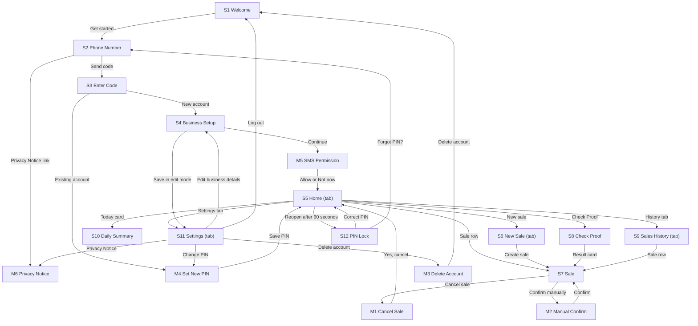

# ProofPay: Product Requirements Document (MVP)

Oct 27, 2026 · @malebza

## Document details

| Field | Answer |
| --- | --- |
| Product name | ProofPay |
| Author(s) | Malebo Nkuna, student no. TO FILL IN |
| Course code and cohort | TO FILL IN |
| Facilitator / reviewer | TO FILL IN |
| Link to original app idea | ProofPay App Concept Document (Assignment 1) |
| GitHub repository | TO FILL IN (this PRD is saved in it as docs/PRD.md) |
| Version | v0.3 |
| Status | Draft |

**Change log**

| Version | Date | Section(s) changed | What changed | Regenerated? |
| --- | --- | --- | --- | --- |
| v0.1 | 27 Oct 2026 | All | First draft | None |
| v0.2 | 29 Oct 2026 | 8.2 (M6), 8.3, 8.4, 9.1, 10.4 | Answered 6 design questions from the Stitch prompts: tab bar icons (house, plus-circle, clock, gear); permission banner colour #FFF4D6 with text #8A5A00; numeric keypad drawn as a standard 3 by 4 keypad; exact Privacy Notice wording in M6; added earlier sample Sale PP-2104 (26 Oct 2026) so S9 shows a second date; empty-state illustration set to navy #12304A, 120px wide | None yet (S5 banner and S9 list to be updated in Stitch) |
| v0.3 | 3 Nov 2026 | 4.3, 4.4 (BR4, BR16), 6.2, 10.1, 10.4, 11.1, 11.3, 12.3 | Answered the 13 clarifications in IMPLEMENTATION\_PLAN.md Section 18: test tools and extra libraries; Edge Functions and the login\_attempts table; push-only offline sync; no restore on a new phone; test sender 5550001; receipt layout; server-side expiry; Android service permissions; unreadable message amount; received\_amount after manual confirm; edge case 1 wording | None |

## 1. Product overview

**1.1 Product name:** ProofPay

**1.2 One-line pitch:** ProofPay helps small traders to confirm bank transfers in seconds so that fake payment proofs cannot cost them money. (19 words)

**1.3 Problem statement:** Small traders in South Africa, such as spaza shop owners, hair salons and online sellers, often accept bank transfers instead of cards. Customers can show an edited screenshot or a fake "payment successful" screen, take the goods, and the money never arrives. To check a payment, the trader must open their own banking app and wait for the balance to change, which works for one bank only and takes minutes while a customer waits at the counter. For a trader who makes about R500 profit in a day, one fake R500 proof erases that whole day. Card machines remove the risk, but they cost money for the device and for every transaction.

**1.4 Solution:**

- The Trader enters the amount of a Sale, and ProofPay creates a Reference such as PP-4821 and a QR code for the customer.
- When the customer pays, ProofPay reads the Bank Message that arrives on the Trader's phone and compares the amount and the Reference.
- If both match, the Sale changes to Confirmed within 30 seconds. If the amount is different, the Sale changes to Suspicious and shows the difference.
- The Trader can also type a Reference from a customer's screenshot into Check Proof to see whether a matching payment exists.

**1.5 Platform:** Android app. It is built and tested on Android only, because reading Bank Messages needs the Android SMS permission. iPhone is a future feature.

**1.6 Vision:** In 2 years, ProofPay is the standard way for small traders across South Africa to confirm any bank transfer, in 4 languages, with a built-in check for edited payment screenshots.

**1.7 Key terms**

| Term | Exact meaning in this app |
| --- | --- |
| Trader | The person who owns the account and takes payments from customers. The customer never installs the app. |
| Sale | One amount the Trader expects to be paid by one customer. It has a Reference and a Status. |
| Reference | The code ProofPay gives a Sale, written PP- followed by 4 digits, such as PP-4821 (BR3). The customer quotes it when paying. |
| Bank Message | An SMS that a chosen bank sends to the Trader's phone when money arrives. |
| Status | Where a Sale stands: Pending, Confirmed, Suspicious, Expired or Cancelled (Section 10.3). |
| Check Proof | The screen where the Trader types a Reference from a customer's screenshot to see that Sale's Status (BR10). |
| Manual Confirm | The Trader marks a Sale as paid by hand, with a reason and the PIN (BR11). |

## 2. Users, personas and roles

**2.1 Primary user:** Owners of micro and small businesses in South Africa who accept bank transfers: spaza and tuckshop owners, hair and barber salons, market and street traders, home caterers and online sellers. Age 20 to 55. Tech comfort: Medium. Device: Android phone with 3 GB of memory, on prepaid mobile data of about 1 GB a month.

**2.2 Secondary users:** None. Customers do not install or use the app. Admin work is described in 2.5.

**2.3 Personas**

| Field | Persona 1 | Persona 2 |
| --- | --- | --- |
| Name and age | Thandi Mokoena, 34 | Sipho Dlamini, 26 |
| Role (from 2.4) | Trader | Trader |
| Occupation / situation | Owns a tuckshop in Soweto; 40 to 60 customers a day, about 15 of them pay by transfer | Sells sneakers on WhatsApp and Facebook from Pretoria; delivers after payment |
| Device and connectivity | Android phone, prepaid data | Android phone, prepaid data plus home Wi-Fi |
| Tech comfort | Medium | High |
| Language(s) | English, Sepedi | English, isiZulu |
| Goal | Know within 30 seconds that a transfer is real before handing over goods | Dispatch an order only when the money has arrived |
| Frustrations today | Customers show edited screenshots; she cannot open her banking app with a queue waiting | Buyers send screenshots that look real; he has sent parcels and never been paid |
| How the app helps | Shows Confirmed in green as soon as the money arrives | Sends a Reference to the buyer and sees Confirmed before he ships |
| Quote | "I just want to know if the money is in." | "Show me the real payment, not a picture of one." |

**2.4 Roles and permissions**

| Role | How someone gets this role | Can do | Cannot do |
| --- | --- | --- | --- |
| Trader | Signs up with a South African mobile number and a 6-digit code | Create, extend and cancel own Sales; use Check Proof; confirm a Sale manually; view own Sales, history and summary; send receipts; change own PIN; log out; delete own account | See or change another Trader's Sales, Bank Messages or phone number; change the amount or Reference of a Sale after it is created; edit or delete a Confirmed Sale |

Every "Cannot do" is enforced by the database rules in Section 11.4.

**2.5 Admin:** Admin work is done directly in the Supabase dashboard (adding bank sender IDs, reading support requests, deleting accounts on request). There are no admin screens in v1.

## 3. Goals, success metrics and non-goals

**3.1 Goals**

| # | Goal | Metric (what you count) | Target | How you will check it |
| --- | --- | --- | --- | --- |
| G1 | Confirmation arrives while the customer is still at the counter | % of automatically Confirmed Sales where confirmed\_at minus the Bank Message received\_at is 30 seconds or less | 95% | Sale and BankMessage tables, pilot data for 4 weeks |
| G2 | Confirmations are correct | Confirmed Sales that did not appear on the Trader's bank statement, as a share of all Confirmed Sales | Fewer than 1 in 200 (0.5%) | Each pilot Trader compares Confirmed Sales with their bank statement every Friday for 4 weeks |
| G3 | Setup is short | % of test users who go from install to their first Sale in 5 minutes or less | 8 out of 10 testers | Timed user test with 10 people who have never seen the app |
| G4 | Traders keep using it | Pilot Traders who create at least 5 Sales a week in week 4 | 12 of 20 | Sale table: count per trader\_id for week 4 |

**3.2 Non-goals**

1. **No AI check of payment screenshots.** It needs model training and testing that does not fit this project. Check Proof uses the Reference instead.
2. **No iPhone app.** iPhones do not let apps read SMS.
3. **No bank connections (open banking or bank APIs).** Each bank needs its own approval process, which takes months.
4. **No card payments and no holding of money.** ProofPay never moves or stores money. It only confirms that money arrived.
5. **No customer accounts or customer app.** Customers pay with their normal banking app.
6. **No sharing of fraud alerts between Traders.** It needs privacy rules and moderation beyond this project.

## 4. Features, business rules and notifications

**4.1 Feature list**

| ID | Feature name | What the user can do (every action) | Priority | Goal (G#) | Stories (US#) | Screens (S#) |
| --- | --- | --- | --- | --- | --- | --- |
| F1 | Account and setup | Sign up or log in with a phone number and a 6-digit code; enter business name and type; choose banks; allow SMS reading; set, change and reset a 4-digit PIN; lock and unlock the app; read the Privacy Notice; log out; delete the account | Must | G3 | US1, US2, US3, US4 | S1, S2, S3, S4, S11, S12, M3, M4, M5, M6 |
| F2 | Create a Sale | Enter an amount and an optional note; get a Reference and a QR code; watch a countdown; extend once; cancel; see a Sale expire | Must | G4 | US5, US6 | S6, S7, M1 |
| F3 | Automatic matching | Have Bank Messages from chosen banks read and matched; see a Sale become Confirmed or Suspicious; get a notification; works with the app closed and with no internet | Must | G1, G2 | US7, US8 | S7 |
| F4 | Check Proof | Type a Reference from a customer's screenshot and see that Sale's Status, or "Not found" | Must | G2 | US9 | S8 |
| F5 | History and Daily Summary | See today's totals; browse and filter all Sales; open any Sale; see totals for any day | Must | G4 | US10 | S5, S9, S10 |
| F6 | Manual Confirm | Mark a Sale as paid by hand, with a reason and the PIN | Should | G2 | US11 | S7, M2 |
| F7 | WhatsApp receipt | Send a text receipt for a Confirmed Sale through WhatsApp or any share option | Should | G4 | US12 | S7 |

**4.2 MVP:** A Trader can sign up, create a Sale with a Reference, and see it become Confirmed, Suspicious or Expired by matching the Bank Message on their own phone, with no internet needed for the matching.

**4.3 Future features:**

- AI check of edited payment screenshots
- isiZulu, Sesotho, Sepedi and Xitsonga screens
- Paid plan with CSV export of Sales
- Email alert reading and bank connections
- Staff accounts for shops with more than one till; restoring earlier Sales on a new phone
- iPhone app

**4.4 Business rules**

| ID | Rule (exact logic, numbers and limits) | Used by (F#, S#) |
| --- | --- | --- |
| BR1 | **Amount.** From R1.00 to R50,000.00 in rand with exactly 2 decimal places. Anything else is not accepted. | F2, S6 |
| BR2 | **Note.** Optional. Plain text, 0 to 60 characters. | F2, S6, S7 |
| BR3 | **Reference.** PP- followed by 4 digits from 1000 to 9999, chosen at random. A Reference must be different from every other Pending Sale of the same Trader. It can be used again once its Sale is no longer Pending. | F2, S6, S7 |
| BR4 | **Sale lifetime.** A Sale expires 15 minutes after it is created. The Trader can extend it once by 15 minutes, which makes it 30 minutes in total. When the time ends, the Status changes from Pending to Expired. A Trader can cancel a Pending Sale at any time, which changes the Status to Cancelled. On the server, overdue Pending Sales are set to Expired during each sync. | F2, F3, S7, M1 |
| BR5 | **Match for Confirmed.** A Pending Sale, or an Expired Sale whose time ended less than 5 minutes ago, becomes Confirmed only when all 4 conditions are true: (a) a Bank Message holds the Sale's Reference, ignoring capital letters, spaces and the hyphen ("pp 4821" and "PP4821" both match PP-4821); (b) the Bank Message amount is exactly the Sale amount; (c) the Bank Message arrived after the Sale was created and no later than 5 minutes after the Sale's expiry time; (d) that Bank Message has not been used for another Sale. | F3, S7 |
| BR6 | **Suspicious.** A Pending Sale becomes Suspicious when a Bank Message holds its Reference but the amount is different (higher or lower). The Sale screen shows the exact difference, for example "Expected R150.00, received R120.00. Short by R30.00." A Bank Message that holds the Reference of a Sale that is already Confirmed changes nothing. | F3, S7 |
| BR7 | **Which messages are read.** ProofPay reads only SMS whose sender ID is in the bank\_senders list for the banks the Trader chose in S4. All other SMS are ignored and never saved or uploaded. | F1, F3, S4 |
| BR8 | **What is saved from a Bank Message.** Only the bank name, the amount, the Reference text, the time received and whether it was read. The full SMS text, the payer's name and account numbers are never saved or uploaded. | F3 |
| BR9 | **Matching time.** Matching runs within 5 seconds of the SMS arriving on the phone, also when the app is closed (using an Android foreground service) and when there is no internet. | F3 |
| BR10 | **Check Proof.** The Trader types a Reference in the format PP-4821. The app looks only at that Trader's own Sales from the last 12 months and shows that Sale's Status, amount and time, or "Not found" when none exists. | F4, S8 |
| BR11 | **Manual Confirm.** Allowed on a Sale whose Status is Pending, Suspicious or Expired, within 24 hours of its creation. The Trader chooses a reason (Seen in banking app, Customer is known and trusted, Other) and enters the PIN. The Sale becomes Confirmed with confirm\_type Manual. Manual Sales are counted separately in S10. | F6, S7, M2 |
| BR12 | **Login code.** 6 digits, accepted for 5 minutes. After 3 wrong codes the Trader must wait 10 minutes. A new code can be requested after 60 seconds. | F1, S2, S3 |
| BR13 | **PIN.** 4 digits. It cannot be 4 identical digits, 1234 or 4321. The app locks after 60 seconds in the background. After 5 wrong PINs it locks for 15 minutes. The PIN is stored only on the phone. | F1, S4, S12, M4 |
| BR14 | **History.** Newest first, 20 Sales at a time. Sales are kept for 12 months and then deleted automatically. | F5, S9 |
| BR15 | **Daily Summary.** A day runs from 00:00 to 23:59 South African time (SAST). It shows the count and rand total of Confirmed Sales, of which Manual, and the counts of Pending, Suspicious, Expired and Cancelled Sales created that day. Totals are calculated from Sales and are not stored. | F5, S5, S10 |
| BR16 | **Receipt.** Allowed only for a Confirmed Sale. The text says "Payment verified by ProofPay" for an automatic confirmation and "Payment confirmed manually" for a Manual one. Each item is on its own line: business name, "Receipt", date and time, amount, Reference, then the verified line. | F7, S7 |
| BR17 | **Business name and type.** Name: 2 to 40 characters. Type: one of Spaza or Tuckshop, Salon or Barber, Market or Street Trader, Online Seller, Caterer, Other. | F1, S4 |
| BR18 | **Sales per day.** A Trader can create at most 200 Sales per day (00:00 to 23:59 SAST). | F2, S6 |
| BR19 | **Offline and sync.** Creating, matching and viewing Sales work with no internet. Sales and Bank Message records sync to the server in the order they were created when the phone is online again. A Sale is changed only on the phone that created it, so there are no conflicts. | F2, F3, F5 |

**4.5 Notifications** (Android notifications on the phone, plus the login code SMS)

| Trigger | Who receives it | Channel | Exact text | Tapping it opens |
| --- | --- | --- | --- | --- |
| A Sale becomes Confirmed automatically | Trader | In-app (Android notification) | "Confirmed: R150.00 received for PP-4821." | S7 for that Sale |
| A Sale becomes Suspicious | Trader | In-app (Android notification) | "Suspicious: PP-2290 expected R150.00, received R120.00." | S7 for that Sale |
| A Pending Sale has 2 minutes left | Trader | In-app (Android notification) | "PP-7305 expires in 2 minutes." | S7 for that Sale |
| A Bank Message from a chosen bank cannot be read while a Sale is Pending | Trader | In-app (Android notification) | "We could not read a bank message. Confirm the payment yourself in your banking app." | S5 |
| SMS reading is on | Trader | In-app (permanent Android notification while the service runs) | "ProofPay is watching for payments." | S5 |
| The Trader asks for a login code | Trader | SMS | "Your ProofPay code is 482913. It expires in 5 minutes." | None (the Trader types it on S3) |

No email or push messages are sent in v1.

## 5. Accounts and sign-in

| Decision | Your answer |
| --- | --- |
| Sign-up methods | South African mobile number plus a 6-digit code sent by SMS. No password. |
| Who may sign up | Anyone with a South African mobile number (10 digits starting with 0, or +27 followed by 9 digits) who is 18 or older. |
| Minimum age | 18. S2 has the checkbox "I am 18 or older", which must be ticked. This avoids needing a parent's consent under POPIA in v1. |
| Phone verification | Required. The Trader cannot reach any other screen until the correct code is entered on S3 (BR12). |
| Password rules | Not needed because there are no passwords. The Trader uses a 4-digit PIN to unlock the app (BR13). The PIN never leaves the phone. |
| Forgot PIN | S12 has a "Forgot PIN?" link. It logs the Trader out and goes to S2. After a new code is entered on S3, M4 Set New PIN opens, and then S5. The Trader's Sales are not deleted. |
| Failed log-in attempts | After 3 wrong codes: "Too many attempts. Try again in 10 minutes." After 5 wrong PINs: "Too many attempts. Try again in 15 minutes." |
| Stay logged in | 30 days. After 30 days the Trader must enter a new code. The PIN is asked every time the app has been in the background for more than 60 seconds. |
| Log out | S11 Settings, button "Log out". No confirmation. Sales stay on the phone. If a different number then logs in on that phone, the earlier Trader's Sales are removed from the phone (they stay on the server). |
| Delete account | S11 Settings, "Delete account", then M3. Immediately and permanently deletes the Trader, all Sales, all Bank Message records and the bank choices from the server and from the phone. |
| Change phone number | Not in v1. |

## 6. User stories, acceptance criteria and edge cases

**6.1 Stories**

**US1 (F1):** As a Trader, I want to sign up or log in with my mobile number so that I can use ProofPay on my phone.

- **T-US1-1:** Given I am on S2, when I enter 0821234567, tick "I am 18 or older" and "I agree to the Privacy Notice", and tap "Send code", then a 6-digit code is sent by SMS and I go to S3 with the text "Enter the code we sent to 082 123 4567."
- **T-US1-2 (unhappy):** Given I type a number that is not a South African mobile number, then "Send code" is greyed out and the field shows a red border and "Enter a South African mobile number, for example 0821234567."
- **T-US1-3:** Given I am on S3, when I type the correct 6-digit code, then I go to S4 if the number has no account, otherwise M4 opens and, after I save a PIN, I go to S5.
- **T-US1-4 (unhappy):** Given I type a wrong code, then I see "That code is not correct. 2 attempts left." After the 3rd wrong code I see "Too many attempts. Try again in 10 minutes." and the code boxes are disabled.

**US2 (F1):** As a Trader, I want to set up my business, banks and PIN so that ProofPay knows which Bank Messages to read.

- **T-US2-1:** Given I am on S4, when I enter a business name of 2 to 40 characters, choose a business type, choose at least 1 bank, and enter the same 4-digit PIN twice, and tap "Continue", then M5 opens.
- **T-US2-2:** Given M5 is open, when I tap "Allow" and accept the Android SMS permission, then I go to S5 and the notification "ProofPay is watching for payments." appears.
- **T-US2-3 (unhappy):** Given I tap "Not now" on M5 or refuse the Android permission, then I go to S5 with the banner "Automatic confirmation is off. Turn it on in Settings." and every Sale needs Manual Confirm.
- **T-US2-4 (unhappy):** Given the PIN is 1234 or the two PINs are different, then "Continue" is greyed out and the field shows "Choose a different PIN." or "The PINs do not match."

**US3 (F1):** As a Trader, I want the app to lock with my PIN so that other people cannot see or change my Sales.

- **T-US3-1:** Given I leave the app for more than 60 seconds, when I open it again, then S12 opens and after the correct PIN I return to the screen I left.
- **T-US3-2 (unhappy):** Given I type a wrong PIN, then I see "Wrong PIN. 4 attempts left." After the 5th wrong PIN I see "Too many attempts. Try again in 15 minutes."
- **T-US3-3:** Given I tap "Forgot PIN?" on S12 and then log in with a new code on S3, then M4 opens, and after I save a new PIN I go to S5 and my Sales are still listed.

**US4 (F1):** As a Trader, I want to delete my account so that my information is removed when I stop using ProofPay.

- **T-US4-1:** Given I am on S11, when I tap "Delete account", then M3 opens with the text "Delete your account? All your Sales and settings will be deleted. This cannot be undone." and the buttons "Delete account" and "Cancel".
- **T-US4-2:** Given M3 is open, when I tap "Delete account" and type my PIN, then my account, Sales, Bank Message records and bank choices are deleted from the server and the phone, and I go to S1.
- **T-US4-3 (unhappy):** Given the phone has no internet, when I tap "Delete account" on M3, then I see "You're offline. Connect to the internet to delete your account." and nothing is deleted.

**US5 (F2):** As a Trader, I want to create a Sale for an exact amount so that the customer knows what to pay and what Reference to quote.

- **T-US5-1:** Given I am on S6, when I type 150 (shown as R150.00), type the note "2 loaves and airtime", and tap "Create sale", then S7 opens for a new Pending Sale with a Reference (PP- and 4 digits), the amount "R150.00", a QR code and a countdown that starts at 15:00.
- **T-US5-2 (unhappy):** Given the amount is below R1.00 or above R50,000.00, then "Create sale" is greyed out and the field shows "Enter an amount from R1.00 to R50,000.00."
- **T-US5-3 (unhappy):** Given I have already created 200 Sales today, when I tap "Create sale", then I see "You have reached 200 Sales today. Try again tomorrow." and no Sale is created.
- **T-US5-4:** Given the QR code is on S7, when a customer scans it with any QR reader, then the reader shows the text "ProofPay|Thandi's Tuckshop|R150.00|PP-4821" (business name, amount and Reference).

**US6 (F2):** As a Trader, I want to extend, cancel or let a Sale expire so that old Sales do not stay open.

- **T-US6-1:** Given a Sale is Pending and has not been extended, when I tap "Add 15 minutes", then the countdown goes up by 15 minutes and the button is hidden.
- **T-US6-2:** Given a Sale is Pending, when I tap "Cancel sale" and then "Yes, cancel" on M1, then the Status is Cancelled and I go to S5.
- **T-US6-3 (unhappy):** Given the countdown reaches 00:00 and no matching Bank Message has arrived, then the Status becomes Expired and S7 shows "Expired. No payment was found."

**US7 (F3):** As a Trader, I want a Sale to turn Confirmed by itself when the money arrives so that I can hand over the goods without opening my banking app.

- **T-US7-1:** Given Sale PP-4821 for R150.00 is Pending, when a Bank Message from a chosen bank arrives with R150.00 and the text "PP-4821", then within 5 seconds the Status becomes Confirmed, S7 turns green with the word "Confirmed", the phone vibrates once for 300 ms and plays one short sound.
- **T-US7-2:** Given the app is closed and the phone has no internet, when that Bank Message arrives, then the Sale is Confirmed on the phone and the notification "Confirmed: R150.00 received for PP-4821." appears.
- **T-US7-3 (unhappy):** Given a Bank Message arrives with R150.00 but no Reference, then nothing changes and the Sale stays Pending.
- **T-US7-4 (unhappy):** Given an SMS arrives from a sender that is not a chosen bank, then it is ignored and nothing from it is saved.

**US8 (F3):** As a Trader, I want a warning when the amount paid is different so that I do not hand over goods for a short payment.

- **T-US8-1:** Given Sale PP-2290 for R150.00 is Pending, when a Bank Message holds PP-2290 and R120.00, then the Status becomes Suspicious, S7 turns red with the word "Suspicious" and the text "Expected R150.00, received R120.00. Short by R30.00."
- **T-US8-2:** Given the Bank Message holds PP-2290 and R180.00, then S7 shows "Expected R150.00, received R180.00. Over by R30.00."
- **T-US8-3 (unhappy):** Given a Bank Message holds the Reference of a Sale that is already Confirmed, then the Sale stays Confirmed and nothing else changes.

**US9 (F4):** As a Trader, I want to check the Reference on a customer's screenshot so that I know whether it is a real payment.

- **T-US9-1:** Given I am on S8, when I type PP-4821 and tap "Check", then I see "Confirmed: R150.00 received on 27 Oct 2026 at 10:12."
- **T-US9-2 (unhappy):** Given I type PP-9999 and no Sale with that Reference exists, then I see "Not found. This Reference was not created in your ProofPay. Do not hand over goods."
- **T-US9-3 (unhappy):** Given I type 4821 without PP-, then "Check" is greyed out and the field shows "Enter a Reference like PP-4821."

**US10 (F5):** As a Trader, I want to see today's totals and my past Sales so that I know how my day went.

- **T-US10-1:** Given I have Sales today, when I open S5, then I see the "Today" card with the total of Confirmed Sales and the count of each Status, and my last 5 Sales.
- **T-US10-2:** Given I am on S9, when I tap the filter "Suspicious", then only Suspicious Sales are listed, 20 at a time, and the next 20 load when I reach the bottom.
- **T-US10-3 (unhappy):** Given no Sale matches the filter, then I see "No Sales found. Try another filter."
- **T-US10-4:** Given I tap the "Today" card on S5 and then pick another date, then S10 shows the BR15 totals for that date.

**US11 (F6):** As a Trader, I want to confirm a payment by hand so that I can still sell when a Bank Message is late or cannot be read.

- **T-US11-1:** Given a Sale is Pending, when I tap "Confirm manually", choose "Seen in banking app" and type my PIN on M2, then the Status becomes Confirmed with the label "Confirmed manually".
- **T-US11-2 (unhappy):** Given I type a wrong PIN on M2, then I see "Wrong PIN. 4 attempts left." and the Sale does not change.
- **T-US11-3 (unhappy):** Given a Sale was created more than 24 hours ago, then the button "Confirm manually" is not shown.

**US12 (F7):** As a Trader, I want to send a receipt so that my customer has proof of the payment.

- **T-US12-1:** Given a Sale is Confirmed, when I tap "Send receipt", then the Android share sheet opens with the text "Thandi's Tuckshop, Receipt, 27 Oct 2026 10:12, Amount R150.00, Reference PP-4821, Payment verified by ProofPay".
- **T-US12-2 (unhappy):** Given a Sale is Pending, Suspicious, Expired or Cancelled, then the button "Send receipt" is not shown.

**6.2 Edge cases**

| Situation | What the user sees (exact text) | What the app does |
| --- | --- | --- |
| The customer pays the right amount but does not quote the Reference | Check Proof shows "Pending: no payment found yet." (S7 shows "Waiting for payment.") | Nothing is matched, because BR5 needs the Reference. The Trader can use Manual Confirm. |
| A matching Bank Message arrives 3 minutes after the Sale expired | "Confirmed" with the note "Paid after the time ended." | The Sale becomes Confirmed (BR5 allows up to 5 minutes after expiry). |
| A matching Bank Message arrives 8 minutes after the Sale expired | The Sale stays "Expired. No payment was found." | The message is saved without a Sale. The Trader can use Manual Confirm within 24 hours of creation. |
| The phone restarts while a Sale is Pending | The notification "ProofPay is watching for payments." returns | The reading service restarts after the phone starts. Sales are kept on the phone. |
| Android stops the reading service to save battery | "Automatic confirmation is paused. Open ProofPay to restart it." | The service restarts when the Trader opens the app. |
| The Trader creates a Sale with no internet | The banner "You're offline. Sales are saved on this phone and will sync later." | The Sale is saved on the phone and matching works. The Sale syncs when the phone is online (BR19). |
| Two Pending Sales have the same amount | Each Sale shows its own Status | Matching uses the Reference, not the amount, so the correct Sale is confirmed. |
| A different number logs in on the same phone | Nothing extra | The earlier Trader's Sales are removed from the phone. They stay on the server. |

## 7. User flows and navigation map

**Flow 1: First sign-up to first Sale (F1, F2)**

Starts when: Thandi installs ProofPay and opens it for the first time.

1. S1 Welcome: taps "Get started" → S2 Phone Number
2. S2 Phone Number: types her number, ticks both checkboxes, taps "Send code" → S3 Enter Code
3. S3 Enter Code: types the 6-digit code. If the number has no account → S4 Business Setup; otherwise → M4 Set New PIN → S5 Home
4. S4 Business Setup: enters name, type, banks and PIN, taps "Continue" → M5 SMS Permission
5. M5 SMS Permission: taps "Allow" (or "Not now") → S5 Home
6. S5 Home: taps "New sale" → S6 New Sale
7. S6 New Sale: types the amount and taps "Create sale" → S7 Sale

Ends when: S7 shows her first Pending Sale with a Reference and a QR code.

**Flow 2: A Sale is paid, short-paid or not paid (F2, F3)**

Starts when: Thandi is on S7 with a Pending Sale and the customer is at the counter.

1. S7 Sale: the customer scans the QR code and pays in their banking app
2. If a Bank Message arrives with the right Reference and the exact amount → S7 turns Confirmed (green) and Thandi hands over the goods
3. If a Bank Message arrives with the right Reference and a different amount → S7 turns Suspicious (red) and shows the difference
4. If no matching Bank Message arrives before 00:00 → S7 shows Expired (grey)
5. Before the time ends, Thandi can tap "Add 15 minutes" (once) or "Cancel sale" → M1 Cancel Sale → S5 Home

Ends when: S7 shows Confirmed, Suspicious, Expired or Cancelled.

**Flow 3: Check a customer's screenshot (F4)**

Starts when: A customer shows Thandi a payment screenshot that quotes a Reference.

1. S5 Home: taps "Check Proof" → S8 Check Proof
2. S8: types the Reference from the screenshot and taps "Check"
3. If the Reference belongs to a Confirmed Sale → the green result "Confirmed: R150.00 received on 27 Oct 2026 at 10:12."
4. If the Reference is not found → the red result "Not found. This Reference was not created in your ProofPay. Do not hand over goods."
5. Tapping the result of a found Sale → S7

Ends when: Thandi knows whether the money has arrived.

**Flow 4: Review the day (F5)**

Starts when: It is closing time and Thandi wants her totals.

1. S5 Home: reads the "Today" card, taps it → S10 Daily Summary
2. S10: reads the totals, taps the date to pick another day
3. Taps the History tab → S9 Sales History
4. S9: taps the filter "Suspicious", taps a Sale → S7

Ends when: Thandi has seen the totals and has opened the Sales she wants to check.

**Flow 5: Confirm by hand and send a receipt (F6, F7)**

Starts when: A Bank Message was late, and the customer says they have paid.

1. S7 Sale (Pending or Expired within 24 hours): taps "Confirm manually" → M2 Manual Confirm
2. M2: chooses a reason, types the PIN, taps "Confirm" → S7 shows "Confirmed manually"
3. S7: taps "Send receipt" → the Android share sheet opens

Ends when: The customer receives the receipt on WhatsApp.

**Flow 6: Lock, change PIN, read the Privacy Notice and delete the account (F1)**

Starts when: Thandi returns to the app after 5 minutes in the background.

1. S12 PIN Lock: types her 4-digit PIN → the screen she left. If she taps "Forgot PIN?" → S2 Phone Number → S3 Enter Code → M4 Set New PIN → S5 Home
2. S11 Settings: taps "Change PIN" → M4 Set New PIN, saves the new PIN → S11 with the toast "Saved"
3. S11: taps "Privacy Notice" → M6 Privacy Notice, taps "Close" → S11
4. S11: taps "Edit business details" → S4 Business Setup (edit mode), taps "Save" → S11
5. S11: taps "Delete account" → M3 Delete Account, types her PIN, taps "Delete account" → S1 Welcome

Ends when: Thandi has unlocked the app, or her account is deleted and S1 is shown.

**7.2 Navigation map**

Tabs (bottom bar): S5 Home, S6 New Sale, S9 Sales History, S11 Settings. The tab bar is hidden on S1 to S4, S7, S8, S10 and S12. S12 appears when the app is opened after more than 60 seconds in the background and returns to the screen the Trader left.

## 8. Screens

**8.1 Screen inventory**

| ID | Screen name | Type | Who can open it | Purpose (one line) | Tab bar shown? | Stories (US#) |
| --- | --- | --- | --- | --- | --- | --- |
| S1 | Welcome | Full screen | Logged out | Logo, pitch and the "Get started" button | No | US1 |
| S2 | Phone Number | Full screen | Logged out | Sign up or log in by entering a mobile number | No | US1 |
| S3 | Enter Code | Full screen | Logged out | Type the 6-digit code from the SMS | No | US1 |
| S4 | Business Setup | Full screen | Trader (new account, or editing from S11) | Enter business name, type, banks and PIN | No | US2 |
| S5 | Home | Tab | Trader | Today's totals, last 5 Sales, buttons for New sale and Check Proof | Yes | US10 |
| S6 | New Sale | Tab | Trader | Enter the amount and note and create a Sale | Yes | US5 |
| S7 | Sale | Full screen | Trader | Show one Sale with Reference, QR code, countdown and Status | No | US5, US6, US7, US8, US11, US12 |
| S8 | Check Proof | Full screen | Trader | Look up a Reference from a customer's screenshot | No | US9 |
| S9 | Sales History | Tab | Trader | List and filter all Sales | Yes | US10 |
| S10 | Daily Summary | Full screen | Trader | Totals for one day | No | US10 |
| S11 | Settings | Tab | Trader | Business details, automatic confirmation, sound, PIN, Privacy Notice, log out, delete account | Yes | US2, US3, US4 |
| S12 | PIN Lock | Full screen | Trader (after 60 seconds in the background) | Unlock the app with the PIN | No | US3 |
| M1 | Cancel Sale | Modal | Trader | Confirm cancelling a Pending Sale | Not applicable | US6 |
| M2 | Manual Confirm | Bottom sheet | Trader | Choose a reason and type the PIN to confirm a Sale by hand | Not applicable | US11 |
| M3 | Delete Account | Modal | Trader | Confirm permanent deletion with the PIN | Not applicable | US4 |
| M4 | Set New PIN | Modal (full height) | Trader | Save a new PIN after login or from Settings | Not applicable | US1, US3 |
| M5 | SMS Permission | Modal | Trader | Explain why SMS access is needed and ask for it | Not applicable | US2 |
| M6 | Privacy Notice | Modal (full height) | Anyone | Read what is collected, why and how to delete it | Not applicable | US1 |

Common screens checked: Welcome is S1. Sign up and Log in are the same screen, S2, because both use a phone number and a code. Forgot password is not needed because there are no passwords; "Forgot PIN?" is on S12. Profile setup is S4. Home is S5. Profile and settings, log out, delete account and the Privacy Notice are in S11, M3 and M6. A separate onboarding slide show is not needed because S4 and M5 are the onboarding.

**8.2 Screen specifications**

**S1 Welcome**

- **Purpose:** Introduce ProofPay and start sign-up or log-in. **Who can open it:** Logged out. **Comes from / goes to:** App start, S11 (Log out), M3 → this screen → S2.
- **Layout:** (1) Logo: tick-in-circle icon above the wordmark "ProofPay". (2) Title "Know the money is real." (3) Body text "Confirm bank transfers in seconds. Log in or create an account with your phone number." (4) Primary button "Get started".
- **Form fields:** None. **Buttons:** "Get started" → S2.
- **States:** Normal only. Empty, Loading, Error, Offline and Success are not needed because the screen shows fixed text and needs no data.
- **Sample content:** The text above is the whole content.

**S2 Phone Number**

- **Purpose:** Enter a mobile number to receive a login code. **Who can open it:** Logged out. **Comes from / goes to:** S1, S12 (Forgot PIN?) → this screen → S3, M6.
- **Layout:** (1) Header: back arrow, title "Your phone number". (2) Field "Mobile number". (3) Checkbox "I am 18 or older". (4) Checkbox "I agree to the Privacy Notice" with "Privacy Notice" as a link. (5) Primary button "Send code".

| Field label | Type | Required? | Placeholder text | Rules | Error message (exact text) |
| --- | --- | --- | --- | --- | --- |
| Mobile number | Phone | Yes | "082 123 4567" | 10 digits starting with 0, or +27 followed by 9 digits | "Enter a South African mobile number, for example 0821234567." |
| I am 18 or older | Checkbox | Yes | Not applicable | Unticked by default; must be ticked | "Tick this box to continue." |
| I agree to the Privacy Notice | Checkbox | Yes | Not applicable | Unticked by default; must be ticked | "Tick this box to continue." |

- **Buttons:** "Send code" (greyed out until the number is accepted and both boxes are ticked) → S3. "Privacy Notice" link → M6. Back arrow → S1.
- **States:** Normal: as above. Empty: not needed because the screen is a form. Loading: the button shows a spinner and the text "Sending…". Error: "We could not send the code. Try again." with the button "Try again". Offline: banner "You're offline. Connect to the internet to continue." and "Send code" disabled. Success: not needed because the Trader goes straight to S3.
- **Sample content:** 0821234567 (Thandi), 0731234567 (Sipho), +27641234567 (Nomsa).

**S3 Enter Code**

- **Purpose:** Prove the number is the Trader's own. **Who can open it:** Logged out. **Comes from / goes to:** S2 → this screen → S4 (new account) or M4 (existing account).
- **Layout:** (1) Header: back arrow, title "Enter code". (2) Text "Enter the code we sent to 082 123 4567." (3) 6 code boxes. (4) Text link "Send a new code" (disabled with the text "Send a new code in 0:45" for the first 60 seconds).

| Field label | Type | Required? | Placeholder text | Rules | Error message (exact text) |
| --- | --- | --- | --- | --- | --- |
| Code | 6 digit boxes | Yes | Empty boxes | 6 digits, accepted for 5 minutes (BR12) | "That code is not correct. 2 attempts left." |

- **Buttons:** Typing the 6th digit checks the code. "Send a new code" → sends a new SMS. Back arrow → S2.
- **States:** Normal: as above. Empty: not needed because the screen is a form. Loading: the boxes are disabled with a spinner under them. Error: wrong code message above; after 3 wrong codes "Too many attempts. Try again in 10 minutes." Offline: banner "You're offline. Connect to the internet to continue." Success: the boxes turn green for 1 second, then S4 or M4 opens.
- **Sample content:** "Enter the code we sent to 073 123 4567." with code 482913 in the example SMS.

**S4 Business Setup**

- **Purpose:** Tell ProofPay about the business, the banks and the PIN. **Who can open it:** Trader with a new account, or from S11 "Edit business details" (edit mode: PIN fields hidden, button text "Save"). **Comes from / goes to:** S3, S11 → this screen → M5 (new account) or S11 (edit mode).
- **Layout:** (1) Header: title "Your business" (back arrow in edit mode only). (2) Field "Business name". (3) "Business type" chips. (4) "Which banks do you get paid in?" with 8 bank chips. (5) Field "Choose a 4-digit PIN". (6) Field "Repeat PIN". (7) Primary button "Continue".

| Field label | Type | Required? | Placeholder text | Rules | Error message (exact text) |
| --- | --- | --- | --- | --- | --- |
| Business name | Text | Yes | "Thandi's Tuckshop" | 2 to 40 characters (BR17) | "Enter 2 to 40 characters." |
| Business type | Single-select chips | Yes | Not applicable | Spaza or Tuckshop, Salon or Barber, Market or Street Trader, Online Seller, Caterer, Other | "Choose a business type." |
| Banks | Multi-select chips | Yes | Not applicable | Capitec, FNB, Standard Bank, Absa, Nedbank, TymeBank, African Bank, Discovery Bank; at least 1 | "Choose at least 1 bank." |
| Choose a 4-digit PIN | PIN (number) | Yes (not in edit mode) | "4 digits" | 4 digits, not 4 identical digits, not 1234 or 4321 (BR13) | "Choose a different PIN." |
| Repeat PIN | PIN (number) | Yes (not in edit mode) | "Repeat PIN" | Same as the PIN above | "The PINs do not match." |

- **Buttons:** "Continue" (greyed out until all fields are accepted) → M5. In edit mode "Save" → S11 with the toast "Saved".
- **States:** Normal: as above. Empty: not needed because the screen is a form. Loading: the button shows a spinner. Error: "Something went wrong. Try again." with "Try again". Offline: banner "You're offline. Sales are saved on this phone and will sync later."; the form still works. Success: edit mode only, the toast "Saved".
- **Sample content:** "Thandi's Tuckshop", Spaza or Tuckshop, Capitec and FNB. "Sipho Sneakers", Online Seller, TymeBank and Capitec. "Nomsa's Hair Studio", Salon or Barber, Standard Bank.

**S5 Home**

- **Purpose:** See today at a glance and start the two main actions. **Who can open it:** Trader. **Comes from / goes to:** M4, M5, M1, S12, any tab → this screen → S6, S7, S8, S9, S10, S11.
- **Layout:** (1) Header: wordmark "ProofPay". (2) Permission banner when automatic confirmation is off or paused (3) "Today" card (taps to S10): date, total of Confirmed Sales in rand, counts. (4) Two buttons side by side: "New sale" and "Check Proof". (5) Heading "Recent sales" and up to 5 Sale cards. (6) Tab bar, Home active.
- **Sale card shows, in order:** Reference, amount, note (1 line), Status (icon and word), the label "Manual" if confirmed manually, time (24-hour time for today, date such as 25 Oct for earlier days).
- **Buttons:** "New sale" → S6. "Check Proof" → S8. "Today" card → S10. Sale card → S7. Banner button "Turn on" → Android permission screen.
- **States:** Normal: as above. Empty: a receipt illustration, "No Sales yet. Tap New sale to create your first one." and a primary button "New sale" → S6. Loading: 1 grey card and 3 grey rows. Error: "Something went wrong. Try again." with "Try again". Offline: banner "You're offline. Sales are saved on this phone and will sync later." Success: the toast "Sale cancelled" after M1.
- **Sample content:** "Today · 27 Oct 2026 · R470.00 confirmed · 2 Confirmed · 1 Pending · 1 Suspicious". Cards: PP-3377 R320.00 "Groceries" Confirmed, Manual, 11:05; PP-7305 R85.50 "Cooldrink and chips" Pending, 10:40; PP-4821 R150.00 "2 loaves and airtime" Confirmed, 10:12.

**S6 New Sale**

- **Purpose:** Create a Sale. **Who can open it:** Trader. **Comes from / goes to:** Tab bar, S5, S7 ("New sale with the same amount") → this screen → S7.
- **Layout:** (1) Header: title "New sale". (2) Field "Amount" in 40px type. (3) Field "Note (optional)". (4) Primary button "Create sale". (5) Tab bar, New Sale active.

| Field label | Type | Required? | Placeholder text | Rules | Error message (exact text) |
| --- | --- | --- | --- | --- | --- |
| Amount | Money (ZAR) | Yes | "R0.00" | R1.00 to R50,000.00, 2 decimal places (BR1); typing 150 shows R150.00 | "Enter an amount from R1.00 to R50,000.00." |
| Note | Text | No | "What is the customer buying?" | 0 to 60 characters (BR2) | "Use 60 characters or fewer." |

- **Buttons:** "Create sale" (greyed out until the amount is accepted) → S7. When the 200 Sales per day limit (BR18) is reached: "You have reached 200 Sales today. Try again tomorrow."
- **States:** Normal: as above. Empty: not needed because the screen is a form. Loading: the button shows a spinner for up to 1 second. Error: "Something went wrong. Try again." Offline: banner "You're offline. Sales are saved on this phone and will sync later." and the form still works. Success: S7 opens.
- **Sample content:** R150.00 "2 loaves and airtime"; R649.99 "Size 8 sneakers"; R200.00 "Braids deposit".

**S7 Sale**

- **Purpose:** Follow one Sale until it is paid, and act on it. **Who can open it:** Trader. **Comes from / goes to:** S5, S6, S8, S9, notifications, M2 → this screen → S5, S6, M1, M2.
- **Layout:** (1) Header: back arrow, title "Sale PP-4821". (2) Status block: icon, Status word and one line of text (full width, coloured as in Section 9). (3) Amount, 40px bold. (4) Reference, 32px semibold, with a "Copy" icon button. (5) Note, if any, in secondary text. (6) QR code, 240 by 240px, Pending only. (7) Countdown "14:32 left to pay", Pending only. (8) Buttons for the Status (below). (9) Details list: Created, Confirmed (if confirmed), How (Automatic or Manual and the reason), Received amount (Suspicious only).
- **Buttons by Status:** Pending: "Add 15 minutes" (secondary, hidden after 1 use) → countdown +15:00; "Confirm manually" (secondary) → M2; "Cancel sale" (danger) → M1. Confirmed: "Send receipt" (primary) → Android share sheet; "Done" (secondary) → S5. Suspicious: "Confirm manually" (secondary) → M2; "Done" → S5. Expired: "Confirm manually" (secondary, shown for 24 hours after creation) → M2; "New sale with the same amount" (primary) → S6 with amount and note filled; "Done" → S5. Cancelled: "Done" → S5.
- **States:** Pending (normal): amber block, clock icon, "Pending", "Waiting for payment." Confirmed: green block, tick icon, "Confirmed", "Payment received." or "Confirmed manually." Suspicious: red block, warning icon, "Suspicious", "Expected R150.00, received R120.00. Short by R30.00." Expired: grey block, cross icon, "Expired", "No payment was found." Cancelled: grey block, cross icon, "Cancelled", "You cancelled this Sale." Loading: grey placeholders for the status block and amount. Error: "Something went wrong. Try again." with "Try again". Offline: banner "You're offline. Sales are saved on this phone and will sync later." (matching still works). Success: when the Status becomes Confirmed the phone vibrates once for 300 ms and plays one short sound, unless turned off in S11.
- **Sample content:** PP-4821 R150.00 "2 loaves and airtime" Confirmed 10:12; PP-2290 R150.00 "Gas refill deposit" Suspicious, received R120.00; PP-6143 R40.00 "Airtime" Expired.

**S8 Check Proof**

- **Purpose:** Find out whether a Reference from a customer's screenshot is a real payment. **Who can open it:** Trader. **Comes from / goes to:** S5 → this screen → S7.
- **Layout:** (1) Header: back arrow, title "Check Proof". (2) Text "Type the Reference from the customer's screenshot." (3) Field "Reference". (4) Primary button "Check". (5) Result card (after a check).

| Field label | Type | Required? | Placeholder text | Rules | Error message (exact text) |
| --- | --- | --- | --- | --- | --- |
| Reference | Text | Yes | "PP-4821" | PP- followed by 4 digits (BR3); capital letters are applied as typed | "Enter a Reference like PP-4821." |

- **Buttons:** "Check" (greyed out until the format is accepted) shows the result card. Result card → S7 when a Sale was found. Back arrow → S5.
- **States:** Normal: field and button. Empty: not needed because the screen is a form. Loading: the button shows a spinner for up to 1 second. Result texts: Confirmed (green) "Confirmed: R150.00 received on 27 Oct 2026 at 10:12."; Pending (amber) "Pending: no payment found yet."; Suspicious (red) "Suspicious: expected R150.00, received R120.00."; Expired (grey) "Expired: no payment was found."; Cancelled (grey) "Cancelled: this Sale was cancelled."; Not found (red) "Not found. This Reference was not created in your ProofPay. Do not hand over goods." Error: "Something went wrong. Try again." Offline: works, because the Sales are on the phone; no banner needed. Success: the result card.
- **Sample content:** PP-4821 (Confirmed), PP-7305 (Pending), PP-9999 (Not found).

**S9 Sales History**

- **Purpose:** Browse and filter all Sales. **Who can open it:** Trader. **Comes from / goes to:** Tab bar → this screen → S7.
- **Layout:** (1) Header: title "Sales". (2) Filter chips, single choice: All, Pending, Confirmed, Suspicious, Expired, Cancelled. (3) Sale cards (as on S5) under date headings ("Today", "26 Oct 2026"), 20 at a time. (4) Tab bar, History active.
- **Form fields:** None other than the filter chips. **Buttons:** Filter chip → refreshes the list. Sale card → S7. Reaching the bottom loads the next 20, with a small spinner.
- **States:** Normal: as above. Empty (no Sales at all): "No Sales yet. Tap New sale to create your first one." and "New sale" → S6. Empty (filter): "No Sales found. Try another filter." Loading: 5 grey rows. Error: "Something went wrong. Try again." Offline: banner "You're offline. Sales are saved on this phone and will sync later." Success: not needed because the screen only lists.
- **Sample content:** Today: PP-3377 R320.00 Confirmed; PP-7305 R85.50 Pending; PP-4821 R150.00 Confirmed; PP-2290 R150.00 Suspicious; PP-6143 R40.00 Expired. Under the heading "26 Oct 2026": PP-2104 R95.00 Confirmed.

**S10 Daily Summary**

- **Purpose:** See totals for one day. **Who can open it:** Trader. **Comes from / goes to:** S5 ("Today" card) → this screen → back to S5.
- **Layout:** (1) Header: back arrow, title "Daily Summary". (2) Date row: left arrow, the date "27 Oct 2026" (opens the Android date picker), right arrow (disabled on today's date). (3) Card "Confirmed": count and rand total. (4) Card "Confirmed manually": count and rand total. (5) Cards in a 2-column grid: "Pending", "Suspicious", "Expired", "Cancelled", each with a count.
- **Form fields:** The date picker only (dates in the future are not selectable). **Buttons:** Date arrows and the date row change the day. Back arrow → S5.
- **States:** Normal: as above. Empty (a day with no Sales): all counts show 0 and totals show R0.00, with the text "No Sales on this day." Loading: grey placeholder cards. Error: "Something went wrong. Try again." Offline: works from the phone; no banner needed. Success: not needed because the screen only reads.
- **Sample content:** 27 Oct 2026: Confirmed 2 Sales R470.00; Confirmed manually 1 Sale R320.00; Pending 1; Suspicious 1; Expired 1; Cancelled 0. (Expired 1 is PP-6143.)

**S11 Settings**

- **Purpose:** Manage the business details, automatic confirmation, sound, PIN and account. **Who can open it:** Trader. **Comes from / goes to:** Tab bar → this screen → S4, M3, M4, M6, S1.
- **Layout:** (1) Header: title "Settings". (2) "Business": name, type and banks as read-only text, and a secondary button "Edit business details". (3) "Automatic confirmation": status "On" or "Off" and, when Off, a button "Turn on". (4) Toggle "Sound when a Sale is Confirmed" and toggle "Vibration when a Sale is Confirmed", both On by default. (5) Row "Change PIN". (6) Row "Privacy Notice". (7) Row "Log out". (8) Danger row "Delete account". (9) Text "Version 1.0.0". (10) Tab bar, Settings active.
- **Buttons:** "Edit business details" → S4 (edit mode). "Turn on" → Android permission screen. "Change PIN" → M4. "Privacy Notice" → M6. "Log out" → S1. "Delete account" → M3.
- **States:** Normal: as above. Empty: not needed because the Trader always has settings. Loading: not needed because the settings are on the phone. Error: not needed for the same reason. Offline: banner "You're offline. Sales are saved on this phone and will sync later."; "Delete account" shows the offline message from T-US4-3. Success: toast "Saved" after changing a toggle, the business details or the PIN.
- **Sample content:** "Thandi's Tuckshop · Spaza or Tuckshop · Capitec, FNB"; Automatic confirmation On.

**S12 PIN Lock**

- **Purpose:** Stop other people from opening the app. **Who can open it:** Trader, when the app returns after 60 seconds in the background. **Comes from / goes to:** Any screen → this screen → the screen the Trader left, or S2.
- **Layout:** (1) Logo and wordmark. (2) Text "Enter your PIN". (3) 4 dots. (4) Number keypad. (5) Text link "Forgot PIN?".
- **Form fields:** PIN, 4 digits. Error: "Wrong PIN. 4 attempts left." After 5 wrong PINs: "Too many attempts. Try again in 15 minutes."
- **Buttons:** Typing the 4th digit checks the PIN. "Forgot PIN?" → logs out → S2.
- **States:** Normal: as above. Empty, Loading, Offline and Success: not needed because the PIN is checked on the phone and the screen needs no data. Error: the messages above, with the dots shaking for 300 ms.
- **Sample content:** The text above is the whole content.

**M1 Cancel Sale** (modal)

- **Purpose:** Confirm cancelling a Pending Sale. **Comes from / goes to:** S7 → this modal → S5 or back to S7.
- **Layout:** (1) Title "Cancel this sale?" (2) Text "Sale PP-4821 for R150.00 will be marked Cancelled." (3) Danger button "Yes, cancel". (4) Secondary button "Keep sale".
- **States:** Normal only; the other states are not needed because the modal reads no data. **Sample content:** PP-7305 for R85.50.

**M2 Manual Confirm** (bottom sheet)

- **Purpose:** Confirm a Sale by hand. **Comes from / goes to:** S7 → this sheet → S7.
- **Layout:** (1) Title "Confirm manually". (2) Text "Only confirm if you have seen the money in your account." (3) Three radio choices: "Seen in banking app", "Customer is known and trusted", "Other". (4) PIN field "Enter your PIN". (5) Primary button "Confirm". (6) Secondary button "Cancel".
- **Form fields:** Reason (required; error "Choose a reason."); PIN (4 digits; error "Wrong PIN. 4 attempts left."). **Buttons:** "Confirm" (greyed out until a reason is chosen and 4 digits are typed) saves and returns to S7 with the toast "Confirmed manually". "Cancel" closes the sheet.
- **States:** Normal as above. Error: the PIN message. The other states are not needed because the sheet works on the phone. **Sample content:** PP-3377 R320.00, reason "Seen in banking app".

**M3 Delete Account** (modal)

- **Purpose:** Confirm permanent deletion. **Comes from / goes to:** S11 → this modal → S1.
- **Layout:** (1) Title "Delete your account?" (2) Text "All your Sales and settings will be deleted. This cannot be undone." (3) PIN field "Enter your PIN". (4) Danger button "Delete account". (5) Secondary button "Cancel".
- **States:** Normal as above. Loading: the button shows a spinner. Error: "Something went wrong. Try again." Offline: "You're offline. Connect to the internet to delete your account." Success: S1 opens with the toast "Account deleted". **Sample content:** Thandi's account with 6 Sales.

**M4 Set New PIN** (full-height modal)

- **Purpose:** Save a PIN on this phone. **Comes from / goes to:** S3, S11 → this modal → S5 (after login) or S11 (from Settings).
- **Layout:** (1) Title "Choose a new PIN". (2) Field "New PIN". (3) Field "Repeat PIN". (4) Primary button "Save PIN". (5) "Cancel" only when opened from S11.
- **Form fields:** As in S4 (BR13); errors "Choose a different PIN." and "The PINs do not match." **States:** Normal as above. The other states are not needed because the PIN is saved on the phone. Success: the toast "Saved". **Sample content:** Not applicable because PIN digits are never shown.

**M5 SMS Permission** (modal)

- **Purpose:** Explain and ask for SMS access. **Comes from / goes to:** S4 → this modal → S5.
- **Layout:** (1) Title "Allow ProofPay to read bank messages". (2) Text "ProofPay reads SMS on this phone to confirm payments. It only reads messages from the banks you chose. The text of your messages is never saved or uploaded." (3) Primary button "Allow". (4) Secondary button "Not now".
- **Buttons:** "Allow" → Android permission prompt → S5. "Not now" → S5 with the banner "Automatic confirmation is off. Turn it on in Settings." **States:** Normal only; the other states are not needed because the modal reads no data. **Sample content:** The text above.

**M6 Privacy Notice** (full-height modal)

- **Purpose:** Tell the Trader what is collected and why. **Comes from / goes to:** S2, S11 → this modal → back.
- **Layout:** (1) Header: title "Privacy Notice", button "Close". (2) Scrolling text with 6 headings: "What we collect", "Why we collect it", "Who can see it", "Where it is stored", "How long we keep it", "How to delete it". The exact text is: "What we collect": "Your mobile number, business name and type, the banks you chose, and your Sales. From bank messages we keep only the bank name, the amount, the Reference text and the time." "Why we collect it": "To log you in, to choose which messages to read, and to confirm payments." "Who can see it": "Only you and the ProofPay admin." "Where it is stored": "On your phone and in Supabase in Cape Town, South Africa. Login codes are sent through Twilio, which handles your mobile number outside South Africa." "How long we keep it": "Sales and bank message records for 12 months, then they are deleted automatically. Everything else until you delete your account." "How to delete it": "Open Settings and tap Delete account."
- **States:** Normal only; the other states are not needed because the text is stored in the app. **Sample content:** "What we collect: your mobile number, business name and type, the banks you chose, and your Sales. From bank messages we keep only the bank name, the amount, the Reference text and the time."

**8.3 Shared components**

| Component | Used on | What it contains | How it behaves |
| --- | --- | --- | --- |
| Header | S2 to S4, S7 to S11 | Back arrow (44 by 44px) where listed, title in 24px bold | Back arrow returns to the previous screen |
| Tab bar | S5, S6, S9, S11 | 4 tabs with an icon and a label: Home (house icon), New Sale (plus-circle icon), History (clock icon), Settings (settings gear icon), all Lucide outline | The active tab has a filled icon and a green label; the other tabs are grey |
| Primary button | All screens with a main action | Green #0B7A3E, white 16px semibold label, 48px high | Greyed out (#E5E7EB background, #4B5563 label) until the form is accepted |
| Secondary button | Screens with a second action | White background, 1px green border, green label, 48px high | Same height and shape as the primary button |
| Danger button | S7, S11, M1, M3 | Red #B3261E, white label, 48px high | Used only for cancelling or deleting |
| Text field | S2, S4, S6, S8, M2 to M4 | Label above, 48px high box, error text below | Focused: 2px green border. Error: 2px red border and the error text with a warning icon |
| Amount field | S6 | 40px bold number with the "R" prefix | Number keypad; 2 decimal places |
| Status block | S7, S8 | Icon, Status word, one line of text, full width | Colour and icon by Status (Section 9); the word is always shown |
| Sale card | S5, S9 | Reference, amount, note, Status, label "Manual", time | Tap opens S7 |
| Code boxes | S3 | 6 boxes, 48 by 56px | The next box takes focus after each digit |
| PIN dots and keypad | S12, M2 to M4, S4 | 4 dots and a standard 3 by 4 numeric keypad (1 to 9, 0 and a delete key) | A filled dot for each digit typed; the digits are never shown |
| Toast | S5, S11, S1, S7 | One line, dark #111111 background, white text | Disappears after 3 seconds |
| Confirmation pop-up | M1, M3, M5 | Title, text, 2 buttons | Closes when a button is tapped |
| Empty-state block | S5, S9 | Line illustration, one sentence, one button | Shown only when there is no data |
| Loading placeholder | S5, S7, S9, S10 | Grey #E5E7EB rounded boxes | Replaced by real content when data is ready |
| Offline banner | All logged-in screens except S12 | Grey bar: "You're offline. Sales are saved on this phone and will sync later." | Shown while there is no internet; matching still works |
| Permission banner | S5 | Amber bar with background #FFF4D6 and text #8A5A00 (5.4 to 1): "Automatic confirmation is off. Turn it on in Settings." with the button "Turn on" | Shown while SMS reading is off or paused |

**8.4 Sample data set** (used on every screen and in the seed data)

- **thandi** (Thandi Mokoena): 0821234567, "Thandi's Tuckshop", Spaza or Tuckshop, banks Capitec and FNB. 6 Sales. On 27 Oct 2026: PP-3377 R320.00 "Groceries" Confirmed (Manual, "Seen in banking app") 11:05; PP-7305 R85.50 "Cooldrink and chips" Pending 10:40; PP-4821 R150.00 "2 loaves and airtime" Confirmed (Automatic) 10:12; PP-2290 R150.00 "Gas refill deposit" Suspicious (received R120.00) 09:30; PP-6143 R40.00 "Airtime" Expired 08:15. On 26 Oct 2026: PP-2104 R95.00 "Airtime and bread" Confirmed (Automatic) 16:40.
- **sipho** (Sipho Dlamini): 0731234567, "Sipho Sneakers", Online Seller, banks TymeBank and Capitec. 1 Sale: PP-1182 R649.99 "Size 8 sneakers" Confirmed (Automatic) on 25 Oct 2026 at 14:20.
- **nomsa** (Nomsa Khumalo): +27641234567, "Nomsa's Hair Studio", Salon or Barber, bank Standard Bank. 1 Sale: PP-5540 R200.00 "Braids deposit" Confirmed (Automatic) on 26 Oct 2026 at 16:45.
- **ayesha** (Ayesha Patel): 0791234567, "Ayesha's Caterers", Caterer, bank Absa. 0 Sales. Use this account to test the empty states.

## 9. Design direction

**9.1 Look and brand**

| Item | Your choice |
| --- | --- |
| Look and feel (3 words) | Calm, clear, trustworthy |
| Primary colour | Green #0B7A3E (buttons, active tab, Confirmed). White text on it has a contrast ratio of 5.4 to 1. |
| Secondary / accent colour | Navy #12304A (wordmark and screen titles). Contrast on white: 13 to 1. |
| Background colour | White #FFFFFF; cards and surfaces #F5F7F6 |
| Main text colour | Near-black #111111; secondary text #4B5563 (8.4 to 1 on white) |
| Error / success / warning colours | Red #B3261E (6.5 to 1) / green #0B7A3E / amber #8A5A00 (5.9 to 1) |
| Neutral status colour | Grey #5F6368 (6.1 to 1), used for Expired and Cancelled |
| Dark mode | No (v1) |
| Font | Inter |
| Text sizes | Amount 40px bold; Reference 32px semibold; title 24px bold; heading 18px semibold; body 16px regular; button label 16px semibold; small text 12px regular |
| Spacing unit | 4px; gaps are 8, 12, 16, 24 or 32px |
| Screen side margin | 16px |
| Corner radius | Cards 12px; inputs 8px; buttons 12px; chips fully rounded (pill) |
| Shadows | None; 1px #E5E7EB divider lines instead |
| Button height | 48px |
| Icon set | Lucide, outline (clock, check-circle, alert-triangle, x-circle, copy, chevron-left) |
| Logo | A green circle with a white tick, followed by the wordmark "ProofPay" in Inter bold, navy #12304A |
| Images and illustrations | No photos. Empty states use a single-colour line illustration of a receipt in navy #12304A, 120px wide. No profile pictures. |
| Reference apps | Yoco (one clear action per screen and a large amount entry); SnapScan (the QR code is the centre of the Sale screen); Capitec (plain words and large buttons) |

**Status colours, icons and words (used on S5, S7, S8, S9)**

| Status | Colour | Icon | Word on screen |
| --- | --- | --- | --- |
| Pending | Amber #8A5A00 | Clock | Pending |
| Confirmed | Green #0B7A3E | Check-circle | Confirmed |
| Suspicious | Red #B3261E | Alert-triangle | Suspicious |
| Expired | Grey #5F6368 | X-circle | Expired |
| Cancelled | Grey #5F6368 | X-circle | Cancelled |

A Status block has a full-colour background with white text. A Sale card shows the icon and word in the Status colour on a white background.

**9.2 Tone of voice:** Short, calm and direct, because the Trader is serving a customer. Example: "Payment received." instead of "Your payment has been successfully verified!", and "Not found. Do not hand over goods." instead of "We were unable to locate this transaction."

**9.3 Platform rules**

- Android only in v1, designed at 360 by 800px.
- Content stays clear of the phone's top status bar and bottom gesture area.
- Main buttons sit at the bottom of the screen, within thumb reach.
- On S7 the QR code is centred and 240 by 240px with a 16px white border, so a customer's phone can scan it from 30 cm.

**9.4 Accessibility**

- Body text is at least 16px; small text is at least 12px and is used only for times and dates.
- Every text colour passes a contrast ratio of 4.5 to 1 on its background (the figures are in 9.1). Greyed-out buttons use #E5E7EB with a #4B5563 label (6.7 to 1).
- Everything tappable is at least 44 by 44px; buttons are 48px high.
- Colour is never the only signal: every Status has an icon and a word, and every error has a red border plus a message.
- Every icon-only button (back arrow, Copy) and the QR code have a text label for screen readers, such as "Back", "Copy Reference" and "QR code for PP-4821".

## 10. Data model

**10.1 Entities and fields**

**Entity: Trader:** one person with an account.

| Field | Type | Required? | Default | Unique? | Rules | If the linked record is deleted |
| --- | --- | --- | --- | --- | --- | --- |
| id | ID | Yes | Auto | Yes | Same as the login account ID | Not applicable |
| phone | Phone (+27 format) | Yes | None | Yes | 10 digits starting with 0 or +27 and 9 digits; saved in +27 format (BR12) | Not applicable |
| business\_name | Text (40) | Yes | None | No | 2 to 40 characters (BR17) | Not applicable |
| business\_type | Choice | Yes | None | No | Spaza or Tuckshop, Salon or Barber, Market or Street Trader, Online Seller, Caterer, Other | Not applicable |
| is\_18\_or\_older | Yes/No | Yes | No | No | Must be Yes to sign up | Not applicable |
| privacy\_accepted\_at | Date-time | Yes | Now | No | Time the Privacy Notice box was ticked | Not applicable |
| sound\_on | Yes/No | Yes | Yes | No | Set in S11 | Not applicable |
| vibration\_on | Yes/No | Yes | Yes | No | Set in S11 | Not applicable |
| created\_at | Date-time | Yes | Now | No | Not applicable | Not applicable |

**Entity: TraderBank:** one bank that one Trader gets paid in.

| Field | Type | Required? | Default | Unique? | Rules | If the linked record is deleted |
| --- | --- | --- | --- | --- | --- | --- |
| id | ID | Yes | Auto | Yes | Not applicable | Not applicable |
| trader\_id | Link to Trader | Yes | Current user | No | The pair trader\_id and bank is unique | Delete this too |
| bank | Choice | Yes | None | No | Capitec, FNB, Standard Bank, Absa, Nedbank, TymeBank, African Bank, Discovery Bank | Not applicable |
| created\_at | Date-time | Yes | Now | No | Not applicable | Not applicable |

**Entity: Sale:** one amount a Trader expects to be paid by one customer.

| Field | Type | Required? | Default | Unique? | Rules | If the linked record is deleted |
| --- | --- | --- | --- | --- | --- | --- |
| id | ID | Yes | Auto | Yes | Not applicable | Not applicable |
| trader\_id | Link to Trader | Yes | Current user | No | Not applicable | Delete this too |
| reference | Text (7) | Yes | Generated | No | PP- and 4 digits from 1000 to 9999; different from every other Pending Sale of the same Trader (BR3) | Not applicable |
| amount | Money (ZAR) | Yes | None | No | R1.00 to R50,000.00; cannot be changed after creation (BR1) | Not applicable |
| note | Text (60) | No | None | No | 0 to 60 characters (BR2) | Not applicable |
| status | Choice | Yes | Pending | No | Pending, Confirmed, Suspicious, Expired, Cancelled (10.3) | Not applicable |
| confirm\_type | Choice | No | None | No | Automatic or Manual; set when the Status becomes Confirmed | Not applicable |
| manual\_reason | Choice | No | None | No | Seen in banking app, Customer is known and trusted, Other; set only when confirm\_type is Manual (BR11) | Not applicable |
| received\_amount | Money (ZAR) | No | None | No | The amount in the Bank Message; set only when the Status is Suspicious (BR6) | Not applicable |
| extended | Yes/No | Yes | No | No | Becomes Yes after "Add 15 minutes" (BR4) | Not applicable |
| expires\_at | Date-time | Yes | created\_at plus 15 minutes | No | Plus 15 minutes more when extended (BR4) | Not applicable |
| confirmed\_at | Date-time | No | None | No | Set when the Status becomes Confirmed | Not applicable |
| created\_at | Date-time | Yes | Now | No | Saved in UTC, shown in SAST | Not applicable |

The daily totals (S5, S10), the label "Paid after the time ended" (confirmed\_at later than expires\_at) and the Sale's receipt text are calculated from these fields and are not stored.

**Entity: BankMessage:** the saved facts from one SMS sent by a chosen bank (BR8).

| Field | Type | Required? | Default | Unique? | Rules | If the linked record is deleted |
| --- | --- | --- | --- | --- | --- | --- |
| id | ID | Yes | Auto | Yes | Not applicable | Not applicable |
| trader\_id | Link to Trader | Yes | Current user | No | Not applicable | Delete this too |
| sale\_id | Link to Sale | No | None | No | The Sale this message confirmed or made Suspicious; empty when it matched no Sale | Clear the field |
| bank | Choice | Yes | None | No | Same list as TraderBank | Not applicable |
| amount | Money (ZAR) | Yes | None | No | Amount read from the SMS | Not applicable |
| reference\_text | Text (30) | No | None | No | The Reference text found in the SMS | Not applicable |
| received\_at | Date-time | Yes | Now | No | Time the SMS arrived on the phone | Not applicable |
| parse\_status | Choice | Yes | Read | No | Read or Unreadable | Not applicable |
| created\_at | Date-time | Yes | Now | No | Not applicable | Not applicable |

**Entity: BankSender:** reference data. The sender ID that a bank's SMS comes from (BR7).

| Field | Type | Required? | Default | Unique? | Rules | If the linked record is deleted |
| --- | --- | --- | --- | --- | --- | --- |
| id | ID | Yes | Auto | Yes | Not applicable | Not applicable |
| bank | Choice | Yes | None | No | Same list as TraderBank | Not applicable |
| sender\_id | Text (20) | Yes | None | No | The pair bank and sender\_id is unique | Not applicable |
| created\_at | Date-time | Yes | Now | No | Not applicable | Not applicable |

The PIN is not stored in any table. It is stored only on the phone (BR13). Entity LoginAttempt (table login\_attempts, added in v0.3) counts wrong login codes (BR12) with the fields phone, failed\_count (0 to 3), locked\_until and updated\_at, and no access for app roles. For BankMessage, amount is required unless parse\_status is Unreadable. For Sale, received\_amount stays after a Manual Confirm.

**10.2 Relationships**

- One Trader has many Sales.
- One Trader has many Bank Message records.
- One Trader chooses many banks through TraderBank, and one bank is chosen by many Traders.
- One Bank Message record belongs to at most one Sale, and one Sale can have more than one Bank Message record (for example a second payment with the same Reference).
- BankSender lists the sender IDs for each bank. It has no link to a Trader.

**10.3 Status values and changes**

| Entity.field | From | To | Who or what causes it |
| --- | --- | --- | --- |
| Sale.status | Pending | Confirmed | A Bank Message matches (BR5), or Manual Confirm (BR11) |
| Sale.status | Pending | Suspicious | A Bank Message holds the Reference but a different amount (BR6) |
| Sale.status | Pending | Expired | The countdown reaches 00:00 (BR4) |
| Sale.status | Pending | Cancelled | The Trader confirms "Yes, cancel" on M1 |
| Sale.status | Expired | Confirmed | A Bank Message matches within 5 minutes of expiry (BR5), or Manual Confirm within 24 hours of creation (BR11) |
| Sale.status | Suspicious | Confirmed | Manual Confirm within 24 hours of creation (BR11) |
| Sale.extended | No | Yes | The Trader taps "Add 15 minutes" (BR4) |
| BankMessage.sale\_id | Empty | A Sale | The message is matched to a Sale (BR5 or BR6) |

Confirmed and Cancelled are final. They never change again.

**10.4 Reference and seed data**

- **Reference data:** the BankSender list. It must exist before the first Trader signs up. The author fills it in the Supabase dashboard from real bank messages collected in the pilot (13.1). The seed data uses the test sender ID 5550001 for the bank Capitec; test messages are sent with the emulator command adb emu sms send 5550001.
- **Seed data:** the 4 Traders and 8 Sales in 8.4; their bank choices; and 5 Bank Message records: R150.00 with "PP-4821", R649.99 with "PP-1182", R200.00 with "PP-5540", R120.00 with "PP-2290" and R95.00 with "PP-2104".
- **Test accounts:** one Trader account per role (Trader only): thandi, 0821234567, with 6 Sales; and ayesha, 0791234567, with 0 Sales to test empty states. The test-only login code is kept in the seed script's README, never in this document.

## 11. Tech stack and architecture

**11.1 Stack**

| Layer | Your choice (with version) | Why |
| --- | --- | --- |
| Frontend (what users see) | React Native with Expo SDK 54, Expo Router, as a development build (Expo Go cannot read SMS) | Covered in the course; gives access to the Android SMS permission through a small native module |
| Styling | NativeWind v4 | Tailwind-style classes already used in the course |
| Backend / API | Supabase (hosted), supabase-js 2.x | Login, database rules and cron in one service |
| Database | PostgreSQL in Supabase; SQLite on the phone (expo-sqlite) | The phone keeps all Sales so matching works with no internet; PostgreSQL stores the synced copy |
| Log-in (authentication) | Supabase Auth, phone login with a one-time code | Covers BR12 without writing code for codes |
| File / image storage | None | ProofPay stores no images |
| Scheduled jobs | Supabase Cron, daily at 02:00 SAST: delete Sales and Bank Message records older than 12 months | BR14 |
| Hosting / how you share the demo | APK built with Expo EAS (internal distribution) and installed on pilot phones | Google Play limits apps that read SMS, so Play Store release is outside this project |
| Language and package manager | TypeScript, npm, Node.js 20 LTS | Fewer type bugs |
| Other libraries | react-native-qrcode-svg (QR code), expo-notifications (notifications and foreground service notice), React Native Share and Vibration (receipt and 300 ms vibration), expo-dev-client, expo-secure-store (PIN), react-native-svg, @react-native-community/datetimepicker (S10) and expo-audio (confirm sound) | Each covers one feature in Section 4.1 |
| Testing | Jest for BR1, BR3, BR5, BR6, BR13 and the Bank Message reader; manual checklist for all T- criteria; React Native Testing Library with jest-expo for components, pgTAP for database tests, Maestro for end-to-end flows, ESLint and tsc for lint and type checks | The matching rules are the biggest risk |
| Version control | GitHub repository (link in Document details) | PRD saved as docs/PRD.md and MASTER.md in the root folder |

**11.2 Third-party services**

| Service | What it does in your app | Free tier enough? | Needs a key? (listed in 11.5) |
| --- | --- | --- | --- |
| Twilio SMS (used through Supabase Auth) | Sends the 6-digit login code | Yes for the 4-week pilot, using trial credit | Yes, entered only in the Supabase dashboard |

**11.3 How the parts connect:** The app keeps every Sale and Bank Message record in SQLite on the phone and does the matching there, so it works with no internet. When the phone is online, the app sends new and changed rows to Supabase with the Supabase JavaScript client. Supabase Auth sends the login code through Twilio. Database rules (RLS) make sure each Trader can read and change only their own rows. Two Supabase Edge Functions are used: verify-code (counts wrong login codes in login\_attempts, BR12) and delete-account (deletes the auth user so all rows are removed). The sync is push only, in the order created, with the Trader first; a row the server refuses stays in a local outbox with its error. During each sync the server sets overdue Pending Sales to Expired. Earlier Sales are not downloaded to a new phone.

**11.4 Permissions** (enforced as Row-Level Security policies in Supabase)

| Entity | Action | Who is allowed | Extra rule |
| --- | --- | --- | --- |
| Trader | Read, update, delete | Owner only | id equals the logged-in user's id |
| Trader | Create | A logged-in user for their own row | id equals the logged-in user's id; is\_18\_or\_older must be Yes |
| TraderBank | Read, create, delete | Owner only | trader\_id equals the logged-in user's id |
| Sale | Read | Owner only | Not applicable |
| Sale | Create | Owner only | At most 200 Sales per day (BR18), enforced by a database trigger |
| Sale | Update | Owner only | Only status (as in 10.3), extended, expires\_at, confirm\_type, manual\_reason, received\_amount and confirmed\_at can change; amount and reference cannot; a Confirmed or Cancelled Sale cannot be updated |
| Sale | Delete | Nobody in the app | Rows are removed only by account deletion and the nightly job |
| BankMessage | Read, create | Owner only | trader\_id equals the logged-in user's id |
| BankMessage | Update | Owner only | Only sale\_id can change |
| BankMessage | Delete | Nobody in the app | Rows are removed only by account deletion and the nightly job |
| BankSender | Read | Any logged-in user | Not applicable |
| BankSender | Create, update, delete | Admin, in the Supabase dashboard only | Not applicable |

**11.5 Environment variables and secrets**

| Name | What it is | Where to get it | Public or secret? |
| --- | --- | --- | --- |
| EXPO\_PUBLIC\_SUPABASE\_URL | Project address | Supabase dashboard, Project Settings | Public: safe in the app |
| EXPO\_PUBLIC\_SUPABASE\_ANON\_KEY | Public (anon) key | Supabase dashboard, Project Settings | Public: safe only because RLS is on for every table |
| SUPABASE\_SERVICE\_ROLE\_KEY | Admin (service role) key | Supabase dashboard, Project Settings | Secret: used only by the seed script, never in the app or on GitHub |
| Twilio account SID and auth token | Login code SMS credentials | Twilio console | Secret: typed only into Supabase dashboard, Authentication, Providers; never in a file |

The repository holds a .env.example with the first three names and placeholder values.

**11.6 Folder structure**

- app/ : one file per screen (S# and M#); tabs in app/(tabs)/
- components/ : Header, TabBar, Button, TextField, StatusBlock, SaleCard, CodeBoxes, PinPad, Toast, EmptyState, OfflineBanner, PermissionBanner
- lib/ : Supabase client, SQLite setup, sync, Bank Message reader and matcher (BR5 to BR9), business-rule helpers
- android-modules/ : the SMS receiver and foreground service
- supabase/migrations/ : tables, triggers, RLS policies, cron job
- supabase/seed/ : seed script, test messages, README
- tests/ : Jest tests and tests/fixtures/ with at least 10 sample Bank Messages per bank
- docs/PRD.md and MASTER.md in the root

**11.7 Testing plan**

- Every T- criterion is tested manually on a real Android phone, using the checklist in MASTER.md.
- BR1, BR3, BR5, BR6 and BR13 get Jest tests, and the Bank Message reader gets one Jest test per sample message in tests/fixtures.
- Test accounts: thandi and ayesha (10.4).
- **Demo script (5 minutes):**
  1. Log in as thandi and show S5 with the 5 Sales.
  2. Create a Sale for R150.00 on S6 and show the QR code and countdown on S7.
  3. Send a test Bank Message with R150.00 and the Reference; show the green Confirmed screen within 5 seconds.
  4. Create a second Sale and send a test Bank Message with R120.00; show Suspicious and the difference.
  5. Open S8, type a Reference that does not exist, and show "Not found"; then show S10 and the receipt on S7.

## 12. Quality, errors, security and privacy

**12.1 Quality requirements**

| Area | Requirement (must be checkable) |
| --- | --- |
| Speed | Every screen shows content or grey placeholders within 3 seconds on mobile data, tested on the author's phone. A matching Bank Message changes the Status within 5 seconds of arriving (BR9). |
| Data usage | Under 5 MB per Trader per month. No images or video. Only text rows sync. Lists load 20 items at a time. |
| Offline | Creating Sales, matching, Check Proof, history and summaries work with no internet. Banner text: "You're offline. Sales are saved on this phone and will sync later." Sign-up, login and account deletion need internet. |
| Devices | Android 10 or newer, screens from 360px wide, 3 GB of memory. The reading service uses under 3% of battery in 24 hours, tested on the author's phone. |
| Language and region | English (South Africa); dates as 27 Oct 2026; 24-hour time such as 10:12; SAST; currency written R1,234.50; phone numbers saved as +27 and shown as 082 123 4567 |
| Accessibility | As in Section 9.4 |
| Scale | Works for 50 Traders and 5,000 Sales in the first semester |
| Abuse limits | BR18 (200 Sales per day), BR12 (3 wrong codes), BR13 (5 wrong PINs) |

**12.2 Error messages used everywhere**

| Situation | Exact message | What happens next |
| --- | --- | --- |
| No internet | "You're offline. Sales are saved on this phone and will sync later." For actions that need internet: "You're offline. Connect to the internet to continue." | Actions that need internet are disabled; Sales and matching keep working |
| Server or unknown error | "Something went wrong. Try again." | "Try again" button |
| Logged out because the login expired (30 days) | "Please log in again." | Go to S2; Sales stay on the phone |
| Not allowed (database rule refuses) | "You can't do that." | Go back; nothing is saved |
| Form field error | Red border and a message under the field | The field keeps the user's text |
| A Bank Message cannot be read | "We could not read a bank message. Confirm the payment yourself in your banking app." | Notification only; the Trader can use Manual Confirm |

**12.3 Security**

- There are no passwords. Login codes are sent and checked by Supabase Auth, and the PIN is stored only on the phone in the Android Keystore.
- Secret keys never go in the app or on GitHub (Section 11.5).
- Every "Cannot do" in 2.4 and every rule in 11.4 is enforced by the database.
- The full text of a Bank Message is never saved or uploaded (BR8). The app reads only SMS from the chosen banks' sender IDs (BR7).
- All traffic between the app and Supabase uses HTTPS (TLS 1.2 or newer).
- The app asks only for these Android permissions: receive SMS, read SMS, notifications, running a foreground service (type specialUse) and starting after the phone restarts. It asks for no contacts, location or storage access.

**12.4 Privacy and POPIA**

| Personal information | Why you need it | Who can see it | Where it is stored (service and country) | How long you keep it | How the user deletes it |
| --- | --- | --- | --- | --- | --- |
| Mobile number | Log in and send login codes | The Trader and the admin | Supabase, AWS Cape Town, South Africa. The login SMS is sent through Twilio, which handles the number outside South Africa. | Until the account is deleted | S11 → M3 |
| Business name, type and banks | Choose which messages to read and print receipts | The Trader and the admin | Supabase, South Africa, and the phone | Until changed or the account is deleted | S4 (edit mode) or M3 |
| Sales (amount, note, Reference, Status, times) | Confirm payments and show history | The Trader and the admin | Supabase, South Africa, and the phone | 12 months, then deleted automatically (BR14) | M3 |
| Bank Message record (bank, amount, Reference text, time) | Match payments to Sales | The Trader and the admin | Supabase, South Africa, and the phone | 12 months, then deleted automatically | M3 |
| PIN | Lock the app | Nobody | The phone only | Until changed, or the app is removed | M4 or M3 |

- **Consent:** on S2 the checkbox "I agree to the Privacy Notice" is unticked by default and has a link to the notice. M5 asks separately for SMS access.
- **Privacy Notice:** shown on M6, from S2 and S11. It says what is collected, why, who sees it, where it is stored, how long it is kept and how to delete it.
- **Payers' details:** a Bank Message can hold the payer's name and part of their account number. ProofPay reads it on the phone only and never saves or uploads those details (BR8).
- **Under-18 users:** not allowed in v1. The minimum age is 18 (Section 5).
- **Data outside South Africa:** Twilio handles mobile numbers outside South Africa to send login codes. M6 says so.

## 13. Assumptions, risks, open questions and milestones

**13.1 Assumptions**

- **Bank SMS alerts include the payment reference.** Check: 10 testers each send R5 with a reference from their own bank, and the author records in tests/fixtures which banks include it.
- **One fake R500 proof erases a day of profit for a typical Trader.** Check: interview 10 Traders and ask their daily profit and their losses to fake proofs in the last 3 months.
- **Traders will allow SMS access.** Check: at least 8 of 10 testers tap "Allow" on M5.
- **Traders can install an APK for the pilot.** Check: 10 testers install the pilot APK in under 3 minutes with the author's help.
- **Each bank's SMS sender ID stays the same.** Check: collect real messages from the pilot phones for 4 weeks and compare sender IDs.

**13.2 Risks**

| Risk | Likelihood (Low / Medium / High) | Impact (Low / Medium / High) | What you will do about it |
| --- | --- | --- | --- |
| A bank changes its SMS format | Medium | High | One reader per bank with tests on 10 sample messages; Manual Confirm as the fallback; notification when a message cannot be read |
| Customers do not quote the Reference | High | High | The Reference is shown at 32px next to the QR code; Check Proof and Manual Confirm cover the gap; the pilot counts how often it happens |
| Google Play does not allow the SMS permission | High | Medium | Distribute the pilot as an APK through Expo EAS; list Play Store release as a future feature |
| Traders do not trust SMS access | Medium | High | The M5 text says what is and is not saved; the pilot starts with 20 Traders who are interviewed first |
| Login code SMS costs exceed the free credit | Low | Medium | 20 Traders at 1 code a month cost under R50; check Twilio usage weekly |

**13.3 Open questions:** None. All questions were answered and placed in the sections above.

**13.4 Milestones**

| Milestone | What is finished | Where to find it (link) | Target date |
| --- | --- | --- | --- |
| M0: Idea submitted | The ProofPay App Concept Document | Assignment 1 submission | Done |
| M1: PRD approved | This PRD, Status = Approved, signed off by the facilitator | docs/PRD.md | 30 Oct 2026 |
| M2: Design ready | Style guide (Step 0) and all 12 screens and 6 modals generated and checked | Design file link, TO FILL IN | 13 Nov 2026 |
| M3: MASTER.md ready | Generated and checked against this PRD | MASTER.md | 20 Nov 2026 |
| M4: MVP built | F1 to F5 working on an Android phone | APK link, TO FILL IN | 15 Jan 2027 |
| M5: Tested and demoed | Every T- test passed; demo script presented | Test checklist in MASTER.md | 29 Jan 2027 |

## 15. Submission checklist

Section 14 (the AI prompts) and Section 16 (the glossary) are the same in every PRD, so they are not repeated here. Tick each box yourself after you check it.

**Complete**

- [ ] No \[brackets\], "e.g." hints, Why this matters lines or Tips remain. The fields marked TO FILL IN are completed.
- [ ] Every Required section is filled in.
- [ ] The pitch follows the pattern and is 20 words or fewer. The problem statement has a number.
- [ ] 3 to 8 key terms are defined (1.7) and used consistently everywhere.
- [ ] 2 personas, each linked to a role. Every "Cannot do" says how it is enforced. The admin approach is stated (2.5).
- [ ] 2 to 4 goals, each with a target and a way to check it. 2 to 6 non-goals, each with a reason.
- [ ] 3 to 5 Must features, up to 3 Should features, and 6 to 12 full screens.
- [ ] Every rule, limit and calculation is written as a BR#.
- [ ] Notifications are listed, and the account decisions (Section 5) are answered.
- [ ] Every Must and Should feature has a story. Every story has 2 to 4 criteria with test IDs, including at least one unhappy path.
- [ ] At least 5 edge cases are listed.
- [ ] There is a flow for every Must feature, and a navigation map showing every screen.
- [ ] Every screen and modal has a full spec, including all states and sample content.
- [ ] All design values are filled in with exact numbers and hex codes. Every text colour passes the contrast check.
- [ ] Every entity has a field table. Status changes are listed. Reference and seed data are described.
- [ ] Stack (with versions), permissions table, environment variables, folder structure and testing plan are filled in.
- [ ] Error messages, security rules and the POPIA table are filled in, including consent and the age rule.
- [ ] Open questions (13.3) is empty. Milestones have dates, in order.

**Consistent**

- [ ] Every F# has at least one US#. Every US# has at least one S#. Every S# appears in a flow and in the navigation map.
- [ ] Every screen named in a flow, map or criterion exists in 8.1 with the same name.
- [ ] Every field shown on a screen exists in Section 10, and every Choice value is listed.
- [ ] Numbers and limits are the same everywhere (200 Sales per day, 15 minutes, 5 seconds, 30 seconds, 12 months).
- [ ] IDs are unique and have no gaps.
- [ ] The Change log is up to date.
- [ ] Peer review: a classmate who has never heard the idea reads this PRD and explains the app back in one sentence.

**Traceability check**

| Feature | Stories | Screens | Rules |
| --- | --- | --- | --- |
| F1 Account and setup | US1, US2, US3, US4 | S1, S2, S3, S4, S11, S12, M3, M4, M5, M6 | BR7, BR12, BR13, BR17 |
| F2 Create a Sale | US5, US6 | S6, S7, M1 | BR1, BR2, BR3, BR4, BR18 |
| F3 Automatic matching | US7, US8 | S7 | BR5, BR6, BR7, BR8, BR9, BR19 |
| F4 Check Proof | US9 | S8 | BR10 |
| F5 History and Daily Summary | US10 | S5, S9, S10 | BR14, BR15 |
| F6 Manual Confirm | US11 | S7, M2 | BR11 |
| F7 WhatsApp receipt | US12 | S7 | BR16 |
